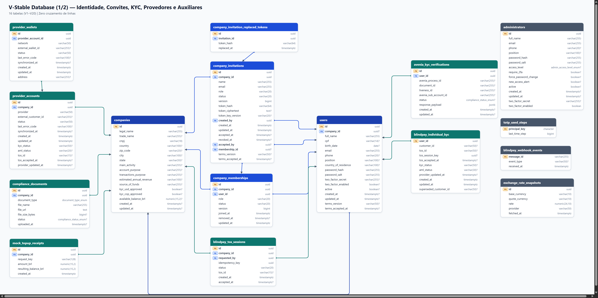
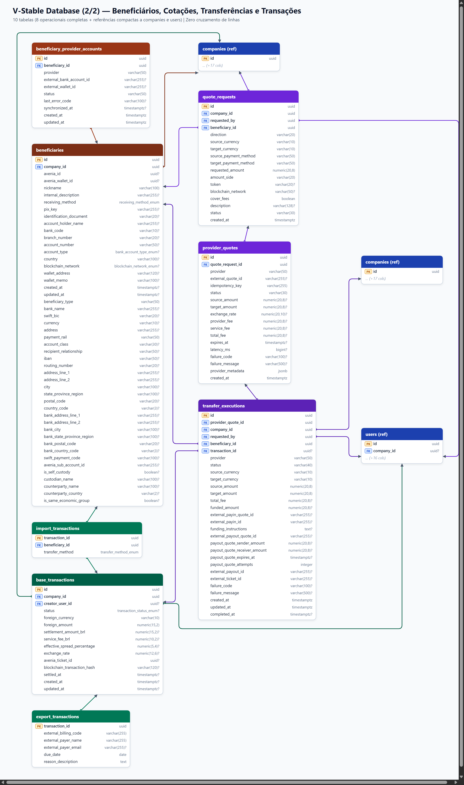

# Banco de Dados

O banco de dados da V-Stable é modelado em **PostgreSQL**, com o schema gerenciado e versionado via **Flyway** (`src/main/resources/db/migration/V1__init.sql` até `V20__kyc_compliance_terms_and_restart.sql`).

## Diagramas

  

   
  <em>Modelo Lógico de Dados (1/2) — Identidade, Convites, KYC, Provedores e Auxiliares (V1–V20)</em>

 

  

   
  <em>Modelo Lógico de Dados (2/2) — Beneficiários, Cotações, Transferências e Transações (V1–V20)</em>

 

  
   
  <em>Modelo Conceitual (referência v8)</em>

## Padrões Adotados

- **Identificadores:** `UUID v4` (`uuid_generate_v4()` via extensão `uuid-ossp`) como chave primária padrão das entidades, evitando enumeração de registros em rotas públicas. Exceções intencionais usam chave natural de deduplicação/estado (`blindpay_webhook_events.message_id`, `totp_used_steps.principal_key`) ou chave primária compartilhada 1-para-1 (`blindpay_individual_kyc.user_id`, `import_transactions.transaction_id`, `export_transactions.transaction_id`).
- **ENUMs nativos, `CHECK` constraints e índices parciais:** os tipos centrais da `V1` utilizam `ENUM` nativos do PostgreSQL (`admin_access_level_enum`, `receiving_method_enum`, `bank_account_type_enum`, `blockchain_network_enum`, `document_type_enum`, `compliance_status_enum`, `transaction_status_enum`, `transfer_method_enum`), enquanto tabelas e evoluções posteriores (`V3`–`V20`) combinam colunas `VARCHAR` com `CHECK` constraints e índices únicos parciais (`WHERE ...`) para evitar rigidez em alterações de catálogo e garantir unicidade condicional.
- **Herança 1-para-1 (Table-per-Type):** os dados financeiros comuns ficam em `base_transactions`, enquanto campos específicos de envio (Importação) e recebimento (Exportação/Invoice) ficam em tabelas filhas (`import_transactions` e `export_transactions`), mantendo a normalização e evitando colunas vazias.
- **Nomenclatura em inglês:** tabelas, colunas e valores de ENUM são nomeados em inglês (ex.: `BANK_ACCOUNT`, `PIX_KEY`, `CRYPTO_WALLET`, `SUPER_ADMIN`, `COMPLIANCE_ANALYST`, `SUPPORT`, `PENDING`, `UNDER_REVIEW`, `APPROVED`, `REJECTED`, `TED`, `PIX`, `ACCOUNT_BALANCE`, `BLOCKCHAIN`).

## Dicionário de Tabelas (24 tabelas)

### 1. Núcleo, Identidade, Vínculos Empresariais e Segurança

- **`companies`** (`V1`, `V18`) — tabela central das PMEs clientes. Armazena razão social (`legal_name`), nome fantasia (`trade_name`), `cnpj` único, endereço, informações de atividade/compliance declaratório (`main_activity`, `account_purpose`, `transactions_purpose`, `estimated_annual_revenue`, `source_of_funds`), flags legadas por moeda (`kyc_usd_approved`, `kyc_cop_approved`) e saldo em BRL (`available_balance_brl numeric(15, 2)`). Na `V18`, as colunas globais `kyb_status` e `aml_status` foram removidas (o status específico por provedor passou a residir em `provider_accounts`, e o onboarding utiliza o KYC individual do representante).
- **`users`** (`V1`, `V8`, `V13`, `V14`, `V20`) — usuários representantes/operadores das PMEs. Armazena dados pessoais (`full_name`, `cpf` único, `birth_date`, `email`, `phone`, `position`, `country_of_residence`), credenciais (`password_hash`, `password_salt`) e 2FA (`two_factor_secret` expandido para `varchar(255)` na `V8` para comportar o texto cifrado AES-GCM, e `two_factor_enabled`). Na `V13`, `company_id` tornou-se anulável (`DROP NOT NULL`) para permitir cadastro e autenticação independentes antes da criação/vinculação da empresa; na `V14`, recebeu índice único *case-insensitive* `users_email_lower_key` em `lower(email)`; e na `V20`, ganhou `terms_version` (`varchar(50)`) e `terms_accepted_at` (`timestamptz`) para registrar o aceite no cadastro próprio.
- **`administrators`** (`V1`, `V8`) — usuários internos da equipe V-Stable, isolados de `users`. Contém `access_level` (`admin_access_level_enum`: `SUPER_ADMIN`, `COMPLIANCE_ANALYST`, `SUPPORT`), `require_2fa`, `force_password_change` e `new_access_alert`. Na `V8`, recebeu `two_factor_secret` (`varchar(255)`) e `two_factor_enabled` (`boolean NOT NULL DEFAULT FALSE`).
- **`company_memberships`** (`V11`) — vínculo ativo ou histórico entre `users` e `companies`, com `role` (`OWNER`, `OPERATOR`, `VIEWER`), `status` (`ACTIVE`, `REMOVED`), controle de concorrência otimista (`version`), `joined_at`, `removed_at` e `updated_at`. Impõe a constraint `company_memberships_removed_at_consistent` e dois índices únicos parciais: no máximo um vínculo `ACTIVE` por usuário (`company_memberships_active_user_key`) e no máximo um `OWNER` `ACTIVE` por empresa (`company_memberships_active_owner_key`).
- **`company_invitations`** (`V11`, `V14`) — convites de membros compartilhados manualmente por link, sem expiração automática por tempo. Armazena `company_id`, `name`, `email`, `role` (`CHECK (role <> 'OWNER')`), `status` (`PENDING` etc.), `version`, `token_hash` (`varchar(64)` UNIQUE), `token_ciphertext`, `token_key_version`, `created_by`, `accepted_at` e `revoked_at`. A constraint `company_invitations_recoverable_token_only_pending` exige que a cópia cifrada exista apenas enquanto `status = 'PENDING'`, e o índice parcial `company_invitations_pending_email_key` impede convites pendentes duplicados para o mesmo `(company_id, lower(email))`. Na `V14`, foram adicionadas `accepted_by` (`ON DELETE SET NULL`), `membership_id` (`ON DELETE SET NULL`), `terms_version` e `terms_accepted_at`, com índices parciais correspondentes.
- **`company_invitation_replaced_tokens`** (`V12`) — histórico dos hashes SHA-256 (`token_hash` UNIQUE) de links de convite substituídos por regeneração, vinculados a `company_invitations` (`ON DELETE CASCADE`) com `replaced_at` (também utilizado para limitar a janela de regenerações).
- **`totp_used_steps`** (`V16`) — controle persistente e compartilhado entre instâncias Lambda contra replay de códigos TOTP. Armazena apenas `principal_key` (`char(64)` PK) e `last_time_step` (`bigint NOT NULL`), garantindo atualizações monotônicas dentro da transação de confirmação sem guardar o código, o segredo ou o e-mail.

### 2. Onboarding, Compliance e Contas em Provedores

- **`avenia_kyc_verifications`** (`V1`, `V3`) — registro da verificação documental e de reconhecimento facial (*liveness*) na Avenia por usuário (`user_id` FK -> `users`, `ON DELETE CASCADE`). Armazena `avenia_process_id`, `document_id`, `liveness_id`, `avenia_sub_account_id` (subconta individual na Avenia para evitar rejeições por submissão repetida na conta mestre), `status` (`compliance_status_enum` default `PENDING`) e `response_payload` (`jsonb`). A `V3` garantiu de forma idempotente (`ADD COLUMN IF NOT EXISTS`) a presença de `document_id`, `liveness_id` e `avenia_sub_account_id` em bases oriundas de versões anteriores da `V1`.
- **`blindpay_individual_kyc`** (`V19`, `V20`) — estado do KYC individual do representante na BlindPay, isolado da conta KYB empresarial (`provider_accounts`) e sem persistir CPF, data de nascimento, documentos ou selfie. Tem `user_id` como PK/FK (`ON DELETE CASCADE`), `customer_id` (`varchar(50)` UNIQUE), `tos_id`, `tos_session_key` (`uuid` UNIQUE), `tos_accepted_at`, `kyc_status`, `aml_status` e `provider_updated_at`. Na `V20`, ganhou `superseded_customer_id` (`varchar(50)`) para guardar o identificador do cliente recusado quando o usuário reinicia o KYC individual, impedindo que webhooks atrasados alterem o novo processo.
- **`compliance_documents`** (`V1`) — metadados de documentos societários/compliance vinculados à empresa (`company_id`), registrando `document_type` (`document_type_enum`: `ARTICLES_OF_INCORPORATION`, `PROOF_OF_ADDRESS`, `REPRESENTATIVE_ID`, `OTHER`), `file_name`, `file_url`, `file_size_bytes` e `status` (`compliance_status_enum` default `UNDER_REVIEW`).
- **`provider_accounts`** (`V3`, `V6`) — mapeamento da empresa (`company_id`) em cada provedor externo (`provider`), com unicidade em `(company_id, provider)`. Armazena `external_customer_id`, `status`, `last_error_code` e `synchronized_at`. Na `V6`, recebeu os campos específicos de compliance e termos na BlindPay (`kyc_status`, `aml_status`, `tos_id varchar(15)`, `tos_accepted_at`, `provider_updated_at`) e o índice único parcial `provider_accounts_provider_external_customer_key` (`(provider, external_customer_id) WHERE external_customer_id IS NOT NULL`).
- **`provider_wallets`** (`V3`, `V7`) — carteiras provisionadas por `provider_account_id` e `network` (`UNIQUE (provider_account_id, network)`), armazenando `external_wallet_id`, `status`, `last_error_code` e `synchronized_at`. Na `V7`, adicionou `address` (`varchar(255)`) para guardar o endereço de origem (`sender_wallet_address`) usado nos payouts EVM da BlindPay.
- **`blindpay_tos_sessions`** (`V6`) — correlação entre cada sessão hospedada de aceite dos termos da BlindPay e a empresa solicitante (`company_id`, `requested_by`, `idempotency_key` UNIQUE, `status`, `tos_id`, `created_at`, `accepted_at`).
- **`blindpay_webhook_events`** (`V6`) — tabela de deduplicação idempotente de eventos recebidos da BlindPay/Svix (`message_id` PK correspondente ao header `svix-id`, `event_type`, `received_at`).

### 3. Diretório Financeiro e Beneficiários

- **`beneficiaries`** (`V1`, `V2`, `V3`, `V4`, `V5`, `V9`, `V10`) — agenda unificada de destinatários por PME (`company_id` FK `ON DELETE CASCADE`). Suporta contas bancárias, PIX (`pix_key`) e carteiras cripto (`blockchain_network`, `wallet_address`, `wallet_memo`) via `receiving_method`. Recebeu evoluções graduais:
  - `V2`: `beneficiary_type` (default `'LEGAL_ENTITY'`), `bank_name`, `swift_bic`, `currency` (`varchar(3)`), `address`.
  - `V3`: `payment_rail` (default `'international_swift'`), `account_class`, `recipient_relationship`, `iban`, `routing_number`, endereço estruturado do beneficiário (`address_line_1`, `address_line_2`, `city`, `state_province_region`, `postal_code`, `country_code`), endereço estruturado do banco (`bank_address_line_1`, `bank_address_line_2`, `bank_city`, `bank_state_province_region`, `bank_postal_code`, `bank_country_code`) e `swift_payment_code`.
  - `V4`: `country_code` e `bank_country_code` ampliados de `varchar(2)` para `varchar(3)` (para aceitar códigos ISO alpha-3 na Avenia para USD/EUR junto ao alpha-2 do SWIFT).
  - `V5`: `avenia_sub_account_id` (identifica em qual subconta Avenia o beneficiário externo foi registrado).
  - `V9`: campos de qualificação regulatória de carteira (`is_self_custody`, `custodian_name`, `counterparty_name`, `counterparty_country`, `is_same_economic_group`).
  - `V10`: `currency` ampliada de `varchar(3)` para `varchar(10)` para acomodar símbolos de tokens (`USDC`, `USDT`, `BRLA`, etc.).
- **`beneficiary_provider_accounts`** (`V3`) — vínculo do beneficiário com os provedores integrados (`UNIQUE (beneficiary_id, provider)`), armazenando `external_bank_account_id`, `external_wallet_id`, `status`, `last_error_code` e `synchronized_at`.

### 4. Cotações, Execução de Transferências, Câmbio, Top-Up e Transações

- **`quote_requests`** (`V3`) — requisições de cotação agregada entre provedores vinculadas a `company_id`, `requested_by` e `beneficiary_id` (todas com `ON DELETE RESTRICT`). Registra `direction`, `source_currency`, `target_currency`, `source_payment_method`, `target_payment_method`, `requested_amount` (`numeric(20, 8)`, `CHECK (requested_amount > 0)`), `amount_side`, `token`, `blockchain_network`, `cover_fees`, `description`, `status` e índice `(company_id, created_at DESC)`.
- **`provider_quotes`** (`V3`) — ofertas individuais retornadas por cada provedor para uma `quote_request_id` (`ON DELETE CASCADE`), garantindo no máximo uma entrada por par `(quote_request_id, provider)` e unicidade de `idempotency_key`. Armazena `external_quote_id`, `status`, `source_amount`, `target_amount`, `provider_fee`, `service_fee`, `total_fee` (`numeric(20, 8)`), `exchange_rate` (`numeric(20, 10)`), `expires_at`, `latency_ms`, `failure_code`, `failure_message` e `provider_metadata` (`jsonb`).
- **`transfer_executions`** (`V7`) — registro do ciclo de vida de uma oferta confirmada pelo usuário (`provider_quote_id` UNIQUE com `ON DELETE RESTRICT`, assegurando que uma mesma oferta origine no máximo uma execução). Liga `company_id`, `requested_by`, `beneficiary_id` e opcionalmente `transaction_id` (`ON DELETE SET NULL`), armazenando `provider`, `status`, `source_currency`, `target_currency`, `source_amount` e `target_amount` (`numeric(20, 8)`, `CHECK` ambos `> 0`), `total_fee`, `funded_amount`, identificadores externos de payin/payout/ticket (`external_payin_quote_id`, `external_payin_id`, `external_payout_quote_id`, `external_payout_id`, `external_ticket_id`), `funding_instructions`, controle de recotação (`payout_quote_sender_amount`, `payout_quote_receiver_amount`, `payout_quote_expires_at`, `payout_quote_attempts`), dados de falha e `completed_at`. Possui índices únicos parciais em `external_payin_id` e `external_payout_id` (`WHERE ... IS NOT NULL`).
- **`exchange_rate_snapshots`** (`V15`) — última cotação de referência por par de moedas (`UNIQUE (base_currency, quote_currency)`), compartilhada entre os usuários e atualizada por upsert (`rate numeric(24, 10)` com `CHECK (rate > 0)`, `provider`, `fetched_at`). Não se confunde com `quote_requests`/`provider_quotes`, que representam cotações operacionais.
- **`mock_topup_receipts`** (`V17`) — recibos idempotentes de crédito simulado em BRL em ambientes de teste (`UNIQUE (company_id, request_key)`), vinculados a `companies` (`ON DELETE CASCADE`), registrando `amount_brl` (`numeric(15, 2) CHECK (amount_brl > 0)`), `resulting_balance_brl` e `created_at` na mesma transação que incrementa `companies.available_balance_brl`.
- **`base_transactions`** (`V1`, `V10`) — núcleo financeiro consolidado de operações de entrada ou saída (`company_id` `ON DELETE RESTRICT`, `creator_user_id` `ON DELETE SET NULL`). Armazena `status` (`transaction_status_enum`), `foreign_currency` (ampliado para `varchar(10)` na `V10`), `foreign_amount` (`numeric(15, 2)`), `settlement_amount_brl`, `service_fee_brl`, `effective_spread_percentage`, `exchange_rate`, `avenia_ticket_id` (UNIQUE), `blockchain_transaction_hash` e `settled_at`.
- **`import_transactions`** (`V1`) — extensão Table-per-Type de `base_transactions` (`ON UPDATE CASCADE ON DELETE CASCADE`) para remessas de saída/pagamento a fornecedores; exige `beneficiary_id` (`ON DELETE RESTRICT`) e `transfer_method` (`transfer_method_enum`).
- **`export_transactions`** (`V1`) — extensão Table-per-Type de `base_transactions` (`ON UPDATE CASCADE ON DELETE CASCADE`) para fluxos de entrada/invoices internacionais; desacoplada de `beneficiaries`, contendo `external_billing_code` (UNIQUE), `external_payer_name`, `external_payer_email`, `due_date` e `reason_description`.

## Histórico de Migrations Flyway (`V1`–`V20`)

| Versão | Arquivo | Resumo das Alterações |
| :--- | :--- | :--- |
| **V1** | `V1__init.sql` | Extensão `uuid-ossp`, 8 tipos `ENUM` e criação inicial de `administrators`, `companies`, `users`, `avenia_kyc_verifications`, `beneficiaries`, `compliance_documents`, `base_transactions`, `export_transactions`, `import_transactions` com FKs e índices base. |
| **V2** | `V2__add_beneficiary_registration_fields.sql` | Adiciona `beneficiary_type`, `bank_name`, `swift_bic`, `currency` e `address` em `beneficiaries`. |
| **V3** | `V3__add_quote_aggregation.sql` | Cria `provider_accounts`, `beneficiary_provider_accounts`, `provider_wallets`, `quote_requests` e `provider_quotes`; expande `beneficiaries` com trilhos/endereços estruturados e assegura colunas da `avenia_kyc_verifications`. |
| **V4** | `V4__expand_beneficiary_country_codes.sql` | Expande `country_code` e `bank_country_code` de `beneficiaries` para `varchar(3)` (ISO alpha-3 Avenia + alpha-2 SWIFT). |
| **V5** | `V5__link_beneficiaries_to_avenia_sub_accounts.sql` | Adiciona `avenia_sub_account_id` em `beneficiaries`. |
| **V6** | `V6__add_blindpay_compliance.sql` | Adiciona colunas KYB/AML/ToS e índice único parcial em `provider_accounts`; cria `blindpay_tos_sessions` e `blindpay_webhook_events`. |
| **V7** | `V7__add_transfer_executions.sql` | Adiciona `address` em `provider_wallets` e cria `transfer_executions` com unicidade por oferta e payin/payout externos. |
| **V8** | `V8__add_admin_2fa.sql` | Adiciona `two_factor_secret` e `two_factor_enabled` em `administrators` e amplia `users.two_factor_secret` para `varchar(255)`. |
| **V9** | `V9__add_wallet_qualification.sql` | Adiciona campos de qualificação regulatória de carteira (`is_self_custody`, `custodian_name`, `counterparty_name`, `counterparty_country`, `is_same_economic_group`) em `beneficiaries`. |
| **V10** | `V10__expand_token_currency_codes.sql` | Amplia `beneficiaries.currency` e `base_transactions.foreign_currency` para `varchar(10)` (tokens como `USDC` e `BRLA`). |
| **V11** | `V11__add_company_memberships_and_invitations.sql` | Cria `company_memberships` e `company_invitations` e realiza o *backfill* dos usuários existentes para vínculos `OWNER`/`OPERATOR`. |
| **V12** | `V12__add_company_invitation_replaced_tokens.sql` | Cria `company_invitation_replaced_tokens` para rastrear hashes de convites substituídos por regeneração. |
| **V13** | `V13__allow_users_without_company.sql` | Torna `users.company_id` anulável para suportar cadastro de conta independente antes da associação empresarial. |
| **V14** | `V14__record_company_invitation_acceptance.sql` | Adiciona `accepted_by`, `membership_id`, `terms_version` e `terms_accepted_at` em `company_invitations` e cria `users_email_lower_key`. |
| **V15** | `V15__add_exchange_rate_snapshots.sql` | Cria `exchange_rate_snapshots` para cache persistente da última cotação de referência por par. |
| **V16** | `V16__persist_totp_used_steps.sql` | Cria `totp_used_steps` para prevenção distribuída de replay de códigos TOTP entre Lambdas. |
| **V17** | `V17__add_mock_topup_idempotency.sql` | Cria `mock_topup_receipts` garantindo idempotência por `(company_id, request_key)` no crédito simulado em BRL. |
| **V18** | `V18__remove_company_kyb_aml_status.sql` | Remove as colunas legadas `kyb_status` e `aml_status` da tabela `companies`. |
| **V19** | `V19__blindpay_individual_kyc.sql` | Cria `blindpay_individual_kyc` isolando o KYC individual na BlindPay por `user_id`. |
| **V20** | `V20__kyc_compliance_terms_and_restart.sql` | Adiciona `terms_version` e `terms_accepted_at` em `users` e `superseded_customer_id` em `blindpay_individual_kyc`. |

## Regras de Negócio e Integridade

- **Isolamento estrutural de transações:** a divisão física entre `import_transactions` (exigindo `beneficiary_id`) e `export_transactions` (exigindo dados de cobrança/invoice) impede a inserção cruzada de atributos incompatíveis com o sentido da operação.
- **Unicidade e idempotência distribuída:** o schema impõe no motor do banco a unicidade de oferta executada (`transfer_executions.provider_quote_id`), payin/payout externos, idempotência de cotações e sessões de termos (`provider_quotes.idempotency_key`, `blindpay_tos_sessions.idempotency_key`), eventos de webhook (`blindpay_webhook_events.message_id`), passos TOTP consumidos (`totp_used_steps.principal_key`) e depósitos simulados (`mock_topup_receipts(company_id, request_key)`).
- **Governança de membros e convites:** garante no banco que cada usuário possua no máximo um vínculo `ACTIVE`, cada empresa possua no máximo um `OWNER` `ACTIVE`, nenhum convite seja emitido como `OWNER`, segredos cifrados de convites permaneçam armazenados somente enquanto `status = 'PENDING'` e e-mails de usuários e convites pendentes respeitem unicidade *case-insensitive*.
- **Consistência de destinos financeiros (`beneficiaries`):**

| `receiving_method` | Exige |
| :--- | :--- |
| `CRYPTO_WALLET` | Endereço da carteira (`wallet_address`), rede blockchain (`blockchain_network`) e campos de qualificação quando aplicável |
| `PIX_KEY` | Chave Pix preenchida (`pix_key`) |
| `BANK_ACCOUNT` | Dados bancários conforme trilho (`payment_rail`): documento de identificação, titular, código/nome do banco, agência/conta ou `iban`/`routing_number`/`swift_bic` e endereço |
