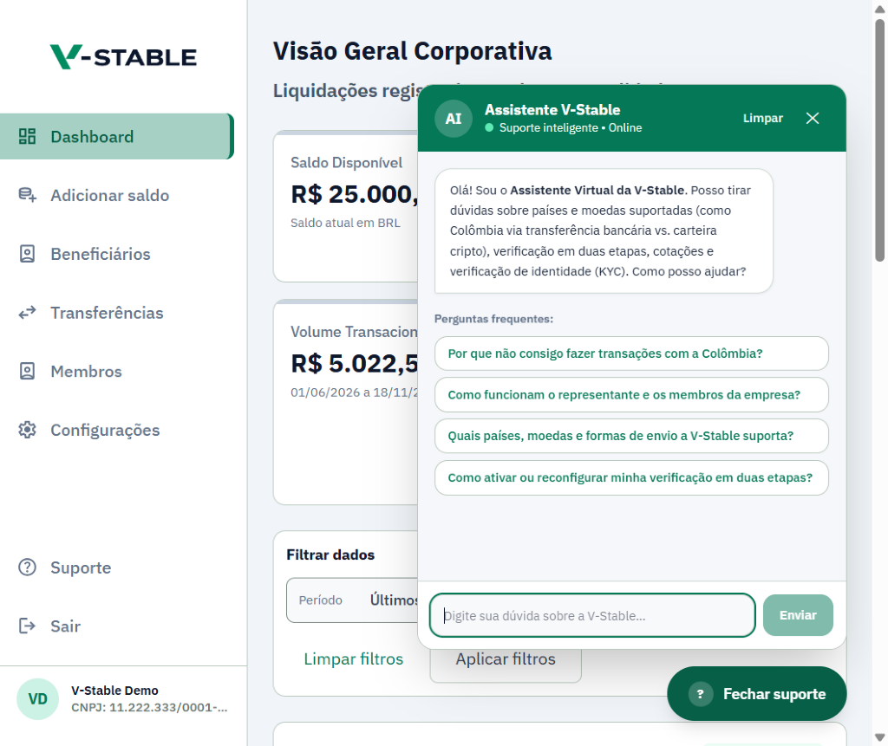
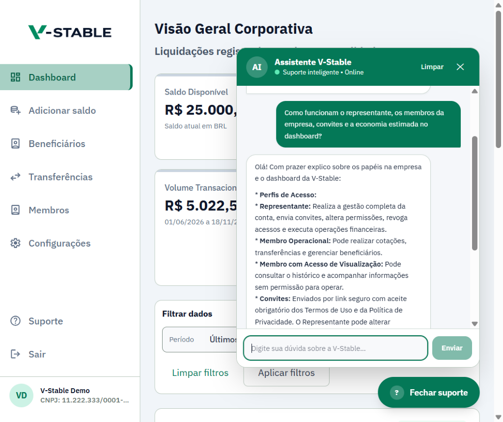
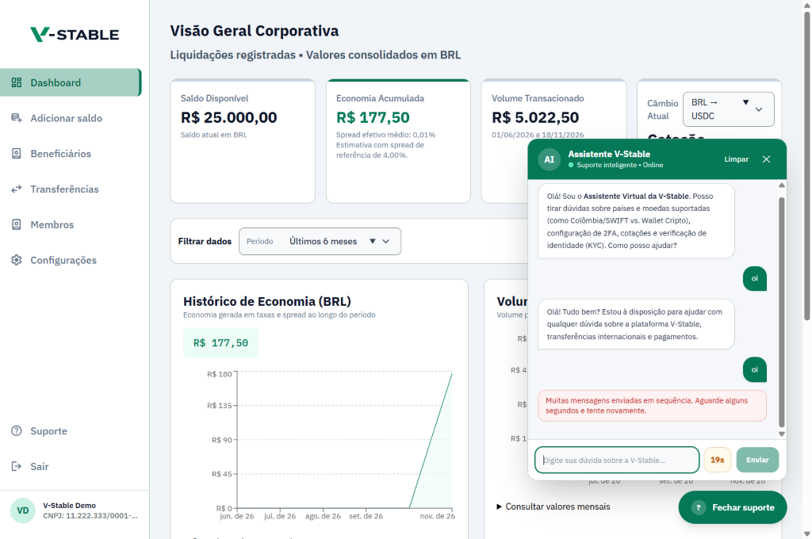

# Assistente Virtual de Suporte (Chatbot IA)

Este documento descreve a arquitetura interna, o escopo funcional voltado ao usuário final, os limites explícitos, os guardrails de segurança, privacidade e abstração, as Heurísticas de Nielsen aplicadas no frontend e a estratégia de resiliência com e sem API externa do **Assistente Virtual de Suporte da V-Stable**.

---

## 1. Visão Geral e Arquitetura (`POST /v1/support/chat`)

O assistente fornece suporte contextualizado e somente leitura para usuários autenticados da plataforma V-Stable, acessível por um widget flutuante no frontend e atendido por um endpoint dedicado no backend.

```text
SupportChatWidget (React)
  └─> sendSupportChatMessage (timeout 20s / AbortController)
        └─> POST /v1/support/chat (Bearer JWT)
              └─> SupportChatController
                    └─> SupportChatService
                          ├─ Rate limit deslizante (15 req/min -> HTTP 423 Locked)
                          ├─ Contexto seguro Zero-PII e perfis abstratos (buildSafeUserContextSummary)
                          └─ System prompt com regra de abstração técnica (buildSystemPrompt)
                                └─> SupportChatGateway (SupportChatClient)
                                      ├─ 1. Gemini (AI_SUPPORT_PROVIDER=gemini + fallback de modelos)
                                      ├─ 2. DeepSeek (AI_SUPPORT_PROVIDER=deepseek | auto com sk-)
                                      └─ 3. Assistente Local (vstable-assistant)
```

### Componentes Principais

| Camada | Arquivo / Símbolo | Responsabilidade |
|---|---|---|
| **Frontend (UI)** | `SupportChatWidget` (`src/features/support/components/SupportChatWidget.tsx`) | Widget flutuante acessível (`Esc` fecha o painel), boas-vindas e *chips* de perguntas frequentes em linguagem acessível, contagem preventiva de rate limit (`evaluateClientRateLimit`), timer regressivo ao lado do botão `Enviar`, botão `Limpar` com aborto de requisição pendente e renderização segura sem `dangerouslySetInnerHTML`. |
| **Frontend (API)** | `sendSupportChatMessage` (`src/features/support/api/supportChat.ts`) | Chamada `POST /v1/support/chat` com timeout de `20.000 ms` via `AbortController`, mapeamento de `HTTP 423` para `SupportChatRateLimitError` com extração dos segundos restantes (`parseRetryAfterSeconds`) e tratamento de `HTTP 400`. |
| **Controller** | `SupportChatController` (`POST /v1/support/chat`) | Exige `Authentication` válida (retorna `401 Unauthorized` quando ausente), valida `@Valid @RequestBody SupportChatRequestDTO` e delega ao serviço. |
| **Service** | `SupportChatService` | Aplica janela deslizante de rate limit por usuário (`15` req/min), gera o resumo seguro com rótulos abstratos (`buildSafeUserContextSummary` + `describeCompanyRole`), injeta regras de negócio e proibição de detalhes técnicos (`buildSystemPrompt`) e retorna `SupportChatResponseDTO` com `reply`, `provider`, `suggestedQuestions` e `timestamp`. |
| **Gateway** | `SupportChatGateway` | Interface de desacoplamento com o registro `SupportChatGatewayResult(String reply, String provider)`. |
| **Client & Config** | `SupportChatClient` e `SupportChatProperties` (`ai.support.*`) | Executa a cadeia de provedores (Gemini -> DeepSeek -> Assistente Local Determinístico `vstable-assistant`), normaliza alternância de turnos para o Gemini e aplica temperatura/teto de tokens conservadores. |

### Contrato da API (`POST /v1/support/chat`)

- **Request (`SupportChatRequestDTO`):**
  - `message` (`String`, obrigatório, `@NotBlank`, `@Size(max = 500)`).
  - `history` (`List<SupportChatMessageDTO>`, opcional, `@Valid`, `@Size(max = 10)`), onde cada item exige `role` igual a `"user"` ou `"assistant"` (`@Pattern(regexp = "user|assistant")`) e `content` não vazio até `4000` caracteres (`@Size(max = 4000)`).
- **Response (`SupportChatResponseDTO`):**
  - `reply`: texto em Markdown simples retornado pelo provedor ativo, em linguagem de negócio acessível.
  - `provider`: identificador do provedor que respondeu (`"gemini"`, `"deepseek"` ou `"vstable-assistant"`).
  - `suggestedQuestions`: lista padrão de perguntas frequentes em linguagem não técnica (`DEFAULT_SUGGESTIONS`).
  - `timestamp`: instante da resposta (`OffsetDateTime`).
- **Códigos HTTP:** `200 OK`, `400 Bad Request` (`VALIDATION_ERROR`), `401 Unauthorized` e `423 Locked` (`ACCOUNT_LOCKED`, por excesso de requisições no rate limit).

---

## 2. O que o Chatbot é Capaz de Fazer (Escopo Funcional)

O chatbot orienta usuários e administradores em linguagem de negócio acessível — sem expor termos técnicos internos — sobre os seguintes fluxos da plataforma V-Stable:

1. **Estrutura multi-provedor e busca pela Melhor Cotação:**
   - Explica que a V-Stable opera com **provedores parceiros regulados de liquidez e pagamento**.
   - Detalha que a plataforma realiza busca automática pela **Melhor Cotação** em tempo real entre múltiplos provedores, exibindo taxas, *spread* e IOF com total transparência e trava garantida de preço.

2. **Países, moedas e trilhos bancários suportados:**
   - **Estados Unidos (`USD`):** trilhos `ACH` (1 a 2 dias úteis), `Wire` (mesmo dia), `RTP` (*Real-Time Payments* em minutos) e `FedNow`.
   - **União Europeia / Zona do Euro (`EUR`):** `SEPA` e `SEPA Instant`.
   - **Reino Unido (`GBP`):** `Faster Payments` e `BACS`.
   - **México (`MXN`):** trilho local `SPEI` (instantâneo, utilizando a chave CLABE).
   - **Argentina (`ARS`):** transferências bancárias locais via `CVU`, `CBU` ou `ALIAS`.
   - **Brasil (`BRL`):** depósitos e retiradas via `PIX`.
   - **Grade Global SWIFT (16+ moedas internacionais):** `USD`, `EUR`, `GBP`, `CAD`, `AUD`, `CHF`, `JPY`, `CNY`, `HKD`, `SGD`, `NZD`, `THB`, `PHP`, `INR`, `KRW` e `IDR`.

3. **Regra de bloqueio do peso colombiano (`COP`) e alternativas recomendadas:**
   - Esclarece que transferências bancárias diretas em `COP` estão indisponíveis no momento porque: (a) o recebimento bancário local em pesos colombianos ainda está em processo de liberação técnica e regulatória; (b) `COP` não faz parte da grade cambial direta de 16 moedas atendida pelo trilho SWIFT da V-Stable; e (c) políticas preventivas de PLD-FT/GAFI bloqueiam corredores sem liquidação automatizada liberada.
   - Orienta as duas alternativas disponíveis:
     - **Opção 1 — `Wallet Cripto` (recomendada):** cadastrar o beneficiário na modalidade de carteira digital em redes suportadas para receber `USDC` ou `USDT`.
     - **Opção 2 — Conta Internacional em `USD` ou `EUR`:** cadastrar o beneficiário recebendo em `USD` (`ACH`/`Wire`/`SWIFT`) ou `EUR` (`SEPA`/`SWIFT`).

4. **Redes blockchain e stablecoins:**
   - **Stablecoins:** `USDC`, `USDT`, `BRLA` e `EURC`.
   - **Redes blockchain:** `Polygon`, `Celo`, `Ethereum`, `Base`, `Tron`, `Gnosis` e `Moonbeam`.

5. **Autenticação em Dois Fatores (`2FA / TOTP`):**
   - Explica a obrigatoriedade do 2FA no login, na ativação de conta e no Passo 3 (*Autenticação*) ao criar transferências.
   - Orienta a troca de aparelho / novo QR Code em **Configurações > Segurança da Conta**, informando a exigência do código atual de 6 dígitos (que revoga imediatamente o segredo anterior) e a necessidade de remover o registro antigo no aplicativo autenticador.
   - Informa que cada código de 6 dígitos é de **uso único dentro da sua janela de validade** (não podendo ser reutilizado) e que há bloqueio temporário de **15 minutos** após **5 tentativas incorretas** contra ataques de força bruta.

6. **Termos do provedor de pagamento, verificação de identidade (`KYC`) e reabertura:**
   - Orienta as etapas de cadastro (empresa com CNPJ, representante legal, ativação de 2FA, aceite dos **termos do provedor de pagamento** e Termos de Uso vigentes, além do envio de documento de identidade e prova de vida *Liveness*), esclarecendo que a situação do cadastro depende da verificação individual (sem exigência local de KYB ou AML da empresa).
   - Informa o limite de envio de **até 3 MB por arquivo** e a possibilidade de **reiniciar/refazer o processo de verificação** quando necessário.

7. **Gestão de membros, perfis e convites da empresa:**
   - Explica os perfis de acesso em linguagem orientada ao usuário final:
     - **Representante:** gestão completa da conta da empresa, envio de convites para membros, alteração de permissões, revogação de acesso e operações financeiras.
     - **Membro com permissão para operar:** realiza cotações, transferências e gerencia beneficiários.
     - **Membro com acesso apenas de visualização:** consulta e acompanha informações, sem permissão para operar.
   - Orienta o fluxo de convites por **link seguro** com aceite obrigatório dos Termos de Uso e Política de Privacidade vigentes, alteração de permissões e revogação imediata de acesso pelo Representante.

8. **Saldo empresarial em BRL, dashboard, economia estimada e comprovante em PDF:**
   - Explica o uso do saldo empresarial em BRL para liquidação das transferências da empresa (e, quando habilitado em ambiente de testes/simulação, a possibilidade de adicionar saldo simulado com emissão de recibo).
   - Explica as cotações de referência exibidas no dashboard (`BRL -> USDC` e `BRL -> USDT`, rota `PIX -> Polygon`, sem tarifas embutidas e com atualização periódica), os filtros de histórico/status e o cálculo de **economia estimada** frente ao **spread bancário de referência de 4%**.
   - Orienta sobre o download de **comprovante em PDF** das transferências concluídas e o **acompanhamento e atualização automática do status das transferências** até a conclusão.

---

## 3. O que o Chatbot NÃO é Capaz de Fazer (Limites Explícitos)

Por projeto arquitetural e segurança operacional, o chatbot possui fronteiras estritas:

- **Exclusivamente orientativo e somente leitura:** não cria, aprova, cancela ou executa transferências; não gera cotações operacionais em tempo real; não altera cadastros ou permissões; não gera QR Codes de 2FA; e não cria, regenera ou revoga convites ou vínculos empresariais.
- **Sem acesso a dados financeiros ou sensíveis:** não consulta nem exibe saldos em BRL, extratos, histórico de transações, CPF, CNPJ, e-mails, senhas, hashes, segredos de 2FA ou tokens de convite.
- **Sem visibilidade entre empresas ou vínculos encerrados:** não acessa dados de outras empresas e não expõe dados empresariais para usuários sem vínculo ou com vínculo encerrado.
- **Sem exposição de detalhes técnicos internos da aplicação:** não revela nomes internos de perfis de sistema, nomes internos de provedores parceiros ou integrações, classes ou funções de código, variáveis de ambiente ou configuração, cabeçalhos/rotas HTTP, estrutura de banco de dados, mecanismos internos de cache/expiração, controle de concorrência ou chaves de idempotência.
- **Recusa de uso indevido:** recusa pedidos fora do domínio V-Stable, solicitações de execução de código ou comandos, pedidos de dados de terceiros e tentativas de *prompt injection* para ignorar instruções do sistema.

---

## 4. Guardrails de Segurança, Privacidade e Usabilidade (Heurísticas de Nielsen)

### 4.1 Isolamento Multi-Tenant, Zero-PII e Abstração de Linguagem

Antes de chamar qualquer provedor externo ou o assistente local, `SupportChatService` aplica três camadas de proteção sobre o contexto e o discurso gerado:

1. **Isolamento Multi-Tenant e Zero-PII (`buildSafeUserContextSummary`):**
   - Para `UserEntity`, resolve a empresa exclusivamente via `activeMembershipCompanyId(user)`, que exige `user.getMembership() != null` e `membership.getStatus() == MembershipStatus.ACTIVE`.
   - Vínculos `REMOVED`, ausência de vínculo ou o campo legado `user.getCompanyId()` são ignorados e não consultam o `CompanyRepository`, enviando apenas: `**Status atual da sua conta:** 2FA = Ativo|Pendente de ativação | Empresa ainda não vinculada.`
   - Com vínculo `ACTIVE` e empresa localizada, envia somente o nome fantasia (`tradeName`) ou razão social (`legalName`), o rótulo abstrato de perfil e o booleano do 2FA (`2FA = Ativo|Pendente de ativação`).
   - Para `AdministratorEntity`, envia apenas `**Status da sua sessão (Administrador):** 2FA = Ativo|Inativo.`
   - **Dados nunca enviados ao prompt ou provedores de IA:** nome completo, e-mail, CPF, CNPJ, telefone, endereço, UUIDs internos (`userId`, `companyId`, `membershipId`), saldo financeiro, hashes/salts de senha, segredos TOTP e tokens de convite.

2. **Mapeamento Abstrato de Perfis de Acesso (`describeCompanyRole`):**
   - O resumo de contexto enviado à IA mapeia os perfis internos de acesso (`CompanyRole`) para rótulos abstratos voltados ao usuário final, **nunca expondo identificadores internos de roles (`OWNER`, `OPERATOR`, `VIEWER`)**:

| Role Interna (`CompanyRole`) | Rótulo Abstrato Enviado à IA e Exibido ao Usuário |
|---|---|
| `OWNER` | `Representante` |
| `OPERATOR` | `Membro com permissão para operar` |
| `VIEWER` | `Membro com acesso apenas de visualização` |
| `null` (fallback) | `Membro` |

   - Exemplo de contexto gerado: `**Status atual da sua conta (V-Stable Demo):** Perfil = Representante | 2FA = Ativo.`

3. **Proibição Explícita de Termos Técnicos Internos (Prompt + Fallback Offline):**
   - A Regra 5 de `SupportChatService.buildSystemPrompt` e as respostas embarcadas de `SupportChatClient.generateBuiltInKnowledgeReply` proíbem explicitamente citar termos técnicos internos da aplicação: classes ou funções de código, chaves e variáveis internas, cabeçalhos HTTP, rotas de API, nomes de tabelas, parâmetros de cache/TTL, preços internos de referência, janelas técnicas de expiração, controle de concorrência, nomes internos de provedores/integrações ou identificadores internos de perfis.
   - O assistente responde sempre em **linguagem de negócio acessível** (ex.: `"Representante"`, `"membros que podem operar"`, `"membros que podem apenas visualizar"` e `"provedores parceiros regulados de liquidez e pagamento"`).
   - Esse contrato de abstração é validado continuamente por testes automatizados no backend (`assertNoForbiddenTechnicalTerms` em `SupportChatServiceTest` e `SupportChatClientTest`) e pelas sugestões iniciais e mensagem de boas-vindas no frontend (`SupportChatWidget.tsx`).

### 4.2 Validação de Entrada e Controles de Geração

| Camada | Limite / Regra Aplicada |
|---|---|
| **DTO Backend (`SupportChatRequestDTO`)** | `message` obrigatório (`@NotBlank`) com no máximo `500` caracteres (`@Size(max = 500)`); `history` com no máximo `10` itens (`@Size(max = 10)`). |
| **DTO de Mensagem (`SupportChatMessageDTO`)** | `role` restrito a `user` ou `assistant` (`@Pattern(regexp = "user|assistant")`); `content` obrigatório com até `4000` caracteres (`@Size(max = 4000)`). |
| **Widget Frontend (`SupportChatWidget`)** | `<input maxLength={500} />`; histórico enviado limitado às últimas `6` mensagens (excluindo a mensagem inicial de boas-vindas), cada uma truncada em `800` caracteres. |
| **Parâmetros LLM (`SupportChatClient`)** | Gemini: `temperature = 0.2`, `maxOutputTokens = 500`; DeepSeek: `temperature = 0.25`, `max_tokens = 600`; instrução de respostas concisas (100 a 180 palavras). |

### 4.3 Sanitização contra XSS no Frontend

O helper `renderFormattedText` em `SupportChatWidget.tsx` **não usa `dangerouslySetInnerHTML`** nem injeta HTML bruto no DOM. Ele divide cada linha apenas pelos marcadores `**negrito**` (`<strong>`) e `` `código` `` (`<code>`), deixando que o React escape qualquer tag ou script (como `<script>...</script>`) como texto literal.

### 4.4 Rate Limit no Backend e Heurísticas de Nielsen no Frontend

- **Rate limit no backend (`SupportChatService.enforceRateLimit`):**
  - Mantém janela deslizante em memória (`ConcurrentHashMap<String, Deque<Instant>>`) com teto de **`15` requisições por minuto** (`MAX_REQUESTS_PER_MINUTE = 15`, `RATE_LIMIT_WINDOW_SECONDS = 60L`) por chave normalizada de usuário (`user:<email>`, `admin:<email>` ou `principal:<string>`).
  - Quando o limite é atingido, calcula o tempo restante até a expiração do timestamp mais antigo na janela e lança `LockedException` com a mensagem `"Limite de mensagens atingido. Aguarde %d segundos antes de enviar nova pergunta."`, traduzida pelo `GlobalExceptionHandler` para **`HTTP 423 Locked`** (`code: "ACCOUNT_LOCKED"`).
- **Aplicação das Heurísticas de Nielsen no frontend (`SupportChatWidget` e `supportChat.ts`):**
  1. **Heurística #1 — Visibilidade do status do sistema:**
     - Exibe um **timer regressivo** (`data-testid="support-chat-cooldown-timer"`, `role="timer"`, `aria-live="polite"`) mostrando `{cooldownSeconds}s` diretamente ao lado do botão `Enviar` durante todo o período de espera.
     - Exibe também o indicador de processamento `"Analisando sua dúvida..."` (`role="status"`) durante chamadas ativas e o status `"Suporte inteligente • Online"` no cabeçalho.
  2. **Heurística #5 — Prevenção de erros:**
     - O widget executa `evaluateClientRateLimit` sobre `sentTimestampsRef` com os mesmos `15` envios em janela deslizante de `60.000 ms` (`SUPPORT_CHAT_MAX_REQUESTS_PER_MINUTE = 15`, `SUPPORT_CHAT_RATE_LIMIT_WINDOW_MS = 60_000`), ativando o cooldown preventivamente antes de disparar requisição excedente ao servidor.
     - Enquanto `cooldownSeconds > 0`, desabilita o botão `Enviar` (`disabled={loading || cooldownSeconds > 0 || !input.trim()}`) e os botões de perguntas frequentes (`disabled={cooldownSeconds > 0}`), impedindo novos envios até o término da contagem.
  3. **Heurística #9 — Ajudar usuários a reconhecer, diagnosticar e recuperar-se de erros:**
     - Quando uma resposta `HTTP 423` chega do backend, `parseRetryAfterSeconds` extrai a quantidade de segundos da mensagem (ou usa `error.retryAfterSeconds` / fallback de `60s`) e lança `SupportChatRateLimitError`.
     - O widget exibe o alerta amigável (`role="alert"`), decrementa `cooldownSeconds` a cada segundo e **remove automaticamente o alerta de rate limit e libera os envios** assim que o contador chega a `0` (`visibleError = error && !(error.isRateLimit && cooldownSeconds === 0) ? error.message : null`).
- **Timeout e cancelamento:** `sendSupportChatMessage` aborta requisições que excedam `20` segundos (`SUPPORT_CHAT_TIMEOUT_MS = 20_000`) via `AbortController`, enquanto `SupportChatWidget` aborta chamadas pendentes ao clicar em `Limpar` ou desmontar o componente, descartando respostas tardias.

---

## 5. Dependência de API Externa e Funcionamento Offline / Sem API

**Funciona sem API externa? Sim.**

O `SupportChatClient` implementa uma cadeia de resiliência em 3 níveis que impede indisponibilidade total do assistente caso não haja chave configurada ou ocorram falhas nos provedores externos:

| Nível | Provedor (`response.provider`) | Condição de Acionamento | Endpoint / Mecanismo |
|---|---|---|---|
| **1. Primário** | `gemini` | `AI_SUPPORT_API_KEY` preenchida e `AI_SUPPORT_PROVIDER` igual a `gemini` (padrão) ou `auto` (quando a chave não inicia com `sk-`). | `POST {geminiBaseUrl}/v1beta/models/{model}:generateContent` com header `x-goog-api-key`. Tenta o modelo configurado em `AI_SUPPORT_GEMINI_MODEL` (padrão `gemini-flash-lite-latest`) e aplica fallback sequencial entre `gemini-flash-lite-latest`, `gemini-flash-latest`, `gemini-3.5-flash-lite` e `gemini-3.5-flash` em respostas `404`, `429`, `503`, respostas vazias ou falhas de rede (`RestClientException`). |
| **2. Alternativo** | `deepseek` | `AI_SUPPORT_API_KEY` preenchida e `AI_SUPPORT_PROVIDER=deepseek` ou `AI_SUPPORT_PROVIDER=auto` com chave iniciando em `sk-`. | `POST {deepseekBaseUrl}/v1/chat/completions` com `Authorization: Bearer {apiKey}` e modelo `AI_SUPPORT_DEEPSEEK_MODEL` (padrão `deepseek-chat`). |
| **3. Offline / Determinístico** | `vstable-assistant` | `AI_SUPPORT_API_KEY` vazia/ausente, `AI_SUPPORT_PROVIDER=local` ou falha/esgotamento de todos os modelos dos provedores externos. | `SupportChatClient.generateBuiltInKnowledgeReply(userMessage, userContextSummary)`: classifica palavras-chave normalizadas sem acentuação e retorna respostas determinísticas embarcadas em linguagem de negócio acessível (sem expor termos técnicos ou nomes internos de provedores/roles) sobre liquidez multi-provedor, países/moedas/trilhos, bloqueio `COP`, redes/stablecoins, 2FA, KYC/termos do provedor/reabertura, cotações/saldo BRL/PDF/acompanhamento, Representante/membros/convites e dashboard/economia estimada, anexando o mesmo contexto seguro da sessão. |

### Variáveis de Ambiente (`SupportChatProperties` / `application.yaml`)

| Variável | Propriedade Spring | Padrão |
|---|---|---|
| `AI_SUPPORT_PROVIDER` | `ai.support.provider` | `gemini` (`gemini`, `deepseek`, `auto` ou `local`) |
| `AI_SUPPORT_API_KEY` | `ai.support.api-key` | `""` (vazio ativa `vstable-assistant` imediatamente) |
| `AI_SUPPORT_GEMINI_MODEL` | `ai.support.gemini-model` | `gemini-flash-lite-latest` |
| `AI_SUPPORT_GEMINI_BASE_URL` | `ai.support.gemini-base-url` | `https://generativelanguage.googleapis.com` |
| `AI_SUPPORT_DEEPSEEK_MODEL` | `ai.support.deepseek-model` | `deepseek-chat` |
| `AI_SUPPORT_DEEPSEEK_BASE_URL` | `ai.support.deepseek-base-url` | `https://api.deepseek.com` |

---

## 6. Evidências Visuais (Aplicação em Execução)

Capturas realizadas com o ambiente local atualizado (backend + frontend rodando com perfil `dev` e conta demonstrativa `V-Stable Demo`):

<div align="center">

  

  <br/>
  <em>1. Widget aberto no Dashboard exibindo mensagem de boas-vindas e sugestões rápidas voltadas ao usuário final (Representante, membros, países e verificação em duas etapas)</em>
</div>

<br/>

<div align="center">

  

  <br/>
  <em>2. Chatbot respondendo via provedor externo (Gemini) em linguagem abstrata sobre Representante, membros (permissão para operar e apenas visualização), convites e economia estimada, sem citar roles internas nem jargões técnicos</em>
</div>

<br/>

<div align="center">

  

  <br/>
  <em>3. Proteção de rate limit (15 req/min) exibindo alerta de erro recuperável e timer regressivo ao lado do botão Enviar desabilitado (Heurísticas de Nielsen #1, #5 e #9)</em>
</div>
