# Relatório de Planejamento, Reconhecimento Técnico e Modelagem de Ameaças — V-Stable (Issue #83)

> [!IMPORTANT]
> **Referência Rastreável:** [AGES-V-Stable/cicd#83 — Planejamento e Reconhecimento Técnico](https://github.com/AGES-V-Stable/cicd/issues/83) (Épico [#80 — Avaliação de Segurança e Remediação de Vulnerabilidades](https://github.com/AGES-V-Stable/cicd/issues/80))  
> **Responsáveis (Assignees):** Rodrigo Schmitt de Almeida (`@RodrigoSchmittDeAlmeida`) e Arthur Pascual (`@ArthurPascual`)  
> **Data do Reconhecimento:** 08/11/2026  
> **Classificação da Informação:** Uso Interno / Restrito à Equipe AGES V-Stable (Evidências sanitizadas — nenhum segredo real reproduzido).

---

## Sumário

1. [Resumo Executivo](#1-resumo-executivo)
2. [Metodologia de Avaliação e Referências Normativas](#2-metodologia-de-avaliação-e-referências-normativas)
3. [Versões, Branches e Commits de Referência](#3-versões-branches-e-commits-de-referência)
4. [Escopo Técnico, Ambientes e Regras de Engajamento (RoE)](#4-escopo-técnico-ambientes-e-regras-de-engajamento-roe)
5. [Mapeamento da Arquitetura, Recursos AWS e Fronteiras de Confiança](#5-mapeamento-da-arquitetura-recursos-aws-e-fronteiras-de-confiança)
6. [Inventário de Endpoints, Autenticação, Perfis e Fluxos Críticos](#6-inventário-de-endpoints-autenticação-perfis-e-fluxos-críticos)
7. [Diagnóstico Técnico de Vulnerabilidades e Lacunas Identificadas (Discovery)](#7-diagnóstico-técnico-de-vulnerabilidades-e-lacunas-identificadas-discovery)
8. [Modelagem de Ameaças (STRIDE, MITRE ATT&CK e DREAD)](#8-modelagem-de-ameaças-stride-mitre-attck-e-dread)
9. [Avaliação Qualitativa, Quantitativa (CVSS/EPSS) e Financeira de Riscos (CRQ)](#9-avaliação-qualitativa-quantitativa-cvssepss-e-financeira-de-riscos-crq)
10. [Plano de Testes, Ferramentas e Recomendações Estratégicas](#10-plano-de-testes-ferramentas-e-recomendações-estratégicas)
11. [Referências](#11-referências)

---

## 1. Resumo Executivo

O presente documento estabelece o **Planejamento e Reconhecimento Técnico (Discovery)** da plataforma **V-Stable**, uma solução B2B *Software as a Service* (SaaS) voltada à intermediação, cotação agregada e liquidação de remessas internacionais utilizando *stablecoins* (`USDC`, `USDT`, `BRLA`, `EURC`) e trilhos fiduciários locais (`PIX`, `ACH`, `Wire`, `SEPA`, `SWIFT`) para pequenas e médias empresas (PMEs) brasileiras.

Seguindo a estrutura metodológica consolidada no relatório de referência de *Segurança de Sistemas* (modelo ISO/IEC 27005:2022, NIST RMF, NIST SP 800-30 Rev. 1, NIST SP 800-53 Rev. 5, CIS Controls v8.1, STRIDE, MITRE ATT&CK, DREAD, CVSS/EPSS e CRQ) e as diretrizes técnicas do **NIST SP 800-115**, **PTES** e **OWASP WSTG v4.2**, foi conduzido o reconhecimento ativo e a análise arquitetural dos quatro repositórios oficiais da organização (`frontend`, `backend`, `cicd` e `wiki`).

Embora a plataforma apresente controles positivos importantes — como autenticação multifator via TOTP (RFC 6238), criptografia AES-256-GCM para segredos TOTP em banco via [`TwoFactorSecretConverter.java`](https://github.com/AGES-V-Stable/backend/blob/82ef01d/src/main/java/ages/vstable/backend/utils/TwoFactorSecretConverter.java), validação criptográfica HMAC-SHA256 de webhooks Svix em [`BlindPayWebhookVerifier.java`](https://github.com/AGES-V-Stable/backend/blob/82ef01d/src/main/java/ages/vstable/backend/external/blindpay/BlindPayWebhookVerifier.java), federação OIDC para deploy sem chaves estáticas de longa duração na AWS e guardrails estritos para uso do servidor MCP da Avenia —, o reconhecimento técnico revelou **11 vulnerabilidades e fragilidades estruturais** que exigem priorização imediata nas próximas etapas da sprint (Issues `#84` a `#88`):

1. **Bypass de 2FA (TOTP) na confirmação e execução de ofertas financeiras (`POST /v1/quotes/offers/{offerId}/confirm`)**, permitindo disparar transferências reais na Avenia e BlindPay apenas com o JWT de sessão, sem validação do código TOTP.
2. **Armazenamento em memória volátil (`ConcurrentHashMap`) da proteção Anti-Replay e Lockout de TOTP** em [`TwoFactorAuthService.java`](https://github.com/AGES-V-Stable/backend/blob/82ef01d/src/main/java/ages/vstable/backend/service/TwoFactorAuthService.java#L38-L41), ineficaz em arquitetura *serverless* AWS Lambda (causa raiz da Issue `#82`).
3. **Ausência de injeção de `TWO_FACTOR_ENCRYPTION_KEY` e `AI_SUPPORT_API_KEY` no Terraform e no `LambdaSecretsEnvironmentPostProcessor`**, além da omissão da chamada da Lambda de `migration` no workflow [`deploy.yml`](https://github.com/AGES-V-Stable/backend/blob/82ef01d/.github/workflows/deploy.yml).
4. **Exposição pública de credencial e endpoint de homologação em texto claro** no corpo da [Issue #74](https://github.com/AGES-V-Stable/cicd/issues/74).
5. **Ausência de isolamento lógico em nível de banco de dados (*Multi-tenancy* sem PostgreSQL RLS) agravada pelo uso da conta mestre `vstable_admin` (`rds_superuser`) pela aplicação Lambda** (após remoção da role restrita no commit `35ee7eb`).
6. **Quebra de segregação de funções administrativas (RBAC)** em [`AdministratorEntity.java`](https://github.com/AGES-V-Stable/backend/blob/82ef01d/src/main/java/ages/vstable/backend/entity/AdministratorEntity.java#L78-L80), onde `SUPER_ADMIN`, `COMPLIANCE_ANALYST` e `SUPPORT` recebem indistintamente a autoridade máxima `ROLE_ADMIN`.
7. **Risco crítico de perda de dados e indisponibilidade no RDS PostgreSQL** ([`terraform/modules/database/main.tf`](https://github.com/AGES-V-Stable/cicd/blob/940f9d1/terraform/modules/database/main.tf)), configurado como *Single-AZ* (`multi_az = false`), **sem backups automatizados** (`backup_retention_period = 0`) e **sem snapshot final** (`skip_final_snapshot = true`).

---

## 2. Metodologia de Avaliação e Referências Normativas

A avaliação foi desenhada em conformidade com os padrões internacionais exigidos na tarefa e no relatório de referência:

| Camada Analítica | Norma / Framework | Aplicação Prática na Avaliação da V-Stable |
| :--- | :--- | :--- |
| **Planejamento e Pré-Engajamento** | **PTES (Pre-engagement Interactions)** & **NIST SP 800-115** | Delimitação de escopo *In-Scope* vs. *Out-of-Scope*, Regras de Engajamento (RoE), limites operacionais em ambientes compartilhados/sandbox e critérios de interrupção (*Stop Criteria*). |
| **Reconhecimento e Coleta de Informações** | **OWASP WSTG v4.2 (01 - Information Gathering)** | Mapeamento White-Box/Gray-Box de diretórios, rotas REST, filtros Spring Security, esquemas de banco Flyway, topologia VPC/AWS em Terraform e fluxos de integração externa. |
| **Governança e Controles Técnicos** | **ISO/IEC 27005:2022**, **ISACA Risk IT**, **NIST SP 800-53 Rev. 5** & **CIS Controls v8.1 (IG1–IG3)** | Verificação de controles de menor privilégio (`AC-6`), separação de funções (`AC-5`), isolamento de recursos compartilhados (`SC-4`), contingência/backups (`CP-2`/`CP-9`), proteção de dados (CIS 3) e segurança de software/CI-CD (CIS 16). |
| **Modelagem de Ameaças e TTPs** | **OWASP Threat Modeling Cheat Sheet**, **STRIDE**, **OWASP Top 10 (2025) / API Top 10 (2023)** & **MITRE ATT&CK Enterprise** | Decomposição da arquitetura em Fronteiras de Confiança (*Trust Boundaries*), identificação de ameaças sob premissa de comprometimento (*Assumed Breach*) e encadeamento tático de ataque. |
| **Avaliação e Quantificação de Riscos** | **DREAD**, **NIST SP 800-30 Rev. 1 (Matriz 5x5)**, **CVSS v3.1 / v4.0**, **EPSS** & **CRQ (SLE)** | Priorização qualitativa, severidade técnica estrutural, probabilidade de exploração e estimativa financeira de Expectativa de Perda Única (*Single Loss Expectancy*) frente à LGPD e SLAs B2B. |

---

## 3. Versões, Branches e Commits de Referência

Para assegurar a reprodutibilidade e auditabilidade dos testes (requisito do DoD das Issues `#83` e `#89`), a tabela abaixo registra o estado exato dos repositórios avaliados em **08/11/2026**:

| Repositório | Branch de Referência (Trunk) | Commit `origin/main` (Data) | Branch Local Adicional Avaliada | Commit Local (Data) | Tecnologias Principais |
| :--- | :--- | :--- | :--- | :--- | :--- |
| **[`AGES-V-Stable/frontend`](https://github.com/AGES-V-Stable/frontend)** | `main` | `4994656` (`2026-11-04 13:45:03 -0300`) | `ia-chatbot` | `d583f5afef932c5598368f85e65b8823457080a4` (`2026-11-04 20:13:18 -0300`) | React `19.2.8`, Vite `8.2.2`, TypeScript `~6.0.2`, React Router `8.3.1`, TailwindCSS `4.3.3`, Zod `4.6.5`, Vitest `4.1.11` |
| **[`AGES-V-Stable/backend`](https://github.com/AGES-V-Stable/backend)** | `main` | `82ef01d` (`2026-11-04 13:29:09 -0300`) | `iachat-backend` | `756fd2fba285db0d55c9b464639c14f052239bd0` (`2026-11-04 21:06:01 -0300`) | Java `25`, Spring Boot `4.1.1`, Spring Security `7.0.5`, JJWT `0.12.6`, Flyway + PostgreSQL `16`, AWS SDK `2.55.14`, PDFBox `3.0.8`, SpringDoc `2.8.6` |
| **[`AGES-V-Stable/cicd`](https://github.com/AGES-V-Stable/cicd)** | `main` | `940f9d1` (`2026-11-04 19:20:48 -0300`) | `origin/main` (IaC oficial) | `940f9d1` (`2026-11-04 19:20:48 -0300`) | Terraform `>= 1.11.0`, AWS Provider `~> 6.0`, GitHub Actions, Reusable GitLab Sync |
| **[`AGES-V-Stable/wiki`](https://github.com/AGES-V-Stable/wiki)** | `main` | `HEAD` (`main`) | — | — | Documentação Markdown (`DATABASE.md`, `PAYMENT_PROVIDERS.md`, `MCP_AVENIA.md`) |

---

## 4. Escopo Técnico, Ambientes e Regras de Engajamento (RoE)

### 4.1. Delimitação de Escopo (In-Scope vs. Out-of-Scope)

| Categoria | Incluído no Escopo (In-Scope) | Fora do Escopo (Out-of-Scope / Exclusões Explícitas) |
| :--- | :--- | :--- |
| **Aplicações e Código** | Código-fonte integral do `frontend` (SPA React), `backend` (API Spring Boot), migrations Flyway (`V1` a `V8`), scripts auxiliares (`scripts/blindpay-diagnostico.ps1`, `scripts/mock-backend.cjs`) e coleções Postman. | Repositórios pessoais de integrantes fora da organização `AGES-V-Stable` e código proprietário interno dos provedores Avenia, BlindPay, Svix e Google. |
| **Ambientes de Execução** | 1. **Ambiente Local / Isolado:** Containers Docker (`docker-compose.yml` com `postgres:16.4`) e Testcontainers (JUnit/Vitest). 2. **Ambiente de Homologação (`staging`):** Prefixo `vstable-staging` na AWS (`us-east-2`), exclusivamente para testes funcionais/segurança controlados com massa sintética. 3. **Ambiente de Produção (`production`):** Prefixo `vstable-production` — **restrito exclusivamente à análise estática de IaC (Terraform) e configuração**. | **Qualquer teste ativo, varredura automatizada (DAST/Fuzzing) ou exploração contra o ambiente de Produção (`vstable-production`)**. |
| **Infraestrutura e CI/CD** | Módulos Terraform (`network`, `database`, `registry`, `api`, `frontend`, `backend_deploy_role`, `frontend_deploy_role`, `global`) e workflows GitHub Actions (`.github/workflows/*.yml`). | Infraestrutura compartilhada da PUCRS (`tools.ages.pucrs.br` / GitLab institucional), infraestrutura interna do GitHub Actions e SonarCloud. |
| **Integrações Externas** | Validação dos clientes HTTP de saída (`AveniaClient`, `BlindPayClient`, `SupportChatClient`), validação de assinatura de webhook (`BlindPayWebhookVerifier`) e contratos com ambientes **Sandbox** utilizando stubs/mocks ou massa de desenvolvimento. | Testes de intrusão, fuzzing ou carga contra os endpoints reais da **Avenia** (`api.sandbox.avenia.io`), **BlindPay** (`api.blindpay.com`), **Avenia MCP Server** (`mcp.avenia.io`) e **Google Gemini / DeepSeek**. |

### 4.2. Regras de Engajamento (RoE) e Limites Operacionais

1. **Modalidade de Teste:** Avaliação **White-Box / Gray-Box** combinando análise estática de código/infraestrutura com testes dinâmicos controlados e autenticados utilizando perfis distintos (`USER` de empresas distintas e `ADMIN`).
2. **Técnicas Autorizadas:**
   - Revisão manual de código e arquitetura, SAST (SonarCloud / análise local), SCA (`npm audit`, inspeção de árvore Gradle), Secret Scanning e IaC Scanning (Terraform/Docker/GitHub Actions).
   - Testes manuais e automatizados de autenticação, ciclo de vida de sessão/JWT, 2FA TOTP, controle de acesso horizontal/vertical (BOLA/IDOR e BFLA), validação de payloads, idempotência e condições de corrida leves (máximo de 5 a 10 requisições concorrentes em ambiente local/controlado).
3. **Dados de Teste Permitidos:**
   - Uso estrito de contas e empresas sintéticas geradas pelo [`SyntheticDataSeeder.java`](https://github.com/AGES-V-Stable/backend/blob/82ef01d/src/main/java/ages/vstable/backend/service/SyntheticDataSeeder.java) (domínios `@example.test`, CNPJs fictícios matematicamente válidos e documentos de teste).
   - Proibição absoluta de utilização de CPFs, CNPJs, documentos de identidade, selfies de *liveness* ou contas bancárias/PIX de pessoas físicas ou jurídicas reais.
4. **Proteção e Sanitização de Evidências:**
   - Nenhum valor de `JWT_SECRET`, `TWO_FACTOR_ENCRYPTION_KEY`, `AVENIA_PRIVATE_KEY`, `AVENIA_API_KEY`, `BLINDPAY_API_KEY`, `BLINDPAY_WEBHOOK_SECRET`, `AI_SUPPORT_API_KEY` ou senhas expostas pode ser transcrito em relatórios, issues ou PRs; deve-se registrar apenas o identificador da variável, o arquivo/linha e o marcador `[REDACTED]`.
5. **Critérios de Interrupção Imediata (*Stop Criteria* / *Kill Switch*):**
   - **Critério 1 (Disponibilidade):** Qualquer degradação, travamento de conexões no RDS (`maximum-pool-size: 2` no Lambda) ou erro `5xx` persistente em `staging` obriga a parada imediata dos testes.
   - **Critério 2 (Integridade Financeira/Terceiros):** Caso qualquer teste ameace disparar liquidação financeira real fora do escopo de sandbox ou atingir limites de *rate limit* / cobrança das APIs externas (Avenia, BlindPay, Gemini).
   - **Critério 3 (Dados Sensíveis):** Caso seja identificado acesso acidental a dados reais não sintéticos, a exploração deve ser interrompida no ato (sem exfiltração) e comunicada imediatamente aos responsáveis do projeto.

---

## 5. Mapeamento da Arquitetura, Recursos AWS e Fronteiras de Confiança

### 5.1. Visão Geral da Arquitetura e Fronteiras de Confiança (*Trust Boundaries*)

O diagrama abaixo modela os componentes dos 3 repositórios principais (`frontend`, `backend`, `cicd`), os provedores externos e as **5 Fronteiras de Confiança (`TB01` a `TB05`)**:

```mermaid
flowchart TD
    subgraph TB01["TB01: Perímetro Público / Clientes Web & Webhooks Externos"]
        UserBrowser["Navegador do Usuário PME / Admin<br/>(SPA React 19 + Vite / localStorage JWT)"]
        SvixWebhook["BlindPay / Svix Webhook Dispatcher<br/>(Assinatura HMAC-SHA256)"]
    end

    subgraph TB02["TB02: Camada de Borda e Entrega AWS (us-east-2)"]
        CF["Amazon CloudFront<br/>(TLS 1.2+, Viewer-Request Function spa-routes.js)"]
        S3["Amazon S3 Bucket Privado<br/>(AES256, OAC SigV4)"]
        APIGW["Amazon API Gateway v2 (HTTP API)<br/>(Rota $default -> AWS_PROXY)"]
    end

    subgraph TB03["TB03: Rede Privada AWS VPC (staging: 10.42.0.0/16 | prod: 10.43.0.0/16)"]
        subgraph PrivateSubnets["Private Subnets (us-east-2a / us-east-2b)"]
            LambdaAPI["AWS Lambda: backend<br/>(Spring Boot 4.1.1 + Java 25 + LWA :8080)"]
            LambdaMig["AWS Lambda: migration<br/>(Profile: lambda,migration - Concurrency: 1)"]
            LambdaSeed["AWS Lambda: seed<br/>(Profile: lambda,seed - /internal/deployment-seed)"]
            RDS[("Amazon RDS PostgreSQL 16<br/>(db.t4g.micro, Single-AZ, Sem Backup)<br/>User: vstable_admin (rds_superuser)")]
        end
        subgraph PublicSubnets["Public Subnets (us-east-2a / us-east-2b)"]
            NAT["AWS NAT Gateway + EIP"]
        end
        Secrets["AWS Secrets Manager<br/>1. RDS Master Secret<br/>2. {env}/backend/app-config"]
        ECR["Amazon ECR<br/>(Immutable Tags, AES256, Scan on Push)"]
    end

    subgraph TB04["TB04: Integrações Externas (Terceiros via HTTPS/NAT)"]
        Avenia["Avenia API (Sandbox/Prod)<br/>(Auth: X-API-Key + RSA SHA256 Signature)"]
        BlindPay["BlindPay API<br/>(Auth: Bearer API Key + Instance ID)"]
        AIProvider["Google Gemini / DeepSeek API<br/>(Assistente Virtual de Suporte)"]
        AveniaMCP["Avenia Public MCP Server<br/>(https://mcp.avenia.io/mcp - Somente CI/Dev)"]
    end

    subgraph TB05["TB05: Plano de Controle, CI/CD e Governança"]
        GHA["GitHub Actions Pipelines<br/>(OIDC AssumeRoleWithWebIdentity)"]
        GitLab["GitLab AGES Mirror<br/>(tools.ages.pucrs.br - Force Push Sync)"]
        TfRunner["Terraform Runner Conectado<br/>(runner_cidr: 10.100.0.10/32 -> Porta 5432)"]
    end

    UserBrowser -->|"HTTPS GET /*"| CF
    CF -->|"OAC SigV4"| S3
    UserBrowser -->|"HTTPS REST + Bearer JWT"| APIGW
    SvixWebhook -->|"POST /v1/webhooks/blindpay"| APIGW
    APIGW -->|"AWS_PROXY (Payload v2.0)"| LambdaAPI

    LambdaAPI -->|"TCP 5432 (SSL verify-full)"| RDS
    LambdaMig -->|"TCP 5432 (Flyway)"| RDS
    LambdaSeed -->|"TCP 5432 (Seed Admin/Demo)"| RDS
    TfRunner -.->|"TCP 5432 (SG Rule runner_cidr)"| RDS

    LambdaAPI -->|"NAT -> GetSecretValue"| Secrets
    LambdaMig -->|"NAT -> GetSecretValue"| Secrets
    LambdaSeed -->|"NAT -> GetSecretValue"| Secrets

    LambdaAPI -->|"Egress 0.0.0.0/0 via NAT"| NAT
    NAT -->|"HTTPS :10952"| Avenia
    NAT -->|"HTTPS :443"| BlindPay
    NAT -->|"HTTPS :443"| AIProvider

    GHA -->|"OIDC -> S3 Sync & CF Invalidate"| S3
    GHA -->|"OIDC -> Push Image"| ECR
    GHA -->|"OIDC -> Update & Invoke"| LambdaSeed
    GHA -->|"OIDC -> Update Code"| LambdaAPI
    GHA -->|"Basic Auth (GITLAB_SYNC_TOKEN)"| GitLab
    GHA -.->|"JSON-RPC Read-Only"| AveniaMCP
```

### 5.2. Inventário e Classificação de Recursos AWS (Terraform vs. Ambientes)

Abaixo estão todos os recursos AWS mapeados a partir do repositório [`cicd`](https://github.com/AGES-V-Stable/cicd/blob/940f9d1/terraform/README.md) (`origin/main`), confirmando sua configuração para `staging` (`vstable-staging`) e `production` (`vstable-production`):

| Serviço AWS | Recurso Terraform / Identificador | Presença nos Ambientes | Configuração de Segurança Observada | Problemas / Lacunas Identificadas |
| :--- | :--- | :--- | :--- | :--- |
| **VPC & Subnets** | `aws_vpc.main`, `aws_subnet.public` (x2), `aws_subnet.private` (x2), `aws_nat_gateway.main` | `staging` (`10.42.0.0/16`) `production` (`10.43.0.0/16`) | Subnets privadas em `us-east-2a` e `us-east-2b` sem IP público; saída via NAT Gateway. | Apenas **1 NAT Gateway** (na subnet pública `"0"`), criando ponto único de falha zonal; ausência de VPC Flow Logs e VPC Endpoints para Secrets Manager/ECR. |
| **Security Groups** | `aws_security_group.lambda`, `aws_security_group.database` | `staging` e `production` | SG do banco restringe porta `5432/tcp` ao SG do Lambda e ao `runner_cidr`. | Regra `runner_cidr` (`10.100.0.10/32`) permite conexão direta ao PostgreSQL externo ao Lambda; Egress do Lambda totalmente aberto (`0.0.0.0/0`, `ip_protocol = "-1"`). |
| **RDS PostgreSQL** | `aws_db_instance.main` (`{env}-postgres`) | `staging` e `production` | Engine PostgreSQL `16`, `db.t4g.micro`, disco `gp3` 20GB criptografado (`storage_encrypted = true`), `publicly_accessible = false`, `deletion_protection = true`. | **Crítico:** `multi_az = false`, **`backup_retention_period = 0`**, `delete_automated_backups = true`, `skip_final_snapshot = true`, `performance_insights_enabled = false`. Aplicação conecta como **`vstable_admin` (`rds_superuser`)**. |
| **Secrets Manager** | `aws_secretsmanager_secret.app` (`{env}/backend/app-config`) + Secret gerenciado do RDS Master | `staging` e `production` | `secret_string_wo` (write-only no state) contendo `DB_USERNAME`, `DB_PASSWORD`, `JWT_SECRET` e `provider_secrets`. | Não inclui `TWO_FACTOR_ENCRYPTION_KEY` nem `AI_SUPPORT_API_KEY`; rotação de segredos da aplicação depende de incremento manual de `app_config_version`. |
| **AWS Lambda** | `aws_lambda_function.backend` (`{env}-backend`), `internal_job["migration"]`, `internal_job["seed"]` | `staging` e `production` | Imagem container (`x86_64`, 2048 MB), em subnets privadas. Jobs internos têm `reserved_concurrent_executions = 1` e timeout de 900s. | Lambda `backend` não define `reserved_concurrent_executions` (risco de exaustão de conexões no RDS `db.t4g.micro`); `deploy.yml` atualiza `seed` e `backend`, mas **não atualiza nem invoca a Lambda `migration`**. |
| **API Gateway v2** | `aws_apigatewayv2_api.backend` (`{env}-backend-http`) | `staging` e `production` | HTTP API com integração `AWS_PROXY` (payload `2.0`) e rota `$default`. | **Sem AWS WAF**, **sem Throttling/Rate Limit** configurado no stage `$default` e **sem Access Logs** configurados no API Gateway. |
| **S3 & CloudFront** | `aws_s3_bucket.frontend`, `aws_cloudfront_distribution.frontend`, `aws_cloudfront_function.spa_routes` | `staging` e `production` | S3 privado (`block_public_acls = true`), criptografia `AES256`, acesso restrito via CloudFront OAC (`sigv4`), HTTPS obrigatório (`TLSv1.2_2021`). | CloudFront **sem AWS WAF**, **sem Response Headers Policy** (faltam headers `CSP`, `HSTS`, `X-Frame-Options`, `X-Content-Type-Options`), sem logs de acesso e usando certificado default `*.cloudfront.net`. |
| **Amazon ECR** | `aws_ecr_repository.backend` (`{env}-backend`) | `staging` e `production` | `image_tag_mutability = "IMMUTABLE"`, criptografia `AES256`, `scan_on_push = true`. | Ausência de Lifecycle Policy e ausência de gate no CI/CD que bloqueie o deploy caso o `scan_on_push` detecte CVEs críticas na imagem. |
| **IAM & OIDC** | `aws_iam_openid_connect_provider.github`, `backend_deploy_role`, `frontend_deploy_role`, roles de execução Lambda | Global + `staging` e `production` | Trust policy OIDC valida `sub` com IDs imutáveis (`AGES-V-Stable@311973495/...`) e `ref` (`refs/heads/main` para staging e `refs/tags/*` para prod). | Na role `backend_deploy`, a permissão `sts:GetServiceBearerToken` e `ecr:GetAuthorizationToken` aplica-se a `Resource = "*"` (exigência da API AWS), e a role pode invocar diretamente a Lambda `seed` em produção se acionada por tag. |

---

## 6. Inventário de Endpoints, Autenticação, Perfis e Fluxos Críticos

### 6.1. Mecanismos de Autenticação, Autorização e Perfis de Usuário

1. **Autenticação Primária e JWT ([`JwtTokenUtils.java`](https://github.com/AGES-V-Stable/backend/blob/82ef01d/src/main/java/ages/vstable/backend/utils/JwtTokenUtils.java)):**
   - Algoritmo: `HMAC-SHA512` (`Jwts.SIG.HS512`) com chave simétrica `JWT_SECRET` (mínimo de 64 caracteres validado no Terraform).
   - Validade do Token de Sessão: **5 horas** (`JWT_TOKEN_VALIDITY = 18.000s`).
   - Validade do Token de Desafio 2FA (`challengeToken`): **5 minutos** (`CHALLENGE_TOKEN_VALIDITY = 300s`), distinguido pela claim `purpose = "2FA_CHALLENGE"` (rejeitado pelo [`JwtTokenFilter.java`](https://github.com/AGES-V-Stable/backend/blob/82ef01d/src/main/java/ages/vstable/backend/configuration/security/JwtTokenFilter.java#L148) para rotas autenticadas normais).
   - No frontend ([`authToken.ts`](https://github.com/AGES-V-Stable/frontend/blob/4994656/src/shared/http/authToken.ts)), o token emitido no onboarding fica em `sessionStorage` (`vstable:onboarding:access-token`) e o token de login fica em `localStorage` (`token`).
2. **Segundo Fator de Autenticação — 2FA TOTP ([`TotpService.java`](https://github.com/AGES-V-Stable/backend/blob/82ef01d/src/main/java/ages/vstable/backend/service/TotpService.java) e [`TwoFactorAuthService.java`](https://github.com/AGES-V-Stable/backend/blob/82ef01d/src/main/java/ages/vstable/backend/service/TwoFactorAuthService.java)):**
   - Baseado em `HmacSHA1`, segredo de 160 bits (32 chars Base32), 6 dígitos, janela de 30s com tolerância de `±1` janela (90s de validade total).
   - Armazenado nas colunas `users.two_factor_secret` e `administrators.two_factor_secret`, criptografado via `AES/GCM/NoPadding` (IV de 12 bytes + Tag de 128 bits) pelo [`TwoFactorSecretConverter.java`](https://github.com/AGES-V-Stable/backend/blob/82ef01d/src/main/java/ages/vstable/backend/utils/TwoFactorSecretConverter.java).
3. **Perfis de Usuário e Controle de Acesso ([`SecurityConfiguration.java`](https://github.com/AGES-V-Stable/backend/blob/82ef01d/src/main/java/ages/vstable/backend/configuration/security/SecurityConfiguration.java) e [`CompanyAccess.java`](https://github.com/AGES-V-Stable/backend/blob/82ef01d/src/main/java/ages/vstable/backend/configuration/security/CompanyAccess.java)):**
   - **`ROLE_USER` (`UserEntity`):** Representante vinculado a uma única empresa (`company_id`). O isolamento horizontal depende exclusivamente de checagens programáticas no Java (`CompanyAccess.assertMember()`, `CompanyAccess.assertCanRead()` ou filtros `findByIdAndCompanyId()`).
   - **`ROLE_ADMIN` (`AdministratorEntity`):** Staff interno da V-Stable. Embora o banco preveja três níveis (`SUPER_ADMIN`, `COMPLIANCE_ANALYST`, `SUPPORT`), a aplicação converte todos para `ROLE_ADMIN` sem distinção de permissões.

### 6.2. Inventário Completo de Endpoints da API (18 Controllers / 38 Rotas)

| # | Método | Path | Controller | Autenticação / Autorização | Escopo de Isolamento / Observações de Segurança |
| :-: | :---: | :--- | :--- | :--- | :--- |
| 1 | `POST` | `/v1/auth/login` | [`AuthController`](https://github.com/AGES-V-Stable/backend/blob/82ef01d/src/main/java/ages/vstable/backend/controller/AuthController.java) | `permitAll()` | Retorna JWT no header `Authorization` ou `challengeToken` (se 2FA exigido). Sem rate limit de tentativas de senha. |
| 2 | `POST` | `/v1/auth/login/verify-2fa` | [`AuthController`](https://github.com/AGES-V-Stable/backend/blob/82ef01d/src/main/java/ages/vstable/backend/controller/AuthController.java) | `permitAll()` (`challengeToken`) | Valida `challengeToken` + código TOTP de 6 dígitos; lockout e anti-replay estão em memória (`ConcurrentHashMap`). |
| 3 | `POST` | `/v1/auth/2fa/setup` | [`AuthController`](https://github.com/AGES-V-Stable/backend/blob/82ef01d/src/main/java/ages/vstable/backend/controller/AuthController.java) | `authenticated()` | Exige header `X-Current-Totp` se `twoFactorEnabled = true`. Gera novo segredo e desativa 2FA até ativação. |
| 4 | `POST` | `/v1/auth/2fa/activate` | [`AuthController`](https://github.com/AGES-V-Stable/backend/blob/82ef01d/src/main/java/ages/vstable/backend/controller/AuthController.java) | `authenticated()` | Valida TOTP e marca `twoFactorEnabled = true`. |
| 5 | `POST` | `/v1/onboarding` | [`OnboardingController`](https://github.com/AGES-V-Stable/backend/blob/82ef01d/src/main/java/ages/vstable/backend/controller/OnboardingController.java) | `permitAll()` | Cria `CompanyEntity`, `UserEntity` e `AveniaKycVerificationEntity` atomicamente e já retorna `accessToken` JWT. |
| 6 | `GET` | `/v1/onboarding/me` | [`OnboardingController`](https://github.com/AGES-V-Stable/backend/blob/82ef01d/src/main/java/ages/vstable/backend/controller/OnboardingController.java) | `authenticated()` (`UserEntity`) | Retorna estado do KYC do usuário autenticado. |
| 7 | `POST` | `/v1/onboarding/{kycVerificationId}/compliance/documento` | [`ComplianceDocumentController`](https://github.com/AGES-V-Stable/backend/blob/82ef01d/src/main/java/ages/vstable/backend/controller/ComplianceDocumentController.java) | `authenticated()` | Valida se `kycVerificationId` pertence a `currentUserId`; cria subconta Avenia e inicia upload. |
| 8 | `PUT` | `/v1/onboarding/{kycVerificationId}/compliance/documento` | [`ComplianceDocumentController`](https://github.com/AGES-V-Stable/backend/blob/82ef01d/src/main/java/ages/vstable/backend/controller/ComplianceDocumentController.java) | `authenticated()` | Registra `documentoId` na verificação KYC do usuário. |
| 9 | `POST` | `/v1/onboarding/{kycVerificationId}/compliance/liveness` | [`ComplianceLivenessController`](https://github.com/AGES-V-Stable/backend/blob/82ef01d/src/main/java/ages/vstable/backend/controller/ComplianceLivenessController.java) | `authenticated()` | Inicia sessão de *liveness* na Avenia para a subconta do usuário. |
| 10 | `GET` | `/v1/onboarding/{kycVerificationId}/compliance/liveness/status` | [`ComplianceLivenessController`](https://github.com/AGES-V-Stable/backend/blob/82ef01d/src/main/java/ages/vstable/backend/controller/ComplianceLivenessController.java) | `authenticated()` | Consulta status do `livenessId` na Avenia. |
| 11 | `PUT` | `/v1/onboarding/{kycVerificationId}/compliance/liveness` | [`ComplianceLivenessController`](https://github.com/AGES-V-Stable/backend/blob/82ef01d/src/main/java/ages/vstable/backend/controller/ComplianceLivenessController.java) | `authenticated()` | Conclui registro do `livenessId` no KYC. |
| 12 | `POST` | `/v1/onboarding/{kycVerificationId}/compliance/kyc` | [`ComplianceKycController`](https://github.com/AGES-V-Stable/backend/blob/82ef01d/src/main/java/ages/vstable/backend/controller/ComplianceKycController.java) | `authenticated()` (`UserEntity`) | Envia PII do representante para KYC Level 1 na Avenia. |
| 13 | `GET` | `/v1/users/me` | [`UserController`](https://github.com/AGES-V-Stable/backend/blob/82ef01d/src/main/java/ages/vstable/backend/controller/UserController.java) | `authenticated()` | Retorna dados do `UserEntity` ou `AdministratorEntity` logado. |
| 14 | `GET` | `/v1/representatives` | [`RepresentativeController`](https://github.com/AGES-V-Stable/backend/blob/82ef01d/src/main/java/ages/vstable/backend/controller/RepresentativeController.java) | `@PreAuthorize("hasRole('ADMIN')")` | Lista todos os representantes cadastrados em todas as empresas. |
| 15 | `POST` | `/v1/companies` | [`CompanyController`](https://github.com/AGES-V-Stable/backend/blob/82ef01d/src/main/java/ages/vstable/backend/controller/CompanyController.java) | `@PreAuthorize("hasRole('ADMIN')")` | Cria empresa administrativamente. |
| 16 | `GET` | `/v1/companies` | [`CompanyController`](https://github.com/AGES-V-Stable/backend/blob/82ef01d/src/main/java/ages/vstable/backend/controller/CompanyController.java) | `@PreAuthorize("hasRole('ADMIN')")` | Lista todas as empresas. |
| 17 | `GET` | `/v1/companies/summaries` | [`CompanyController`](https://github.com/AGES-V-Stable/backend/blob/82ef01d/src/main/java/ages/vstable/backend/controller/CompanyController.java) | `@PreAuthorize("hasRole('ADMIN')")` | Lista resumos de empresas e representante principal. |
| 18 | `GET` | `/v1/companies/{id}` | [`CompanyController`](https://github.com/AGES-V-Stable/backend/blob/82ef01d/src/main/java/ages/vstable/backend/controller/CompanyController.java) | `CompanyAccess.assertCanRead` | Membros da própria empresa (`id == user.companyId`) ou `ADMIN`. |
| 19 | `GET` | `/v1/companies/{id}/compliance-status` | [`CompanyController`](https://github.com/AGES-V-Stable/backend/blob/82ef01d/src/main/java/ages/vstable/backend/controller/CompanyController.java) | `CompanyAccess.assertCanRead` | Membros da própria empresa ou `ADMIN`. |
| 20 | `PATCH` | `/v1/companies/{id}/compliance-status` | [`CompanyController`](https://github.com/AGES-V-Stable/backend/blob/82ef01d/src/main/java/ages/vstable/backend/controller/CompanyController.java) | `@PreAuthorize("hasRole('ADMIN')")` | Altera status KYB/AML da empresa. Qualquer `ADMIN` (`SUPPORT`) pode aprovar compliance. |
| 21 | `PUT` | `/v1/companies/{id}` | [`CompanyController`](https://github.com/AGES-V-Stable/backend/blob/82ef01d/src/main/java/ages/vstable/backend/controller/CompanyController.java) | `@PreAuthorize("hasRole('ADMIN')")` | Atualiza dados cadastrais da empresa. |
| 22 | `DELETE` | `/v1/companies/{id}` | [`CompanyController`](https://github.com/AGES-V-Stable/backend/blob/82ef01d/src/main/java/ages/vstable/backend/controller/CompanyController.java) | `@PreAuthorize("hasRole('ADMIN')")` | Exclui empresa (`ON DELETE CASCADE` em `users`, `beneficiaries`, `compliance_documents`). |
| 23 | `GET` | `/v1/balance` | [`BalanceController`](https://github.com/AGES-V-Stable/backend/blob/82ef01d/src/main/java/ages/vstable/backend/controller/BalanceController.java) | `authenticated()` (`CompanyAccess.companyUser`) | Consulta `available_balance_brl` da empresa do token. |
| 24 | `POST` | `/v1/companies/{companyId}/beneficiaries` | [`BeneficiaryController`](https://github.com/AGES-V-Stable/backend/blob/82ef01d/src/main/java/ages/vstable/backend/controller/BeneficiaryController.java) | `CompanyAccess.assertMember` | Cria beneficiário na empresa e sincroniza com Avenia/BlindPay. |
| 25 | `GET` | `/v1/companies/{companyId}/beneficiaries` | [`BeneficiaryController`](https://github.com/AGES-V-Stable/backend/blob/82ef01d/src/main/java/ages/vstable/backend/controller/BeneficiaryController.java) | `CompanyAccess.assertCanRead` | Lista beneficiários da empresa. |
| 26 | `GET` | `/v1/companies/{companyId}/beneficiaries/{id}` | [`BeneficiaryController`](https://github.com/AGES-V-Stable/backend/blob/82ef01d/src/main/java/ages/vstable/backend/controller/BeneficiaryController.java) | `CompanyAccess.assertCanRead` | Consulta beneficiário garantindo `findByIdForCompany(companyId, id)`. |
| 27 | `GET` | `/v1/beneficiaries` | [`BeneficiaryController`](https://github.com/AGES-V-Stable/backend/blob/82ef01d/src/main/java/ages/vstable/backend/controller/BeneficiaryController.java) | `@PreAuthorize("hasRole('ADMIN')")` | Lista beneficiários de todas as empresas. |
| 28 | `GET` | `/v1/beneficiaries/{id}` | [`BeneficiaryController`](https://github.com/AGES-V-Stable/backend/blob/82ef01d/src/main/java/ages/vstable/backend/controller/BeneficiaryController.java) | `@PreAuthorize("hasRole('ADMIN')")` | Consulta beneficiário global por ID. |
| 29 | `GET/POST/PUT` | `/v1/blindpay/compliance` (`/`, `/terms`, `/documents`, `/kyb`, `/rfi`) | [`BlindPayComplianceController`](https://github.com/AGES-V-Stable/backend/blob/82ef01d/src/main/java/ages/vstable/backend/controller/BlindPayComplianceController.java) | `@PreAuthorize("hasRole('USER')")` | 7 sub-rotas de KYB/termos/documentos (upload multipart até 3MB) e RFI na BlindPay; usa `currentUser.getCompanyId()`. |
| 30 | `POST` | `/v1/webhooks/blindpay` | [`BlindPayWebhookController`](https://github.com/AGES-V-Stable/backend/blob/82ef01d/src/main/java/ages/vstable/backend/controller/BlindPayWebhookController.java) | `permitAll()` + Assinatura `Svix` | Valida headers `svix-id`, `svix-timestamp` (janela 5 min) e `svix-signature` (`HmacSHA256`) + deduplicação em `blindpay_webhook_events`. |
| 31 | `POST` | `/v1/quotes` | [`QuoteController`](https://github.com/AGES-V-Stable/backend/blob/82ef01d/src/main/java/ages/vstable/backend/controller/QuoteController.java) | `@PreAuthorize("hasRole('USER')")` | Dispara cotações paralelas em Avenia e BlindPay (`quoteProviderExecutor`) e persiste `SELECTED`. |
| 32 | `POST` | `/v1/quotes/offers/{offerId}/confirm` | [`TransferExecutionController`](https://github.com/AGES-V-Stable/backend/blob/82ef01d/src/main/java/ages/vstable/backend/controller/TransferExecutionController.java) | `@PreAuthorize("hasRole('USER')")` | **VULNERÁVEL (VULN-01):** Confirma oferta e executa transferência na Avenia ou BlindPay **sem exigir TOTP (`totpCode`)**! |
| 33 | `GET` | `/v1/transfer-executions/{executionId}` | [`TransferExecutionController`](https://github.com/AGES-V-Stable/backend/blob/82ef01d/src/main/java/ages/vstable/backend/controller/TransferExecutionController.java) | `@PreAuthorize("hasRole('USER')")` | Consulta estado da execução filtrando por `executionId` e `user.getCompanyId()`. |
| 34 | `POST` | `/v1/transfer-executions/{executionId}/requote/confirm` | [`TransferExecutionController`](https://github.com/AGES-V-Stable/backend/blob/82ef01d/src/main/java/ages/vstable/backend/controller/TransferExecutionController.java) | `@PreAuthorize("hasRole('USER')")` | Confirma recotação de payout BlindPay (também sem validação de TOTP). |
| 35 | `POST` | `/v1/transfers/quote` & `POST /v1/transfers` | [`TransferController`](https://github.com/AGES-V-Stable/backend/blob/82ef01d/src/main/java/ages/vstable/backend/controller/TransferController.java) | `authenticated()` (`UserEntity`) | `POST /v1/transfers` exige `totpCode` válido; `GET /v1/transfers` e `GET /v1/transfers/{id}` exigem `ROLE_ADMIN`. |
| 36 | `GET` | `/api/transferencias`, `/{id}`, `/{id}/comprovante` | [`TransactionController`](https://github.com/AGES-V-Stable/backend/blob/82ef01d/src/main/java/ages/vstable/backend/controller/TransactionController.java) & [`TransferDetailsController`](https://github.com/AGES-V-Stable/backend/blob/82ef01d/src/main/java/ages/vstable/backend/controller/TransferDetailsController.java) | `authenticated()` (`UserEntity`) | Histórico, detalhes e geração de comprovante PDF (Apache PDFBox) restritos à empresa do usuário. |
| 37 | `GET` | `/v1/dashboard/*` & `/v1/admin/dashboard/*` & `/api/admin/transferencias` | [`DashboardController`](https://github.com/AGES-V-Stable/backend/blob/82ef01d/src/main/java/ages/vstable/backend/controller/DashboardController.java) & [`AdminDashboardController`](https://github.com/AGES-V-Stable/backend/blob/82ef01d/src/main/java/ages/vstable/backend/controller/AdminDashboardController.java) | `authenticated()` / `hasRole('ADMIN')` | Métricas de economia, volume de remessas e liquidações por empresa ou consolidadas (Admin). |
| 38 | `POST` | `/v1/support/chat` & `POST /internal/deployment-seed` | [`SupportChatController`](https://github.com/AGES-V-Stable/backend/blob/82ef01d/src/main/java/ages/vstable/backend/controller/SupportChatController.java) & [`DeploymentSeedController`](https://github.com/AGES-V-Stable/backend/blob/82ef01d/src/main/java/ages/vstable/backend/controller/DeploymentSeedController.java) | `authenticated()` / `@Profile("deployment-seed") permitAll()` | Chatbot contextual IA (branch `iachat-backend`, rate limit em memória 15 req/min) e rota interna de seed para Lambda privada. |

> [!NOTE]
> **Rota Órfã em `SecurityConfiguration.java`:** A linha 76 de [`SecurityConfiguration.java`](https://github.com/AGES-V-Stable/backend/blob/82ef01d/src/main/java/ages/vstable/backend/configuration/security/SecurityConfiguration.java#L76) declara `.requestMatchers(HttpMethod.GET, "/user/exists").permitAll()`, embora não exista mais um controller mapeando `/user/exists` (resquício de código legado que amplia desnecessariamente a lista de exceções públicas).

### 6.3. Dados Sensíveis e Ativos Críticos (*Crown Jewels*)

| Categoria de Ativo | Ativos e Dados Identificados | Localização / Persistência | Impacto em Caso de Violação (C-I-D) |
| :--- | :--- | :--- | :--- |
| **1. Operações Financeiras e Liquidação Internacional (Crown Jewel #1)** | Ordens de pagamento/payout (`transfer_executions`, `base_transactions`, `import_transactions`), cotações selecionadas (`provider_quotes`) e saldos (`companies.available_balance_brl`). | RDS PostgreSQL + APIs externas Avenia e BlindPay. | **Integridade e Disponibilidade Críticas:** Desvio financeiro direto via criação de tickets/payouts fraudulentos, perda de fundos em stablecoins/PIX e paralisação operacional das PMEs. |
| **2. Segredos Criptográficos e Credenciais de Integração (Crown Jewel #2)** | `JWT_SECRET` (HS512), `TWO_FACTOR_ENCRYPTION_KEY` (AES-256-GCM), `AVENIA_PRIVATE_KEY` (RSA PEM), `AVENIA_API_KEY`, `BLINDPAY_API_KEY`, `BLINDPAY_WEBHOOK_SECRET`, `DB_PASSWORD` (`vstable_admin`). | AWS Secrets Manager (`{env}/backend/app-config`), variáveis de ambiente Lambda/GitHub e memória da JVM. | **Confidencialidade e Integridade Catastróficas:** Forja de tokens JWT para qualquer conta (`ADMIN` ou `USER`), descriptografia em massa de segredos TOTP ou movimentação direta de fundos nas contas institucionais da V-Stable na Avenia/BlindPay. |
| **3. Dados Pessoais (PII), Cadastrais e Documentos de Compliance (LGPD)** | CPF, data de nascimento, endereço, e-mail e telefone de representantes e sócios (`users`, payloads KYC Avenia e KYB BlindPay), documentos de identificação/contrato social (`compliance_documents`, upload multipart até 3MB) e dados bancários/carteiras de beneficiários (`beneficiaries`). | RDS PostgreSQL (`public`), provedores Avenia/BlindPay e logs/trânsito HTTP. | **Confidencialidade Alta:** Sanções administrativas da ANPD (LGPD Art. 52 — multa de até 2% do faturamento), litígios B2B e fraude documental/identidade. |

---

## 7. Diagnóstico Técnico de Vulnerabilidades e Lacunas Identificadas (Discovery)

Cruzando os controles do **CIS Controls v8.1**, **NIST SP 800-53 Rev. 5**, **OWASP Top 10 (2025)** e **OWASP API Security Top 10 (2023)** com a inspeção direta do código-fonte e da infraestrutura da V-Stable, foram identificadas **11 vulnerabilidades e problemas técnicos** que orientarão as fases de análise profunda e exploração controlada:

| ID | Título do Achado / Problema | Componente / Evidência no Código | Classificação (OWASP / CWE / Controle) | Criticidade Preliminar |
| :---: | :--- | :--- | :--- | :---: |
| **VULN-01** | **Bypass de 2FA (TOTP) na Execução de Transferências via Confirmação de Oferta** | [`TransferExecutionController.java:L39-L44`](https://github.com/AGES-V-Stable/backend/blob/82ef01d/src/main/java/ages/vstable/backend/controller/TransferExecutionController.java#L39-L44) e [`TransferExecutionService.java:L114-L133`](https://github.com/AGES-V-Stable/backend/blob/82ef01d/src/main/java/ages/vstable/backend/service/transfer/TransferExecutionService.java#L114-L133): `POST /v1/quotes/offers/{offerId}/confirm` executa transferências reais na Avenia (`createConfirmedOffer`) e BlindPay (`startBlindPay`) recebendo apenas `ConfirmOfferRequest(sourceAmount, targetAmount)`, sem exigir nem validar o código TOTP (ao contrário de `POST /v1/transfers`). | OWASP API2:2023 / A07:2025 CWE-287 / CWE-306 NIST 800-53 `IA-2(1)` | **Crítica** |
| **VULN-02** | **Proteção Anti-Replay e Brute-Force Lockout de TOTP em Memória Volátil no AWS Lambda (Issue #82)** | [`TwoFactorAuthService.java:L38-L41`](https://github.com/AGES-V-Stable/backend/blob/82ef01d/src/main/java/ages/vstable/backend/service/TwoFactorAuthService.java#L38-L41): os mapas `lastUsedCodeByAccount`, `failedAttemptsByAccount` e `lockedUntilByAccount` usam `ConcurrentHashMap` na heap local. Em múltiplas instâncias ou *cold starts* do AWS Lambda, o estado se perde, permitindo **reutilização do mesmo código TOTP dentro da janela de 90s** e bypass do limite de 5 tentativas. | OWASP A07:2025 / API2:2023 CWE-294 / CWE-307 NIST 800-53 `AC-7` / `IA-5` | **Alta** |
| **VULN-03** | **Falha de Configuração de Segredos e Pipeline Lambda (`TWO_FACTOR_ENCRYPTION_KEY`, `AI_SUPPORT_API_KEY` e Lambda `migration`)** | [`LambdaSecretsEnvironmentPostProcessor.java:L20-L24`](https://github.com/AGES-V-Stable/backend/blob/82ef01d/src/main/java/ages/vstable/backend/configuration/LambdaSecretsEnvironmentPostProcessor.java#L20-L24) e [`terraform/environments/staging/variables.tf:L53-L61`](https://github.com/AGES-V-Stable/cicd/blob/940f9d1/terraform/environments/staging/variables.tf) omitiram `TWO_FACTOR_ENCRYPTION_KEY` (exigida no construtor de [`TwoFactorSecretConverter.java:L29`](https://github.com/AGES-V-Stable/backend/blob/82ef01d/src/main/java/ages/vstable/backend/utils/TwoFactorSecretConverter.java#L29)) e `AI_SUPPORT_API_KEY`. Ademais, [`backend/.github/workflows/deploy.yml`](https://github.com/AGES-V-Stable/backend/blob/82ef01d/.github/workflows/deploy.yml) não atualiza nem invoca `MIGRATION_LAMBDA_FUNCTION_NAME`. | OWASP A02:2025 (Security Misconfiguration) CWE-1059 / CWE-547 CIS Control 4 & 16 | **Alta** |
| **VULN-04** | **Exposição Pública de Credencial e URL de Homologação em Issue do GitHub (Issue #74)** | Na [Issue #74 de `AGES-V-Stable/cicd`](https://github.com/AGES-V-Stable/cicd/issues/74), foram publicadas a URL do CloudFront de homologação (`https://d190edmhlfrmcn.cloudfront.net/login`) e uma senha de 16 caracteres (`[REDACTED]`) em repositório público. | OWASP A02:2025 / A07:2025 CWE-798 / CWE-200 CIS Control 3 & 16 | **Alta** |
| **VULN-05** | **Ausência de Isolamento Lógico no Banco (*Multi-tenancy* sem RLS) e Conexão Lambda como `rds_superuser` (`vstable_admin`)** | [`V1__init.sql`](https://github.com/AGES-V-Stable/backend/blob/82ef01d/src/main/resources/db/migration/V1__init.sql) armazena todas as PMEs nas mesmas tabelas sem políticas PostgreSQL `ROW LEVEL SECURITY`. O commit `35ee7eb` em [`terraform/environments/production/main.tf:L22-L28`](https://github.com/AGES-V-Stable/cicd/blob/940f9d1/terraform/environments/production/main.tf) removeu a role restrita e conectou o Lambda usando o master user `vstable_admin` (`rds_superuser`). | OWASP A01:2025 / API1:2023 CWE-250 / CWE-284 NIST 800-53 `AC-6` & `SC-4` | **Alta** |
| **VULN-06** | **Ausência de Segregação de Funções Administrativas (RBAC Ignorado em `AdministratorEntity`)** | [`AdministratorEntity.java:L78-L80`](https://github.com/AGES-V-Stable/backend/blob/82ef01d/src/main/java/ages/vstable/backend/entity/AdministratorEntity.java#L78-L80): `getAuthorities()` retorna sempre `ROLE_ADMIN`, ignorando `accessLevel` (`SUPER_ADMIN`, `COMPLIANCE_ANALYST`, `SUPPORT`). Qualquer operador de suporte pode deletar empresas (`DELETE /v1/companies/{id}`) ou aprovar compliance (`PATCH /v1/companies/{id}/compliance-status`). | OWASP API5:2023 (BFLA) / A01:2025 CWE-269 / CWE-285 NIST 800-53 `AC-5` & `AC-6` | **Alta** |
| **VULN-07** | **Risco Existencial de Perda de Dados e Indisponibilidade no RDS (`backup_retention_period = 0`, `multi_az = false`, `skip_final_snapshot = true`)** | [`terraform/modules/database/main.tf:L22-L27`](https://github.com/AGES-V-Stable/cicd/blob/940f9d1/terraform/modules/database/main.tf) desabilita todos os backups automatizados, snapshots finais e alta disponibilidade Multi-AZ tanto em `staging` quanto em `production`, além de operar com NAT Gateway único. | OWASP A06:2025 (Insecure Design) CWE-1188 NIST 800-53 `CP-2` & `CP-9` / CIS 11 | **Alta** |
| **VULN-08** | **Armazenamento de JWT (5h) em `localStorage` sem Revogação Server-Side e Ausência de Security Headers no CloudFront** | [`authToken.ts:L16-L20`](https://github.com/AGES-V-Stable/frontend/blob/4994656/src/shared/http/authToken.ts#L16-L20) armazena o token em `localStorage`; [`JwtTokenUtils.java:L27`](https://github.com/AGES-V-Stable/backend/blob/82ef01d/src/main/java/ages/vstable/backend/utils/JwtTokenUtils.java#L27) define expiração de 5 horas sem blacklist/revogação no logout. [`terraform/modules/frontend/main.tf`](https://github.com/AGES-V-Stable/cicd/blob/940f9d1/terraform/modules/frontend/main.tf) não define `Content-Security-Policy` (CSP) nem HSTS no CloudFront. | OWASP A02:2025 / A07:2025 CWE-522 / CWE-613 / CWE-693 OWASP ASVS V3 | **Média / Alta** |
| **VULN-09** | **Ausência de Rate Limiting / Throttling no API Gateway, Login, Onboarding e Agregador de Cotações (Sem WAF)** | [`terraform/modules/api/main.tf:L121-L127`](https://github.com/AGES-V-Stable/cicd/blob/940f9d1/terraform/modules/api/main.tf) não configura throttling no stage `$default` nem AWS WAF. Rotas como `/v1/auth/login`, `/v1/onboarding` e `/v1/quotes` não têm rate limit, e o rate limit do `/v1/support/chat` ([`SupportChatService.java:L44`](https://github.com/AGES-V-Stable/backend/blob/82ef01d/src/main/java/ages/vstable/backend/service/SupportChatService.java#L44)) é em memória local. | OWASP API4:2023 (Unrestricted Resource Consumption) CWE-770 / CWE-307 CIS Control 13 | **Média / Alta** |
| **VULN-10** | **Lacunas de Segurança na Esteira CI/CD e Containers (Checks Comentados no Deploy, Sem SCA/Secret Scan no Backend, Docker como `root`, Actions sem SHA Pinning)** | [`frontend/.github/workflows/deploy.yml:L47-L53`](https://github.com/AGES-V-Stable/frontend/blob/4994656/.github/workflows/deploy.yml#L47-L53) comenta os testes e `npm run audit` no deploy; `backend` não possui SCA Gradle nem Secret Scanning; [`Dockerfile`](https://github.com/AGES-V-Stable/backend/blob/82ef01d/Dockerfile) e [`Dockerfile.lambda`](https://github.com/AGES-V-Stable/backend/blob/82ef01d/Dockerfile.lambda) rodam como `root`; workflows usam tags mutáveis (`@v4`, `@v7`, `@v8`). | OWASP A03:2025 (Software Supply Chain Failures) CWE-250 / CWE-829 CIS Control 16 / NIST SSDF | **Média** |
| **VULN-11** | **Ausência de Recepção de Webhooks e Reconciliação Automática para Tickets da Avenia** | [`TransferService.java:L183-L187`](https://github.com/AGES-V-Stable/backend/blob/82ef01d/src/main/java/ages/vstable/backend/service/TransferService.java#L183-L187) e [`TransferExecutionService.java:L268-L272`](https://github.com/AGES-V-Stable/backend/blob/82ef01d/src/main/java/ages/vstable/backend/service/transfer/TransferExecutionService.java#L268-L272): embora `AVENIA_WEBHOOK_URL` exista nas variáveis, não há controller de webhook nem reconciliação para Avenia, deixando falhas de rede em estado incerto (`RECONCILIATION_REQUIRED`). | OWASP A06:2025 / API10:2023 CWE-754 NIST 800-53 `SI-10` | **Média** |

---

## 8. Modelagem de Ameaças (STRIDE, MITRE ATT&CK e DREAD)

Adotando a metodologia estruturada no relatório de referência de *Segurança de Sistemas* (premissa de comprometimento — *Assumed Breach*, taxonomia **OWASP Top 10 / API Top 10**, categorização **STRIDE**, progressão tática **MITRE ATT&CK Enterprise** e quantificação executiva **DREAD de 1 a 5**), foram modelados os **5 Eventos de Ameaça (EA01 a EA05)** mais críticos da arquitetura da V-Stable.

---

### 8.1. Evento de Ameaça 1 (EA01)

- **Descrição:** Execução fraudulenta de transferências internacionais via Bypass de 2FA na confirmação de ofertas e reutilização de TOTP em Lambda.
- **Contexto e Vulnerabilidade:** A plataforma exige 2FA (TOTP) para autorizar remessas financeiras em `POST /v1/transfers`. Contudo, o endpoint de confirmação da melhor oferta (`POST /v1/quotes/offers/{offerId}/confirm` em [`TransferExecutionController.java`](https://github.com/AGES-V-Stable/backend/blob/82ef01d/src/main/java/ages/vstable/backend/controller/TransferExecutionController.java)) **não solicita nem valida o código TOTP (`VULN-01`)**. Além disso, mesmo na rota que exige TOTP, o controle anti-replay (`lastUsedCodeByAccount`) e o lockout (`failedAttemptsByAccount`) residem em um `ConcurrentHashMap` em memória local no AWS Lambda (`VULN-02`), e o JWT de sessão permanece válido por 5 horas em `localStorage` sem revogação server-side (`VULN-08`). Isso configura falha crítica de autenticação e controle de acesso (OWASP A07:2025 / API2:2023).
- **Agente de Ameaça:** Cibercriminoso externo com motivação financeira direta, focado no desvio de liquidez de plataformas B2B de pagamentos e criptoativos (*off-ramp* e *stablecoins*).
- **Vetor de Ataque (MITRE ATT&CK):**
  1. **Reconhecimento (`TA0043`):** Mapeamento das rotas públicas e contratos OpenAPI (`/v3/api-docs`, exposto via `SWAGGER_PERMIT_LIST` em [`SecurityConfiguration.java`](https://github.com/AGES-V-Stable/backend/blob/82ef01d/src/main/java/ages/vstable/backend/configuration/security/SecurityConfiguration.java#L51-L56)).
  2. **Acesso Inicial (`TA0001` — *Valid Accounts* `T1078` / *Steal Web Session Cookie/Token* `T1539`):** O atacante obtém o JWT de sessão (válido por 5h em `localStorage`) ou credenciais expostas (ex.: `VULN-04` na Issue #74) combinadas com *replay* de código TOTP em instância Lambda distinta.
  3. **Exploração e Evasão de Defesas (`TA0005`):** Com o Bearer JWT de um `UserEntity` pertencente a uma PME aprovada em KYB/AML, o invasor cadastra um beneficiário com carteira cripto própria (`POST /v1/companies/{companyId}/beneficiaries` com `receivingMethod = CRYPTO_WALLET`) e solicita uma cotação agregada (`POST /v1/quotes`).
  4. **Impacto (`TA0040` — *Financial Theft*):** Em vez de chamar `POST /v1/transfers` (que exigiria um novo código TOTP do celular da vítima), o atacante invoca `POST /v1/quotes/offers/{offerId}/confirm`, contornando totalmente a validação de 2FA e disparando o ticket/payout na Avenia ou BlindPay para sua carteira blockchain irreversível.
- **Modelagem STRIDE:** **Falsificação de Identidade (*Spoofing*)** combinada com **Elevação de Privilégio (*Elevation of Privilege*)** sobre operações financeiras restritas.

**Avaliação DREAD (EA01):**

| Critério | Nota (1–5) | Justificativa Analítica |
| :--- | :---: | :--- |
| **Dano** | **5** | Transferências liquidadas em redes blockchain (`USDC`/`USDT` em Polygon, Ethereum ou Tron) são tecnicamente irreversíveis, causando perda financeira imediata de caixa e passivo contratual direto para a V-Stable. |
| **Reprodutibilidade** | **5** | O bypass em `POST /v1/quotes/offers/{offerId}/confirm` é determinístico (100% reprodutível): nenhuma verificação de TOTP existe no código de `TransferExecutionService.confirm()`. |
| **Explorabilidade** | **4** | Exige apenas uma sessão autenticada de usuário (`ROLE_USER`) e chamadas HTTP REST padronizadas documentadas no próprio Swagger público da API. |
| **Usuários Afetados** | **4** | Afeta potencialmente qualquer PME cliente ativa com saldo ou limite operacional habilitado na Avenia/BlindPay. |
| **Descobribilidade** | **5** | O Swagger UI (`/swagger-ui/**` e `/v3/api-docs/**`) está liberado com `permitAll()`, permitindo comparar visualmente o schema de `CreateTransferRequest` (com `totpCode`) e `ConfirmOfferRequest` (sem `totpCode`). |
| **Média DREAD** | **4,6 (Crítico)** | Prioridade máxima de correção imediata no código do backend. |

---

### 8.2. Evento de Ameaça 2 (EA02)

- **Descrição:** Comprometimento multi-inquilino (*Cross-Tenant*) e abuso de superusuário de banco de dados (`vstable_admin`) pela ausência de isolamento lógico (RLS).
- **Contexto e Vulnerabilidade:** Assim como no diagnóstico da *Gabriel Station* (T1), a V-Stable armazena todas as PMEs, representantes, documentos de compliance, cotações e transações em um banco PostgreSQL compartilhado sem segurança em nível de linha (*Row-Level Security* — RLS) (`VULN-05`). Além disso, a aplicação Lambda conecta-se ao RDS utilizando a conta mestre `vstable_admin` (`rds_superuser`), e administradores de menor nível (`SUPPORT` / `COMPLIANCE_ANALYST`) recebem a mesma autoridade `ROLE_ADMIN` que um `SUPER_ADMIN` (`VULN-06`). Isso caracteriza falha crítica de controle de acesso (OWASP A01:2025 / API1:2023 / API5:2023).
- **Agente de Ameaça:** Atacante externo utilizando conta empresarial legítima para explorar falhas de autorização horizontal (BOLA/IDOR, como ocorrido na Issue `#59`) ou agente interno/conta de suporte comprometida.
- **Vetor de Ataque (MITRE ATT&CK):**
  1. **Acesso Inicial (`TA0001`):** Uso de conta de representante criada livremente via `POST /v1/onboarding` (rota pública sem aprovação prévia para emissão do primeiro JWT) ou comprometimento de conta administrativa de nível `SUPPORT`.
  2. **Escalonamento de Privilégios (`TA0004`) e Movimentação Lateral (`TA0008`):**
     - *Vetor A (Horizontal / BOLA):* O atacante manipula identificadores UUID (`companyId`, `beneficiaryId`, `offerId`) em rotas onde a validação de propriedade falhe ou apresente condição de corrida (como documentado na Issue `#59`). Como não há RLS no PostgreSQL e a conexão usa `vstable_admin`, o banco executa qualquer query `SELECT`/`UPDATE`/`DELETE` entre empresas sem restrição.
     - *Vetor B (Vertical / BFLA Admin):* Uma conta com `access_level = 'SUPPORT'` obtém `ROLE_ADMIN` em [`AdministratorEntity.java`](https://github.com/AGES-V-Stable/backend/blob/82ef01d/src/main/java/ages/vstable/backend/entity/AdministratorEntity.java#L78-L80), podendo listar todos os representantes (`GET /v1/representatives`), todos os beneficiários (`GET /v1/beneficiaries`), alterar o status KYB/AML de qualquer empresa para `APPROVED` (`PATCH /v1/companies/{id}/compliance-status`) ou **deletar empresas inteiras** (`DELETE /v1/companies/{id}`), acionando `ON DELETE CASCADE` em cascata!
  3. **Exfiltração (`TA0010`) e Impacto (`TA0040`):** Extração massiva de dados cadastrais, financeiros e bancários de todas as PMEs da base ou sabotagem operacional.
- **Modelagem STRIDE:** **Divulgação de Informação (*Information Disclosure*)**, **Adulteração (*Tampering*)** e **Elevação de Privilégio (*Elevation of Privilege*)**.

**Avaliação DREAD (EA02):**

| Critério | Nota (1–5) | Justificativa Analítica |
| :--- | :---: | :--- |
| **Dano** | **5** | Permite tanto o vazamento integral da base multi-tenant (acionando sanções máximas da LGPD) quanto a aprovação fraudulenta de KYB/AML ou exclusão em cascata de empresas (`ON DELETE CASCADE`). |
| **Reprodutibilidade** | **4** | A elevação de privilégio de `SUPPORT`/`COMPLIANCE_ANALYST` para `ROLE_ADMIN` é 100% determinística no código atual, e a ausência de RLS amplifica qualquer falha de filtro por `company_id`. |
| **Explorabilidade** | **4** | Requer apenas chamadas diretas às rotas `/v1/companies/**`, `/v1/beneficiaries/**` ou `/v1/transfers/**` com token de suporte/admin ou exploração de endpoints com validação incompleta. |
| **Usuários Afetados** | **5** | Atinge **100% das PMEs clientes** armazenadas no banco de dados unificado. |
| **Descobribilidade** | **4** | Facilmente identificável por inspeção de código/Swagger e histórico de issues públicas (ex.: Issue `#59` relata exatamente a falta de isolamento de beneficiários na criação de transferências). |
| **Média DREAD** | **4,4 (Crítico)** | Exige segregação imediata de roles administrativas e isolamento rigoroso de tenant. |

---

### 8.3. Evento de Ameaça 3 (EA03)

- **Descrição:** Comprometimento de Ambiente e Integrações via Exposição de Credenciais e Falhas na Esteira DevSecOps.
- **Contexto e Vulnerabilidade:** Durante o reconhecimento, constatou-se a exposição em texto claro da URL do CloudFront de homologação e de uma credencial de 16 caracteres na [Issue #74](https://github.com/AGES-V-Stable/cicd/issues/74) (`VULN-04`). Adicionalmente, a esteira CI/CD não possui varredura automatizada de segredos (Gitleaks/TruffleHog), está com os checks de segurança do deploy do frontend comentados (`VULN-10`), utiliza tags mutáveis em GitHub Actions e sincroniza código com `--force` para o GitLab externo via `GITLAB_SYNC_TOKEN` (OWASP A02:2025 / A03:2025).
- **Agente de Ameaça:** Atores oportunistas utilizando coletores automatizados de segredos em repositórios, issues e logs públicos do GitHub.
- **Vetor de Ataque (MITRE ATT&CK):**
  1. **Reconhecimento (`TA0043` — *Search Open Technical Databases* `T1596` / *Search Open Websites/Domains* `T1593`):** Bots monitoram continuamente os repositórios públicos da organização `AGES-V-Stable` (`frontend`, `backend`, `cicd`, `wiki`), extraindo URLs de infraestrutura (`*.cloudfront.net`, IDs de conta AWS `395799817118` em `terraform/README.md`) e credenciais postadas em issues (`#74`).
  2. **Acesso Inicial (`TA0001` — *Valid Accounts* `T1078`):** O atacante autentica-se no ambiente de homologação com a credencial vazada ou abusa de tokens de integração/CI caso expostos em branches de feature.
  3. **Exploração e Movimentação Lateral (`TA0008`):** A partir do acesso autenticado em `staging`, o invasor interage com as integrações configuradas no ambiente (subcontas Avenia, instância BlindPay e provedor de IA Gemini/DeepSeek) e mapeia comportamentos da API antes de atacar a produção.
- **Modelagem STRIDE:** **Divulgação de Informação (*Information Disclosure*)** seguida de **Falsificação de Identidade (*Spoofing*)**.

**Avaliação DREAD (EA03):**

| Critério | Nota (1–5) | Justificativa Analítica |
| :--- | :---: | :--- |
| **Dano** | **4** | Compromete o ambiente de homologação, expõe integrações com provedores parceiros (Avenia/BlindPay/IA) e revela metadados reais da conta AWS (`395799817118`). |
| **Reprodutibilidade** | **5** | Como os repositórios e issues da organização `AGES-V-Stable` são públicos no GitHub, a coleta automatizada por scanners externos é imediata e contínua. |
| **Explorabilidade** | **5** | Não exige exploração técnica complexa: a URL e a credencial estavam diretamente legíveis no texto da Issue `#74`. |
| **Usuários Afetados** | **3** | Afeta diretamente o ambiente de `staging` e as contas de integração de desenvolvimento compartilhadas pelo time. |
| **Descobribilidade** | **5** | Máxima (5), pois a informação já se encontra publicada em repositório público indexável. |
| **Média DREAD** | **4,4 (Crítico)** | Demanda sanitização imediata da Issue `#74`, rotação de credenciais e implantação de *secret scanning* no CI. |

---

### 8.4. Evento de Ameaça 4 (EA04)

- **Descrição:** Indisponibilidade Sistêmica, Perda Irreversível de Dados Financeiros e *Denial of Wallet* na Infraestrutura AWS.
- **Contexto e Vulnerabilidade:** A infraestrutura AWS provisionada em [`terraform/modules/database/main.tf`](https://github.com/AGES-V-Stable/cicd/blob/940f9d1/terraform/modules/database/main.tf) opera em instância RDS única (`db.t4g.micro`, `multi_az = false`), **sem backups automáticos (`backup_retention_period = 0`) e sem snapshot final (`skip_final_snapshot = true`)** (`VULN-07`). Paralelamente, o API Gateway e o CloudFront não possuem AWS WAF nem limites de *throttling* (`VULN-09`), o pool HikariCP do Lambda é restrito a `maximum-pool-size: 2`, e endpoints como `POST /v1/quotes` e `POST /v1/support/chat` acionam chamadas externas custosas (Avenia, BlindPay, Gemini) sem rate limit distribuído (OWASP A06:2025 / API4:2023).
- **Agente de Ameaça:** Concorrente desleal, grupo de extorsão cibernética ou atacante buscando paralisar a operação financeira da V-Stable e exaurir cotas de APIs externas (*Economic Denial of Sustainability* — EDoS).
- **Vetor de Ataque (MITRE ATT&CK):**
  1. **Reconhecimento (`TA0043`):** Identificação da URL pública do API Gateway e CloudFront e mapeamento das rotas que disparam processamento pesado ou conexões de banco (`POST /v1/onboarding`, `POST /v1/quotes`, `POST /v1/support/chat`, `POST /v1/auth/login`).
  2. **Exploração e Impacto (`TA0040` — *Endpoint Denial of Service* `T1499` / *Data Destruction* `T1485`):**
     - *Cenário 1 (Exaustão de Pool RDS e EDoS):* Envio automatizado de centenas de requisições simultâneas a `POST /v1/quotes` e `POST /v1/onboarding`. Sem throttling no API Gateway e sem `reserved_concurrent_executions` na Lambda `backend`, dezenas de instâncias Lambda iniciam simultaneamente, abrindo 2 conexões cada no `db.t4g.micro` até esgotar o `max_connections` do PostgreSQL e saturar os rate limits da Avenia/BlindPay/Gemini.
     - *Cenário 2 (Perda Irreversível de Dados):* Uma falha de operação no banco (executada sob privilégio `vstable_admin`) ou corrupção da instância Single-AZ ocorre sem que exista nenhum backup (`backup_retention_period = 0`), impossibilitando a recuperação do histórico de transações e saldos das PMEs.
- **Modelagem STRIDE:** **Negação de Serviço (*Denial of Service*)**.

**Avaliação DREAD (EA04):**

| Critério | Nota (1–5) | Justificativa Analítica |
| :--- | :---: | :--- |
| **Dano** | **5** | A paralisação da plataforma interrompe 100% das remessas cambiais das PMEs clientes, e a ausência de backups no RDS (`backup_retention_period = 0`) torna qualquer perda de dados financeiros permanente e catastrófica. |
| **Reprodutibilidade** | **4** | A saturação de conexões do `db.t4g.micro` e de chamadas externas por ausência de throttling no API Gateway é facilmente reproduzível por scripts de carga moderada. |
| **Explorabilidade** | **4** | Rotas públicas como `POST /v1/onboarding` e `POST /v1/auth/login` (BCrypt intensivo em CPU + consulta SQL) não exigem nem mesmo autenticação prévia. |
| **Usuários Afetados** | **5** | Indisponibiliza simultaneamente o sistema para todas as PMEs clientes e administradores. |
| **Descobribilidade** | **4** | A configuração `backup_retention_period = 0` e a ausência de throttling no API Gateway estão visíveis no repositório público `AGES-V-Stable/cicd`. |
| **Média DREAD** | **4,4 (Crítico)** | Exige habilitação imediata de backups no RDS (`backup_retention_period >= 7`) e throttling no API Gateway. |

---

### 8.5. Evento de Ameaça 5 (EA05)

- **Descrição:** Manipulação de Estado Financeiro e Dessincronização de Liquidação entre Provedores (Avenia / BlindPay).
- **Contexto e Vulnerabilidade:** A operação financeira da V-Stable depende da sincronia de estados entre o banco local (`transfer_executions` e `base_transactions`) e os provedores externos. Enquanto a BlindPay conta com webhook autenticado via Svix (`/v1/webhooks/blindpay`) e reconciliação periódica (`@EnableScheduling` a cada 30s), **a integração com a Avenia não possui recepção de webhooks nem reconciliação automática implementada (`VULN-11`)**, além de não suportar chave de idempotência na criação de tickets (`TransferExecutionService.java:L855`). Ademais, o agendamento `@Scheduled` de reconciliação da BlindPay não é compatível com o modelo de execução efêmera do AWS Lambda (que congela a CPU fora do processamento de requisições HTTP).
- **Agente de Ameaça:** Usuário mal-intencionado explorando janelas de conciliação/recotação ou falhas induzidas de comunicação para gerar inconsistência financeira.
- **Vetor de Ataque (MITRE ATT&CK):**
  1. **Exploração (`TA0002`):** O usuário inicia confirmações de ofertas (`POST /v1/quotes/offers/{offerId}/confirm`) em momentos de alta volatilidade cambial ou instabilidade de rede.
  2. **Impacto (`TA0040` — *Data Manipulation* `T1565`):**
     - Na Avenia, se a resposta HTTP do `createTicket` sofrer timeout após o envio do POST, o ticket é criado na Avenia, mas a transação local cai em `RECONCILIATION_REQUIRED` sem existir ferramenta administrativa ou webhook para sincronizá-la.
     - Na BlindPay rodando em AWS Lambda, como o container congela após responder ao cliente, o job `@Scheduled` (`transfers.reconciliation.interval: 30s`) não executa em background caso não haja tráfego constante ou caso um webhook seja perdido, travando payouts financiados (`funded_amount`).
- **Modelagem STRIDE:** **Adulteração (*Tampering*)** e **Repúdio (*Repudiation*)** de estado transacional.

**Avaliação DREAD (EA05):**

| Critério | Nota (1–5) | Justificativa Analítica |
| :--- | :---: | :--- |
| **Dano** | **4** | Gera divergência contábil entre os valores pagos pelas PMEs via PIX e os tickets/payouts liquidados nos provedores, exigindo intervenção manual e gerando risco de litígio financeiro. |
| **Reprodutibilidade** | **3** | Depende de falhas transitórias de rede, timeouts de provedor ou congelamento do ambiente de execução Lambda entre eventos. |
| **Explorabilidade** | **3** | Requer conta com KYB/AML aprovado e interação com o fluxo de confirmação/recotação de ofertas. |
| **Usuários Afetados** | **3** | Afeta as PMEs cujas transações utilizem o provedor Avenia ou passem por recuperação de webhook na BlindPay. |
| **Descobribilidade** | **4** | Explicitamente documentado nos comentários de código de `TransferService.java` e `TransferExecutionService.java`. |
| **Média DREAD** | **3,4 (Alto)** | Importante para garantia da integridade das operações financeiras (escopo da Issue `#85`). |

---

## 9. Avaliação Qualitativa, Quantitativa (CVSS/EPSS) e Financeira de Riscos (CRQ)

### 9.1. Matriz Qualitativa de Riscos (NIST SP 800-30 Rev. 1 — Escala 5x5)

Seguindo a escala 5x5 do **NIST SP 800-30 Rev. 1** (onde o Impacto 5 — Catastrófico — aplica-se a eventos que comprometem diretamente os fundos das PMEs, a base multi-tenant completa ou a disponibilidade/existência dos dados no RDS):

| Evento de Ameaça | Probabilidade (1–5) | Impacto (1–5) | Score Qualitativo ($P \times I$) | Classificação NIST SP 800-30 | Justificativa de Priorização |
| :--- | :---: | :---: | :---: | :---: | :--- |
| **EA01 — Bypass de 2FA na Confirmação de Oferta + Replay TOTP no Lambda** | **5** (Muito Alta) | **5** (Catastrófico) | **25** | **CRÍTICO** | Falha confirmada diretamente no código (`TransferExecutionService.confirm` sem TOTP e `ConcurrentHashMap` em Lambda). Permite movimentação financeira sem 2FA. |
| **EA02 — Comprometimento Multi-Tenant (Sem RLS + `rds_superuser`) e Falha RBAC Admin** | **4** (Alta) | **5** (Catastrófico) | **20** | **CRÍTICO** | Ausência total de RLS somada à conexão `vstable_admin` e concessão de `ROLE_ADMIN` para contas `SUPPORT`. |
| **EA03 — Exposição de Credenciais em Issue Pública (#74) e Lacunas DevSecOps** | **5** (Muito Alta) | **4** (Alto) | **20** | **CRÍTICO** | Credencial e URL de `staging` já foram expostas publicamente na Issue `#74`; exige revogação/rotação imediata. |
| **EA04 — Indisponibilidade Sistêmica e Perda de Dados RDS (`backup = 0`) + Sem Rate Limit** | **3** (Média) | **5** (Catastrófico) | **15** | **ALTO / CRÍTICO** | A ausência de backups (`backup_retention_period = 0`) e de throttling no API Gateway torna qualquer incidente de banco irreversível. |
| **EA05 — Dessincronização de Liquidação (Sem Webhook Avenia / Scheduler em Lambda)** | **3** (Média) | **4** (Alto) | **12** | **ALTO** | Afeta a rastreabilidade e a liquidação contábil de remessas em cenários de falha parcial. |

### 9.2. Avaliação Quantitativa de Severidade Técnica (CVSS v3.1 & CVSS v4.0) e Racional EPSS

> [!NOTE]
> Conforme diretriz da Issue `#87`, o índice **EPSS** oficial da FIRST aplica-se estritamente a vulnerabilidades de dependências com **CVE** atribuído (que serão escaneadas na Issue `#84`). Na tabela abaixo, apresentamos o vetor **CVSS v3.1** (para comparabilidade direta com o relatório T1) e o vetor **CVSS v4.0** (exigido na Issue `#87`), acompanhados da estimativa analítica de tendência de exploração ativa:

| Evento / Vulnerabilidade Associada | CVSS v3.1 (Score & Vetor) | CVSS v4.0 (Score & Vetor) | Estimativa Analítica de Exploração |
| :--- | :--- | :--- | :--- |
| **EA01 (`VULN-01` + `VULN-02`)** *Improper Authentication / Missing 2FA on Offer Confirmation* (`CWE-287`, `CWE-306`) | **8.8 (Alto)** `CVSS:3.1/AV:N/AC:L/PR:L/UI:N/S:U/C:H/I:H/A:H` | **8.7 (Alto)** `CVSS:4.0/AV:N/AC:L/AT:N/PR:L/UI:N/VC:H/VI:H/VA:H/SC:N/SI:N/SA:N` | **Alta (~75%):** Endpoints REST que saltam etapas de verificação multifator (2FA bypass) são explorados de forma trivial com qualquer token de sessão válido. |
| **EA02 (`VULN-05` + `VULN-06`)** *Broken Function/Object Level Authorization & Superuser DB* (`CWE-269`, `CWE-284`) | **8.8 (Alto)** `CVSS:3.1/AV:N/AC:L/PR:L/UI:N/S:U/C:H/I:H/A:H` | **8.6 (Alto)** `CVSS:4.0/AV:N/AC:L/AT:N/PR:L/UI:N/VC:H/VI:H/VA:H/SC:L/SI:L/SA:L` | **Alta (~70%):** Falhas de isolamento entre empresas (BOLA/IDOR) e ausência de RBAC entre perfis administrativos estão no topo do OWASP API Security Top 10. |
| **EA03 (`VULN-04` + `VULN-10`)** *Exposure of Sensitive Credentials in Public Issue / Repo* (`CWE-798`, `CWE-200`) | **9.1 (Crítico)** `CVSS:3.1/AV:N/AC:L/PR:N/UI:N/S:U/C:H/I:H/A:N` | **9.3 (Crítico)** `CVSS:4.0/AV:N/AC:L/AT:N/PR:N/UI:N/VC:H/VI:H/VA:N/SC:N/SI:N/SA:N` | **Muito Alta (>90%):** Bots de varredura monitoram continuamente repositórios e issues públicas do GitHub sem exigir autenticação prévia. |
| **EA04 (`VULN-07` + `VULN-09`)** *Unrestricted Resource Consumption & No DB Backups* (`CWE-770`, `CWE-1188`) | **7.5 (Alto)** `CVSS:3.1/AV:N/AC:L/PR:N/UI:N/S:U/C:N/I:N/A:H` | **8.7 (Alto)** `CVSS:4.0/AV:N/AC:L/AT:N/PR:N/UI:N/VC:N/VI:N/VA:H/SC:N/SI:N/SA:H` | **Média/Alta (~50%):** Rotas públicas sem throttling no API Gateway e pool restrito (`max=2`) permitem esgotar conexões do RDS rapidamente. |
| **EA05 (`VULN-11`)** *Improper Exception/State Handling in External Settlement* (`CWE-754`) | **6.5 (Médio)** `CVSS:3.1/AV:N/AC:L/PR:L/UI:N/S:U/C:N/I:H/A:N` | **6.9 (Médio)** `CVSS:4.0/AV:N/AC:L/AT:P/PR:L/UI:N/VC:N/VI:H/VA:N/SC:N/SI:N/SA:N` | **Moderada (~25%):** Requer condições específicas de timeout ou falha de entrega de eventos assíncronos. |

### 9.3. Quantificação de Risco Cibernético (CRQ) — Expectativa de Perda Única (SLE)

Seguindo a modelagem financeira de **Quantificação de Risco Cibernético (CRQ)** do relatório de referência, projetamos o impacto financeiro para uma operação B2B da V-Stable em estágio produtivo (assumindo conservadoramente um volume transacionado anual de **R$ 120 milhões** em remessas PME e receita operacional bruta anual de **R$ 12 milhões** via spread/tarifas de serviço, equivalente a R$ 1.000.000,00/mês):

#### Cenário A: Vazamento Massivo Multi-Tenant de Dados de KYC/KYB e Transações (`EA02`)
A exploração da base unificada sem RLS expõe CPFs, documentos de identidade de representantes, contratos sociais (`compliance_documents`), chaves PIX e histórico cambial de todas as PMEs:
- **Multa Regulatória Estimada (LGPD Art. 52 — 2% do faturamento bruto):** R$ 240.000,00
- **Custos de Resposta a Incidentes, Perícia Forense e Notificação Jurídica B2B:** R$ 180.000,00
- **Perda de Contratos Corporativos (Churn reputacional estimado de 15% da carteira anual):** R$ 1.800.000,00
- **Expectativa de Perda Única (SLE — Cenário A):** **R$ 2.220.000,00**

#### Cenário B: Fraude Financeira Direta (Bypass 2FA `EA01`) + Indisponibilidade/Perda de Banco sem Backup (`EA04`)
O comprometimento de contas ou a perda da instância RDS sem backups (`backup_retention_period = 0`) combinada com 48 horas de paralisação total das liquidações internacionais:
- **Desvio Direto de Liquidez em Stablecoins (Payouts irreversíveis via `EA01` antes do bloqueio das chaves da Avenia/BlindPay):** R$ 850.000,00
- **Perda Direta de Receita e Ressarcimento de Variação Cambial (48h de paralisação em dias úteis):** R$ 320.000,00
- **Reconstrução Forense Contábil (Reconciliação manual contra extratos Avenia/BlindPay pela falta de backup no RDS) e Multas de SLA:** R$ 1.400.000,00
- **Expectativa de Perda Única (SLE — Cenário B):** **R$ 2.570.000,00**

> [!WARNING]
> **Conclusão da Modelagem Financeira (CRQ):** Assim como constatado no estudo de referência, para uma fintech de pagamentos cross-border como a V-Stable, a **integridade da execução financeira (`EA01`)** e a **resiliência/recuperabilidade do banco de dados (`EA04`)** geram perdas imediatas e irreversíveis de fluxo de caixa superiores ao passivo regulatório isolado.

---

## 10. Plano de Testes, Ferramentas e Recomendações Estratégicas

### 10.1. Metodologia, Ferramentas e Procedimentos para as Próximas Etapas (Issues #84 a #88)

| Fase da Avaliação | Issue Vinculada | Ferramentas Selecionadas | Procedimentos Técnicos Definidos |
| :--- | :---: | :--- | :--- |
| **1. Análise de Código, Dependências, Segredos e Infra (SAST / SCA / IaC)** | [Issue #84](https://github.com/AGES-V-Stable/cicd/issues/84) | **SonarCloud**, **npm audit**, **Gradle Dependency Analysis / OWASP Dependency-Check / Trivy**, **Gitleaks / TruffleHog**, **Checkov / Trivy Config (Terraform & Docker)** | 1. Auditar Quality Gates e Security Hotspots do SonarCloud (`AGES-V-Stable_backend` e `frontend`). 2. Executar `npm audit` no frontend e varredura de CVEs na árvore Gradle (`build.gradle`) do backend. 3. Varrer todo o histórico Git (`git log -p --all`) dos 4 repositórios e issues em busca de segredos. 4. Auditar módulos Terraform (`cicd`) e Dockerfiles quanto às benchmarks CIS AWS Foundations. |
| **2. Testes de Segurança da Aplicação, APIs e Regras de Negócio** | [Issue #85](https://github.com/AGES-V-Stable/cicd/issues/85) | **JUnit 5 + Spring MockMvc + Testcontainers**, **Vitest**, **Postman / Bruno**, **OWASP ZAP (Modo Controlado Local)** | 1. Testar autenticação, expiração JWT, challengeToken 2FA, replay de TOTP e bypass de TOTP em `/v1/quotes/offers/{offerId}/confirm`. 2. Testar isolamento horizontal (BOLA/IDOR) entre Empresa A e Empresa B em todas as 38 rotas. 3. Testar segregação vertical (BFLA) entre `USER` e os 3 níveis de `ADMIN`. 4. Testar integridade de cotações, validade temporal (`expiresAt`), idempotência, concorrência (TOCTOU) e verificação de assinatura Svix (`/v1/webhooks/blindpay`). |
| **3. Pentest Controlado (Gray-Box) e Análise de Impacto** | [Issue #86](https://github.com/AGES-V-Stable/cicd/issues/86) | **Burp Suite Community / Caido / curl / PowerShell**, **Ambiente Local Docker + Staging Autorizado** | 1. Reproduzir de ponta a ponta as cadeias de ataque `EA01` a `EA05` com dados 100% sintéticos. 2. Comprovar o impacto técnico de cada vetor diferenciando fatos comprovados de inferências arquiteturais (como configurações AWS avaliadas via Terraform). |
| **4. Consolidação, Remediação, Reteste e Relatório Final** | [Issues #87](https://github.com/AGES-V-Stable/cicd/issues/87), [#88](https://github.com/AGES-V-Stable/cicd/issues/88) e [#89](https://github.com/AGES-V-Stable/cicd/issues/89) | **GitHub Issues & PRs**, **Suíte de Regressão JUnit/Vitest**, **Pipelines CI/CD** | 1. Consolidar matriz única de achados com CVSS v4.0 e CWE/OWASP. 2. Implementar correções em PRs rastreáveis com testes automatizados de regressão e documentar retestes e riscos residuais. |

### 10.2. Matriz de Recomendações Estratégicas (Curto, Médio e Longo Prazo)

Seguindo o padrão do Capítulo 7 do relatório de referência, as recomendações de tratamento para os problemas descobertos foram organizadas por horizonte temporal e controle normativo (**NIST SP 800-53 Rev. 5** e **CIS Controls v8.1**):

| Horizonte | Domínio Técnico | Recomendação Estratégica e Aplicação na V-Stable | Framework e Controle |
| :--- | :--- | :--- | :--- |
| **Curto Prazo (Imediato)** | **Autenticação e Integridade de Transferências (`VULN-01` & `VULN-02`)** | 1. Exigir e validar obrigatoriamente o `totpCode` em [`ConfirmOfferRequest`](https://github.com/AGES-V-Stable/backend/blob/82ef01d/src/main/java/ages/vstable/backend/dto/transfer/ConfirmOfferRequest.java) e [`TransferExecutionService.confirm()`](https://github.com/AGES-V-Stable/backend/blob/82ef01d/src/main/java/ages/vstable/backend/service/transfer/TransferExecutionService.java#L114-L133) antes de executar qualquer oferta na Avenia ou BlindPay. 2. Migrar o controle anti-replay (`last_used_totp_code` / `last_used_totp_window`) e os contadores de tentativas falhas (`failed_2fa_attempts`, `locked_until`) do `ConcurrentHashMap` em [`TwoFactorAuthService.java`](https://github.com/AGES-V-Stable/backend/blob/82ef01d/src/main/java/ages/vstable/backend/service/TwoFactorAuthService.java) para colunas persistidas no PostgreSQL com bloqueio pessimista/atômico (resolvendo a Issue `#82`). | **NIST 800-53:** `IA-2(1)` (MFA) e `AC-7` (Unsuccessful Logon Attempts) |
| **Curto Prazo (Imediato)** | **Gestão de Segredos e Configuração Lambda (`VULN-03` & `VULN-04`)** | 1. Remover/editar imediatamente a senha exposta na [Issue #74](https://github.com/AGES-V-Stable/cicd/issues/74) e rotacionar a credencial de `staging`. 2. Adicionar `TWO_FACTOR_ENCRYPTION_KEY` e `AI_SUPPORT_API_KEY` à allowlist de [`LambdaSecretsEnvironmentPostProcessor.java`](https://github.com/AGES-V-Stable/backend/blob/82ef01d/src/main/java/ages/vstable/backend/configuration/LambdaSecretsEnvironmentPostProcessor.java) e às variáveis `provider_secrets` do Terraform. 3. Incluir o step de atualização e invocação de `MIGRATION_LAMBDA_FUNCTION_NAME` em [`backend/.github/workflows/deploy.yml`](https://github.com/AGES-V-Stable/backend/blob/82ef01d/.github/workflows/deploy.yml). | **CIS Controls v8.1 (IG2):** Controle 3 (Proteção de Dados) e Controle 4 (Configuração Segura) |
| **Curto Prazo (Imediato)** | **Resiliência de Banco de Dados (`VULN-07`)** | Alterar [`terraform/modules/database/main.tf`](https://github.com/AGES-V-Stable/cicd/blob/940f9d1/terraform/modules/database/main.tf) para habilitar backups automáticos (`backup_retention_period = 7` em staging e `>= 14` em produção), `skip_final_snapshot = false` (com `final_snapshot_identifier`) e `multi_az = true` em produção. | **NIST 800-53:** `CP-9` (System Backup) & **CIS Controls v8.1 (IG1):** Controle 11 (Recuperação de Dados) |
| **Médio Prazo** | **Controle de Acesso e Isolamento Multi-Tenant (`VULN-05` & `VULN-06`)** | 1. Mapear `AdministratorEntity.getAuthorities()` para refletir o `accessLevel` real (`ROLE_SUPER_ADMIN`, `ROLE_COMPLIANCE_ANALYST`, `ROLE_SUPPORT`) e restringir operações destrutivas (`DELETE /v1/companies/{id}`) exclusivamente a `SUPER_ADMIN`. 2. Restaurar uma role de banco de dados de menor privilégio para a aplicação (sem `rds_superuser`) e implementar políticas de **Row-Level Security (RLS)** no PostgreSQL atreladas ao `company_id` da sessão. | **NIST 800-53:** `AC-5` (Separação de Funções), `AC-6` (Menor Privilégio) e `SC-4` (Isolamento em Recursos Compartilhados) |
| **Médio Prazo** | **Segurança na Esteira DevSecOps (`VULN-10`)** | 1. Descomentar o step `Check frontend` em [`frontend/.github/workflows/deploy.yml`](https://github.com/AGES-V-Stable/frontend/blob/4994656/.github/workflows/deploy.yml#L47-L53). 2. Pinar todas as GitHub Actions por hash SHA-256 completo. 3. Adicionar usuário não-root (`USER appuser`) em [`Dockerfile`](https://github.com/AGES-V-Stable/backend/blob/82ef01d/Dockerfile) e [`Dockerfile.lambda`](https://github.com/AGES-V-Stable/backend/blob/82ef01d/Dockerfile.lambda) e acoplar Gitleaks + Trivy/Dependency-Check nos workflows `pr-to-trunk.yml`. | **CIS Controls v8.1 (IG3):** Controle 16 (Segurança de Software) & **NIST SP 800-218 (SSDF)** |
| **Longo Prazo** | **Proteção de Borda, Sessão e Conciliação Assíncrona (`VULN-08`, `VULN-09`, `VULN-11`)** | 1. Configurar `default_route_settings` (throttling) no API Gateway v2, anexar AWS WAF e adicionar `aws_cloudfront_response_headers_policy` (CSP, HSTS, X-Frame-Options) no CloudFront. 2. Reduzir o TTL do JWT de acesso (ex.: 15–30 min) ou implementar revogação server-side. 3. Substituir o `@Scheduled` local de reconciliação por gatilho **Amazon EventBridge Scheduler** invocando uma Lambda dedicada e implementar o receptor de webhooks da Avenia. | **NIST 800-53:** `SC-5` (Proteção contra DoS), `SC-8` e `CP-2` (Plano de Contingência) |

---

## 11. Checklist de Cumprimento do Definition of Done (DoD — Issue #83)

- [x] **Escopo técnico, ambientes incluídos e exclusões documentados** ([Seção 4.1](#41-delimitação-de-escopo-in-scope-vs-out-of-scope)).
- [x] **Regras de engajamento, limites operacionais e critérios de interrupção definidos** ([Seção 4.2](#42-regras-de-engajamento-roe-e-limites-operacionais)).
- [x] **Arquitetura, ativos, tecnologias, integrações e pontos de entrada mapeados** ([Seções 5.1](#51-visão-geral-da-arquitetura-e-fronteiras-de-confiança-trust-boundaries) e [6.2](#62-inventário-completo-de-endpoints-da-api-18-controllers--38-rotas)).
- [x] **Recursos AWS identificados e classificados conforme sua presença nos ambientes** ([Seção 5.2](#52-inventário-e-classificação-de-recursos-aws-terraform-vs-ambientes)).
- [x] **Dados sensíveis, operações financeiras e fluxos críticos identificados** ([Seção 6.3](#63-dados-sensíveis-e-ativos-críticos-crown-jewels)).
- [x] **Fronteiras de confiança e modelo de ameaças documentados** ([Seções 5.1](#51-visão-geral-da-arquitetura-e-fronteiras-de-confiança-trust-boundaries), [8](#8-modelagem-de-ameaças-stride-mitre-attck-e-dread) e [9](#9-avaliação-qualitativa-quantitativa-cvssepss-e-financeira-de-riscos-crq)).
- [x] **Metodologia, ferramentas e procedimentos de avaliação definidos** ([Seções 2](#2-metodologia-de-avaliação-e-referências-normativas) e [10.1](#101-metodologia-ferramentas-e-procedimentos-para-as-próximas-etapas-issues-84-a-88)).
- [x] **Versões, branches e commits de referência registrados** ([Seção 3](#3-versões-branches-e-commits-de-referência)).

---

## 12. Referências

1. **NIST SP 800-115** — *Technical Guide to Information Security Testing and Assessment*. Disponível em: https://csrc.nist.gov/pubs/sp/800/115/final.
2. **PTES** — *Penetration Testing Execution Standard: Pre-engagement Interactions & Threat Modeling*. Disponível em: http://www.pentest-standard.org/.
3. **OWASP Web Security Testing Guide (WSTG) v4.2** — *01. Information Gathering*. Disponível em: https://owasp.org/www-project-web-security-testing-guide/v42/.
4. **OWASP Threat Modeling Cheat Sheet**. Disponível em: https://cheatsheetseries.owasp.org/cheatsheets/Threat_Modeling_Cheat_Sheet.html.
5. **Microsoft Threat Modeling — STRIDE**. Disponível em: https://learn.microsoft.com/en-us/power-platform/well-architected/security/threat-model.
6. **NIST SP 800-30 Rev. 1** — *Guide for Conducting Risk Assessments*. Disponível em: https://csrc.nist.gov/pubs/sp/800/30/r1/final.
7. **NIST SP 800-53 Rev. 5** — *Security and Privacy Controls for Information Systems and Organizations*. Disponível em: https://csrc.nist.gov/publications/detail/sp/800-53/rev-5/final.
8. **CIS Critical Security Controls Version 8.1**. Center for Internet Security, 2025. Disponível em: https://www.cisecurity.org/controls/.
9. **ISO/IEC 27005:2022** — *Information security, cybersecurity and privacy protection — Guidance on managing information security risks*. Disponível em: https://www.iso.org/standard/80585.html.
10. **ISACA Risk IT Framework, 2nd Edition**. Disponível em: https://www.isaca.org/resources/risk-it.
11. **OWASP API Security Top 10 (2023)** & **OWASP Top 10 (2025)**. Disponível em: https://owasp.org/www-project-api-security/.
12. **MITRE ATT&CK® Enterprise Matrix**. Disponível em: https://attack.mitre.org/.
13. **FIRST — CVSS v3.1 / v4.0 Specification & EPSS**. Disponível em: https://www.first.org/cvss/v4-0/specification-document e https://www.first.org/epss/.
14. **BASTIANI, E. C.; SURIS, E. V.; SILVA, G. A.; GRAZIATO, R.** *T1 de Segurança de Sistemas: Relatório de Avaliação de Segurança da Empresa Fictícia Gabriel Station*. PUCRS, Porto Alegre, 2026.
