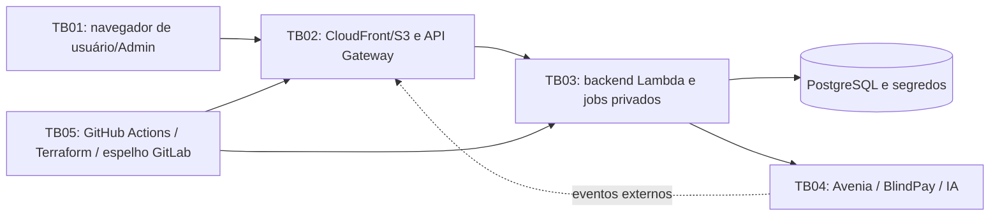

# Relatório técnico final de segurança — consolidação da avaliação V-Stable

**Referência:** [cicd#89](https://github.com/AGES-V-Stable/cicd/issues/89), épico [cicd#80](https://github.com/AGES-V-Stable/cicd/issues/80).  
**Data de corte documental:** 15/11/2026, horário de Brasília.  
**Situação:** minuta para revisão pelo superior responsável, organizada pelas issues [#87](https://github.com/AGES-V-Stable/cicd/issues/87), [#88](https://github.com/AGES-V-Stable/cicd/issues/88) e [#89](https://github.com/AGES-V-Stable/cicd/issues/89). Consolidação documental executada; classificação formal, implementação de correções e retestes não são declarados concluídos.  
**Abrangência:** avaliação da equipe documentada nas issues #83–#86, incluindo reconhecimento, modelagem de ameaças, código, dependências, segredos, infraestrutura, aplicação/APIs, sandboxes e pentest.  
**Elaboração da consolidação:** Arthur Pascual (`ArthurPascual`). Os trabalhos de origem e seus responsáveis são identificados na seção 2; este relatório reúne as entregas da equipe, sem restringir os resultados às issues ou aos PRs do redator.  
**Classificação desta versão:** conteúdo técnico sanitizado destinado à wiki do projeto; sem credenciais, documentos pessoais, dados bancários ou valores financeiros reais.

## Navegação

- [Resumo executivo](#1-resumo-executivo)
- [Objetivo, fontes e responsabilidades](#2-objetivo-fontes-e-responsabilidades)
- [Escopo, ambientes e regras](#3-escopo-período-ambientes-e-regras-de-engajamento)
- [Metodologia e versões](#4-metodologia-ferramentas-e-interpretação)
- [Arquitetura e ameaças](#5-arquitetura-ativos-e-superfície-de-ataque)
- [Resultados de todas as etapas](#6-resultados-consolidados-por-etapa-e-componente)
- [Rastreabilidade e revisão das conclusões](#7-rastreabilidade-entre-as-entregas-e-revisão-das-conclusões)
- [Registro e avaliação de riscos](#8-registro-consolidado-de-riscos-e-recomendações)
- [Tratamento e retestes](#9-correções-mitigações-retestes-e-aceite-de-risco)
- [Evidências e limitações](#10-evidências-confidencialidade-e-limitações)
- [Plano de evolução](#11-recomendações-e-evolução-do-desenvolvimento-seguro)
- [Conclusão e critérios de entrega](#12-conclusão-e-critérios-de-entrega-da-89)
- [Identificação das fontes](#13-identificação-das-fontes-desta-consolidação)

## 1. Resumo executivo

Este relatório reúne **todos os documentos de origem em `wiki/security/` disponíveis na data de corte**: planejamento/reconhecimento e modelagem de ameaças (#83), análise de código/dependências/segredos/infraestrutura (#84), testes de aplicação e APIs com complementos de sandbox (#85) e pentest controlado com disponibilidade e não repúdio (#86). O próprio relatório consolidado não é contado como uma quinta avaliação independente. As issues #87, #88 e #89 orientam o registro de riscos, a situação do tratamento e a apresentação final.

A avaliação documentada identificou fragilidades relevantes em autorização de operações financeiras com segundo fator, reutilização de TOTP, revogação de sessões, decisões humanas de compliance, precisão monetária e tratamento de integrações. Os sandboxes demonstraram funcionamento de operações selecionadas e também reproduziram falhas: a confirmação sem TOTP financeiro chegou ao provedor e o histórico perdeu precisão de um montante cripto sintético. A avaliação local de impacto demonstrou encadeamentos sob pré-condições controladas, não o comprometimento inicial de uma conta ou da infraestrutura.

O trabalho da equipe também caracterizou, localmente, degradação por ocupação do pool de banco, ausência de limitação nas rajadas examinadas, listagens que carregam conjuntos completos e lacunas de autoria/preservação de auditoria. A análise estática acrescentou riscos de provisionamento de segredos, privilégios/recuperação do banco, pipelines/artefatos, dependências e fluxos de upload. SonarCloud, npm e SAST têm resultados próprios: alertas, severidades de ferramentas e hipóteses de arquitetura não são todos vulnerabilidades exploráveis confirmadas.

Houve controles efetivos nos cenários examinados: rejeição de JWT inválido/expirado e de tokens de desafio em rotas protegidas, restrição de rotas administrativas, isolamento entre empresas nos caminhos exercitados, validação de ofertas e proteção contra execução repetida da mesma oferta. Esses resultados não demonstram cobertura integral de todos os endpoints ou ausência de outras vulnerabilidades.

Na Avenia, um ticket empresarial chegou a `PAID` no sandbox, enquanto o backend permaneceu em `SUBMITTED`. Essa observação é operacional e limitada ao ambiente e à instrumentação da captura; o polling do teste não implementou conciliação na aplicação. Não houve recebimento de webhook Avenia real nem onboarding documental KYC/KYB completo.

**Conclusão executiva:** há riscos que exigem tratamento e verificação posterior. A conclusão dos testes selecionados, a aprovação de uma regressão e o merge de um PR de testes não constituem remediação ou aceite de risco. O relatório pode ser elaborado antes da conclusão das #87/#88, registrando o estado da avaliação na data de corte. Não se declara encerramento integral do épico, certificação ou segurança da implantação em produção.

| Frente da avaliação | Resultado consolidado para decisão |
|---|---|
| Identidades, autorização e operações financeiras | Falhas reproduzidas em controles específicos; priorizar fator financeiro, estado TOTP, revogação, decisão de compliance e consistência de valores/tarifas |
| Isolamento e controles de integridade | Negativas entre empresas, JWT, oferta, idempotência e webhook local funcionaram nos caminhos examinados; preservar esses controles durante a remediação |
| Disponibilidade e responsabilização | Complemento local da equipe executado; tratar limites/paginação, degradação e trilha de autoria, sem extrapolar resultados para DDoS/AWS |
| Código, dependências, segredos e entrega | Revisões e varreduras registradas, com achados e falsos positivos; confirmar aplicabilidade, exposição, rotação e eficácia dos gates |
| Infraestrutura e integrações externas | IaC revisada e operações reais de sandbox selecionadas; implantação AWS, recebimento de webhooks reais e onboarding documental integral continuam sem validação |
| Tratamento e risco residual | Registro central e plano propostos; implementação/mitigação, retestes, responsáveis e eventual aceite exigem evidência própria |

## 2. Objetivo, fontes e responsabilidades

O objetivo é apresentar uma visão auditável **da avaliação completa documentada pela equipe**, permitindo entender o que foi avaliado, por quem, em que versão, qual resultado foi observado e o que continua sem confirmação. Os quatro relatórios originais são fontes técnicas de igual relevância dentro de seus métodos; não são apenas contexto para os testes de um integrante. Este documento consolida suas conclusões e explicita diferenças de período, método e autoria.

| Fonte | Participação e utilização nesta consolidação |
|---|---|
| [Planejamento e reconhecimento — #83](PLANEJAMENTO_E_RECONHECIMENTO_TECNICO.md) | Responsáveis registrados: Rodrigo Schmitt de Almeida e Arthur Pascual. Arquitetura, inventário, TB01–TB05, VULN-01–11, EA01–EA05 e avaliações preliminares; inspeção/modelagem não equivalem a exploração comprovada |
| [Análise de código, dependências, segredos e infraestrutura — #84](ANALISE_CODIGO_DEPENDENCIAS_SEGREDOS_INFRA.md) | Responsável registrado: Rodrigo Schmitt de Almeida. Revisão dos três repositórios de execução, SonarCloud, SCA, segredos, CI/IaC e complementos de 14/11 sobre uploads e SpotBugs/Find Security Bugs |
| [Testes da aplicação e APIs — #85](TESTES_SEGURANCA_APLICACAO_APIS.md) | Entrega de Arthur: avaliação local, revisão da instrumentação e complementos reais BlindPay/Avenia, com resultados por captura |
| [Pentest e impacto — #86](PENTEST_CONTROLADO_E_ANALISE_DE_IMPACTO.md) | Arthur: campanha base e complementação QA P86-22–27. Rodrigo: complemento dedicado de disponibilidade e não repúdio, seção 12 |
| Históricos de trabalho fornecidos pelo solicitante | Apoio à atribuição e às decisões de escopo. Os documentos de `security/` são a base desta consolidação; mensagens, comandos sugeridos e textos de PR não comprovam execução por si só |
| PDF “T1 de Segurança de Sistemas — Relatório de Avaliação de Risco da Empresa Fictícia Gabriel Station” | Referência de estrutura: resumo executivo, metodologia, reconhecimento, ameaças, riscos, recomendações e conclusão. Não é fonte de fatos, entrevistas ou perdas financeiras da V-Stable |

A revisão final cabe ao superior indicado pelo solicitante, ainda sem identificação nominal neste registro. Não foi informado aceite formal dos riscos. Na atualização de escopo de 15/11, o superior informou que não estavam conduzindo as #87/#88 separadamente e orientou a consolidação dos trabalhos. Elas são utilizadas como guias para este documento, sem presumir que classificação formal, correções ou retestes já estejam em execução ou concluídos.

### 2.1. Vínculos de entrega e situação conhecida

Os PRs abaixo são vínculos conhecidos de parte das entregas, não o limite de abrangência do relatório. A #83, a #84 e o complemento de disponibilidade/não repúdio também são incluídos mesmo quando não há número de PR identificado na fonte. A existência de uma análise não depende de atribuí-la a um dos quatro PRs de Arthur.

| PR no backend | Entrega | Situação e evidência disponíveis em 15/11 |
|---|---|---|
| [#86](https://github.com/AGES-V-Stable/backend/pull/86) | Complementação local de segurança da aplicação e APIs, issue cicd#85 | PR indicado pelo autor; status final/merge não confirmado nesta consolidação. Resultados técnicos referenciados no relatório #85 |
| [#89](https://github.com/AGES-V-Stable/backend/pull/89) | Integração real com BlindPay Development, issue cicd#85 | Fechado na listagem fornecida pelo autor; não apresentado como merge confirmado. Fechamento não invalida a execução histórica documentada |
| [#92](https://github.com/AGES-V-Stable/backend/pull/92) | Pentest controlado e impacto, issue cicd#86 | Merge confirmado no histórico Git em 14/11/2026; commit `a13c20ef385cc1e47c93f8c1f48bd9e993e10efb` |
| [#97](https://github.com/AGES-V-Stable/backend/pull/97) | Avenia sandbox, issue cicd#85 | Merge confirmado no histórico Git em 14/11/2026; commit `f1230991a4c021024aa230596b905fa90ac488e4` |
| [#96](https://github.com/AGES-V-Stable/backend/pull/96) | Módulo Rust de sanitização, citado pela revisão complementar #84 | Branch `feat/bonus-rust-pdf-image-sanitizer`, base `903ba67`, conforme a fonte. Código de defesa parcial analisado; merge, integração em todos os uploads e reteste de remediação não confirmados nesta consolidação |
| Não identificado nas fontes | Reconhecimento/modelagem #83, análise principal #84 e complemento #86 de disponibilidade/não repúdio | Rastreabilidade pelos documentos, commits, branches e IDs de casos; não inventar PR, autor de alteração ou aprovação ausentes |

**Atenção à numeração:** `backend#89` é um PR de BlindPay; `cicd#89` é a issue deste relatório. O número 86 também identifica tanto um PR do backend quanto a issue de pentest no repositório cicd. São identificadores distintos.

As páginas/API dos PRs não puderam ser consultadas pela ferramenta web desta consolidação. Por isso, os merges de #92/#97 foram confirmados pelo histórico Git local; as demais situações têm a origem da informação explicitada. Não se inferem aprovação de segurança, remediação ou cobertura a partir do status de revisão do PR.

### 2.2. Como as issues orientam esta entrega

| Guia | Aplicação no relatório | O que continua dependendo de evidência ou decisão |
|---|---|---|
| **#87 — Consolidação e avaliação de riscos** | Registro R89 com origens relacionadas, critérios qualitativos, classificação inicial, exposição/impacto e proposta de prioridade; seções 5 e 8 | Validar as fichas por vulnerabilidade, vetores e justificativas CVSS 4.0, CVEs/EPSS aplicáveis e aprovação de prioridades/responsáveis |
| **#88 — Remediação e validação das correções** | Registro do estado de tratamento, critérios de aceite e protocolo de reteste; seções 9 e 11 | Implementar mudanças, vincular PRs de correção, executar CI/retestes e aprovar eventual aceite de risco; recomendações não comprovam execução |
| **#89 — Relatório técnico final** | Consolidar escopo, versões, resultados, autoria, riscos residuais e conclusão auditável, com conteúdo sanitizado | Revisão do superior, verificação da custódia das evidências detalhadas e publicação da revisão |

Assim, a consolidação pode ser entregue para revisão agora. O seu conteúdo cobre parcialmente o registro e planejamento das #87/#88, mas não encerra requisitos de cálculo, implementação, validação ou decisão que não foram executados.

## 3. Escopo, período, ambientes e regras de engajamento

O período documental consolidado abrange o reconhecimento de 08/11, as avaliações de 10–13/11 e os complementos estáticos de 14/11/2026. A redação e a conferência documental foram feitas em 15/11. **Nenhuma suíte, sandbox ou infraestrutura foi reexecutada para produzir este relatório.**

| Componente/ambiente | Avaliação efetivamente registrada | Limite da conclusão |
|---|---|---|
| Backend local | Código, HTTP/MockMvc, serviços, autenticação, persistência e Testcontainers | Resultados por versão e fixture; não representam a implantação AWS |
| Frontend | Análise de código e capturas históricas Vitest, incluindo sessão e autorização de interface | Não houve pentest completo de navegador nem comprovação de obtenção inicial de JWT por XSS |
| PostgreSQL efêmero | Persistência, associações empresariais, precisão e cenários de concorrência locais | Não houve intrusão em RDS ou teste de privilégios no banco implantado |
| BlindPay Development | Chamadas funcionais reais em instância de desenvolvimento confirmada, sem dinheiro real | Cenários e orçamento próprios; sem webhook recebido em endpoint público |
| Avenia sandbox | Conta esperada, assinatura RSA, cotações, beneficiários, tickets e consultas de status | Conta INDIVIDUAL, massa sintética e rotas selecionadas; não comprova KYB institucional |
| AWS, Terraform e pipelines | Revisão documental, de IaC e configurações versionadas | Sem exploração ativa de Lambda, IAM, RDS, WAF, rede ou produção |
| Chatbot/provedores nos testes locais | Mocks e revisão de configurações; complemento de taxa local da equipe | Sem operação real contra provedor de IA |
| Produção e dados reais | Fora dos testes ativos | Não houve pagamento real, exfiltração de dados reais ou avaliação de disponibilidade em produção |

Foram adotados dados sintéticos, banco descartável, evidências sanitizadas, orçamento finito e interrupção diante de efeitos inesperados. Concorrência, adulteração, mensagens inválidas e condições temporais induzidas permaneceram nas camadas locais controladas. Nos sandboxes, foram realizadas chamadas funcionais sequenciais, sem fuzzing ou carga. O complemento DoS também foi local, com integrações simuladas; não é prova de DDoS ou WAF em AWS.

## 4. Metodologia, ferramentas e interpretação

A avaliação combinou **White Box e Gray Box**: reconhecimento e leitura de código/arquitetura, análise de configurações/dependências e modelagem; seleção de cenários, preparação de pré-condições, execução controlada, observação HTTP/SQL, comparação com as regras confirmadas e registro de impacto e limitações. Cada frente conserva o tipo de evidência efetivamente obtido.

Ferramentas registradas nas fontes incluem inspeção Git/regex, consulta de métricas SonarCloud, `npm audit`, resolução de dependências Gradle, SpotBugs/Find Security Bugs, Java 25, JUnit, Spring Boot Test/MockMvc, Mockito, Testcontainers/PostgreSQL 16.4, Vitest e JaCoCo. Na Avenia, foram usados o cliente/assinador RSA do backend e um transporte de teste restrito; alguns GETs sem método público no gateway passaram por adaptador de teste explicitamente identificado. Gitleaks, Trivy, Checkov, tfsec e scanners SCA Gradle aparecem no planejamento, mas a #84 registra que não estavam disponíveis: não são apresentados como ferramentas executadas.

Referências metodológicas da issue: [NIST SP 800-115](https://csrc.nist.gov/pubs/sp/800/115/final), [PTES Reporting](http://www.pentest-standard.org/index.php/Reporting), [OWASP WSTG 4.2](https://owasp.org/www-project-web-security-testing-guide/v42/), [NIST SP 800-30 Rev. 1](https://csrc.nist.gov/pubs/sp/800/30/r1/final) e [OWASP SAMM](https://owaspsamm.org/model/). A estrutura se inspira também no PDF fornecido. Não foi realizada certificação ou avaliação integral de maturidade/conformidade com esses referenciais.

ASVS 5.0.0, OWASP API Security Top 10:2023, CWE, SSDF e controles CIS aparecem nas fontes para classificar causas e orientar tratamento. Não se demonstra atendimento integral a esses catálogos. PCI DSS não foi avaliado; não foi estabelecido escopo de dados de cartão. A condição de operar pagamentos/stablecoins não é usada para afirmar conformidade regulatória.

Regras de interpretação:

- **Diagnóstico #85:** PASS representa a expectativa segura satisfeita; FAIL representa desvio dessa expectativa nas condições executadas.
- **Caracterização de impacto #86:** PASS pode indicar que uma vulnerabilidade foi reproduzida conforme o cenário. Não significa segurança ou correção.
- **Análise estática:** apontamento de código/configuração não equivale a exploração nem a confirmação da configuração implantada.
- **BLOQUEADO/NÃO EXECUTADO:** não se convertem em PASS. Falha no cenário funcional do provedor também não equivale automaticamente a vulnerabilidade da aplicação.
- **Reteste:** nova execução após correção identificada. Revisar uma asserção de teste ou obter build verde não demonstra remediação do controle.

### 4.1. Versões e rastreabilidade das capturas

| Captura | Base registrada na fonte | Origem |
|---|---|---|
| Reconhecimento/modelagem, 08/11 | Backend `82ef01d`, frontend `4994656`; branches adicionais `iachat-backend` (`756fd2fba285db0d55c9b464639c14f052239bd0`) e `ia-chatbot` (`d583f5afef932c5598368f85e65b8823457080a4`); cicd `940f9d1` | #83, seção 3; referência de leitura/modelagem, sem atribuir testes dinâmicos às branches adicionais |
| Análise principal de código/SCA/segredos/IaC, 12/11 | Configurações e versões resolvidas registradas na #84; IaC `940f9d1`. A análise principal não informa um SHA único para todas as capturas de SonarCloud/npm/Gradle | #84, seções 1–7; lacuna de versionamento preservada, sem usar `46ccb12` do complemento como se identificasse toda a análise principal |
| Aplicação/APIs, 10/11 | Backend `07c2302fea9434dfd107f803010a6d066efb548a`; frontend `49946566b6023d36ebf738b7971ecd878e530f71` | #85, seção 2 |
| Complementação local, 12/11 | Backend `3983b755e412e6552a1509992fc7d7485497b3bc` mais instrumentação identificada na captura | #85, seção 3.5 |
| Revisão de testes, 13/11 | Backend `7b46aa6`, branch `test/85-seguranca-aplicacao-apis` | #85, seção 3.7 |
| BlindPay Development, 13/11 | Backend `01af9fcd48431ecb2d059c710c80d23d69318f92`, branch `test/85-integracoes-sandbox` | #85, seção 3.6 |
| Pentest inicial, 13/11 | Backend `6f947fbb6daf61a8dddaa465b87ef3f02359beb9`; frontend `271ce87b8583f44cfe2a9734bbbdccd663051572` | #86, seção 1 |
| Avenia sandbox, 13/11 | Backend `1a3add10ab0032b9834ff552e9af74a14cd859d8`, branch `test/85-seguranca-avenia-sandbox` | #85, seção 3.8 |
| Disponibilidade/não repúdio do Rodrigo | Base `1a3add10ab0032b9834ff552e9af74a14cd859d8`, branch `test/86-dos-e-nao-repudio` | #86, seção 12 |
| Complementos estáticos, 14/11 | Backend `46ccb12`; sanitizador em branch `feat/bonus-rust-pdf-image-sanitizer`, `903ba67` | #84, seções 8–9 |
| IaC de referência | Cicd `940f9d142e733cfdfe69f5cbd14be0a1bcd51695` | #83/#85/#86 |

As bases receberam instrumentação adicional no working tree durante as avaliações. Seus hashes e condições estão descritos nas fontes; um SHA de merge posterior não substitui o SHA da captura nem prova reteste do código integrado. Não se somam as contagens de diferentes versões como se fossem casos independentes.

### 4.2. Adaptação do modelo T1 para a V-Stable

| Estrutura do PDF de referência | Adaptação neste documento |
|---|---|
| Resumo executivo e introdução | Seções 1–3: situação observada, objetivo, autoria, período e escopo |
| Metodologia e reconhecimento ativo | Seções 3–5: ambientes, ferramentas, fontes, arquitetura e fronteiras; não houve entrevistas ou reconhecimento ativo adicionais nesta consolidação |
| Modelagem de ameaças | Seção 5.1: cenários ligados aos achados efetivamente documentados, com pré-condições e limites |
| Avaliação qualitativa/quantitativa e CRQ | Seção 8: critérios qualitativos próprios, distinção entre severidade/risco/prioridade e situação de CVSS/EPSS/CRQ |
| Recomendações de curto, médio e longo prazo | Seção 11: ações por horizonte, dependências, encaminhamento técnico e comprovação esperada |
| Conclusão e referências | Seções 12–13: postura limitada ao escopo, critérios de entrega e fontes identificadas |

O PDF é um modelo de apresentação, não um protocolo a copiar integralmente. Ele utiliza CVSS 3.1 e estimativas EPSS por cenário; a issue #87 exige **CVSS 4.0** e **EPSS somente para CVE correspondente**. Não se reutilizam suas pontuações, percentuais, entrevistas, premissas de faturamento, multas ou perdas projetadas. A #83 também contém avaliações preliminares e projeções: sua existência é preservada na seção 8.6, com as premissas e revisões posteriores, sem promovê-las a métricas finais validadas. A matriz qualitativa da seção 8 é uma convenção proposta para este relatório, sem afirmar que o NIST imponha suas dimensões ou que as notas já tenham sido aprovadas pelo negócio.

## 5. Arquitetura, ativos e superfície de ataque

A arquitetura considerada consiste em frontend React consumindo backend Spring Boot; autenticação JWT/TOTP; usuários vinculados a empresas; PostgreSQL; clientes Avenia/BlindPay; interfaces de compliance; e infraestrutura AWS descrita em IaC, com API Gateway/Lambda, RDS, Secrets Manager e S3/CloudFront. GitHub Actions e os demais pipelines compõem a cadeia de entrega.

Ativos relevantes são identidades e credenciais, associações empresa/usuário/beneficiário, documentos de compliance, cotações, valores e históricos de transferência, registros de auditoria, código e artefatos de implantação. As fronteiras consideradas são navegador/API, API/banco, API/provedores, recepção de eventos externos e plano de controle/infraestrutura.

O desenho resume o modelo TB01–TB05 da #83. Não é inventário obtido de uma conta AWS: código/IaC sustentam a topologia, e as chamadas externas comprovadas se limitam aos sandboxes descritos. Nos testes locais, HTTP/serviços/PostgreSQL foram exercitados em laboratório; a borda AWS e os serviços de terceiros foram substituídos onde indicado. O MCP Avenia é ferramenta documental/de desenvolvimento no modelo, não uma integração financeira cuja exploração tenha sido executada.

| Fronteira da #83 | Ativos e controles considerados | Evidência disponível |
|---|---|---|
| TB01 — clientes e entrada externa | JWT, desafio/TOTP, perfis, propriedade, dados de entrada e assinatura de evento | Testes locais #85/#86; webhook gerado pelo harness, sem entrega externa real |
| TB02 — borda e entrega | TLS, headers, throttling/logs, S3/CloudFront/API Gateway | Configuração versionada #83/#84; sem teste ativo da implantação |
| TB03 — aplicação, banco e segredos | Validação financeira, sessão, associações, persistência, pool, auditoria, criptografia, privilégios e backups | Testes locais e leitura de código/IaC; sem acesso ao RDS/Secrets Manager reais |
| TB04 — provedores | Assinatura/credenciais de integração, contrato, valor/moeda, estado, tempo, repetição e callbacks | Mocks/testes de transporte e operações funcionais reais BlindPay/Avenia separadas |
| TB05 — controle e entrega | Repositórios, OIDC, permissões, workflows, dependências, imagens, estado Terraform e evidências | Revisão #83/#84; sem ataque ao CI, acesso a settings ou comprovação do estado aplicado |

Superfície avaliada: login e desafio 2FA; rotas públicas e autenticadas; rotas administrativas; cadastros/compliance; uploads; beneficiários; cotações e confirmações; histórico/comprovante; membros/convites; webhook BlindPay local; consumidores HTTP; consultas sem paginação; e configuração de CI/IaC. As quantidades de endpoints variam conforme o commit e o profile; o inventário de uma captura não cobre automaticamente os endpoints adicionados depois.

**Regra de negócio vigente para interpretar as capturas:** OWNER é Representante, OPERATOR opera e VIEWER apenas consulta, dentro do escopo empresarial. Admin é conta separada da V-Stable. Decisões de aprovação/reprovação de compliance pertencem aos provedores. A interpretação anterior baseada em segregação entre SUPPORT, COMPLIANCE_ANALYST e SUPER_ADMIN foi superada; não é reapresentada como vulnerabilidade confirmada.

### 5.1. Cenários de ameaça e encadeamento considerados

Os cenários CEN89 abaixo organizam o raciocínio como os eventos de ameaça do T1. Não substituem os IDs EA/VULN das fontes nem representam novas explorações. STRIDE descreve a natureza do cenário; não é uma declaração de cobertura integral das seis categorias.

| Evento original da #83 | Encaminhamento na avaliação consolidada |
|---|---|
| EA01 — fraude via TOTP/sessão | CEN89-01/02; R89-01/02/04. Confirmações e efeitos selecionados reproduzidos; obtenção inicial de sessão/fator e fraude em produção não demonstradas |
| EA02 — isolamento e privilégios | CEN89-04/06; R89-03/14/16. Regra de Admin revisada; isolamento negativo efetivo nos caminhos examinados; ausência de RLS/privilégio de banco permanece ponto de arquitetura |
| EA03 — credenciais e entrega | CEN89-06; R89-15/17. Exposição histórica e revisão de CI/segredos registradas; sem utilização da credencial ou comprometimento da esteira |
| EA04 — disponibilidade/recuperação | CEN89-05/06; R89-11/16. Complemento local executado; exaustão distribuída AWS e restauração continuam sem demonstração |
| EA05 — sincronização financeira | CEN89-03; R89-05/06/07/13. Testes de estados, tarifas e acompanhamento real selecionados; sem prova de scheduler congelado em Lambda nem recuperação externa completa |

O cenário CEN89-05 também incorpora o resultado dedicado de não repúdio da #86; CEN89-06 relaciona os riscos de conteúdo da #84. MITRE ATT&CK é referência complementar de objetivos nos relatórios de origem: não implica shell, movimento lateral, exfiltração ou persistência de host executados. As médias DREAD da #83 e sua matriz histórica estão identificadas na seção 8.6.

| Cenário | Ativo, pré-condição e caminho considerado | Evidência e limite do impacto | STRIDE e registro relacionado |
|---|---|---|---|
| **CEN89-01 — Uso indevido de sessão financeira** | Sessão válida previamente disponível → confirmação sem fator financeiro → registro e acionamento de transferência | Cadeias locais #86 e tickets reais de sandbox #85; não foi demonstrado roubo inicial de JWT, dinheiro real ou tomada de conta em produção | Spoofing/Tampering; R89-01, R89-04 |
| **CEN89-02 — Reutilização/intercalamento de TOTP** | Mesmo usuário/segredo em instâncias locais ou chamadas intercaladas → controle em memória e separação entre validação e consumo | Replay e concorrência locais; a extensão a Lambdas reais é inferência arquitetural, sem teste ativo AWS | Spoofing/Tampering; R89-02 |
| **CEN89-03 — Divergência em valores e estado financeiro** | Operação sintética válida → persistência com precisão/unidade incorreta ou ticket final não refletido localmente | Precisão e tarifa demonstradas nas fontes; PAID/SUBMITTED é observação operacional; não se quantificou prejuízo de negócio | Tampering; R89-05, R89-06, R89-07, R89-13 |
| **CEN89-04 — Decisão de compliance fora do fluxo do provedor** | Sessão Admin → alteração humana de estado cadastral/compliance | Alteração local persistida sem decisão do provedor; não demonstra aprovação institucional real ou escalada entre perfis administrativos que não existem na regra atual | Tampering/Elevation of Privilege no sentido de função de negócio indevida; R89-03 |
| **CEN89-05 — Consumo excessivo e rastreabilidade insuficiente** | Chamadas locais controladas/listagens → pressão sobre recursos; ações sensíveis sem trilha suficiente | Complementos de Rodrigo: pool, limites, volume e não repúdio. Não demonstram DDoS externo, indisponibilidade AWS ou falsificação de comprovante em produção | Denial of Service/Repudiation; R89-11, R89-12 |
| **CEN89-06 — Ampliação de alcance entre componentes** | Falha de autorização/validação, segredo exposto ou configuração privilegiada → possível alcance sobre documentos, empresas ou infraestrutura | Negativas locais preservaram isolamento nos caminhos testados; uploads/segredos/IaC têm evidências de naturezas distintas. Não se comprovou acesso lateral a outro host, RDS ou IAM | Information Disclosure/Tampering/Elevation of Privilege como hipóteses condicionais; R89-08, R89-09, R89-15–17 |

O fato de não haver RLS ou de o token estar em armazenamento do navegador não prova, isoladamente, exfiltração ou quebra de isolamento. Condições de exploração e controles efetivos entram na avaliação contextual, em vez de transformar cada característica arquitetural em ataque confirmado.

## 6. Resultados consolidados por etapa e componente

### 6.1. Planejamento, reconhecimento e modelagem — #83

O reconhecimento de 08/11 organizou os quatro repositórios, a arquitetura de negócio B2B, ativos, ambientes, regras de engajamento e fronteiras TB01–TB05. A fonte registrou um inventário de **18 controllers/38 entradas de rotas**, 11 apontamentos VULN-01–11 e cinco eventos EA01–EA05, com STRIDE, referências ATT&CK e avaliações preliminares DREAD/CVSS/risco/CRQ. As 38 entradas agrupam algumas sub-rotas: não equivalem às 59/71 combinações MVC de capturas posteriores.

Essa etapa orientou as provas posteriores de TOTP, sessão, autorização e operações financeiras, além da revisão de infraestrutura/entrega. Os apontamentos eram derivados principalmente de código e arquitetura; o próprio solicitante esclareceu que não tinham sido previamente reproduzidos em testes. A consolidação conserva sua origem e atualiza sua interpretação com #84–#86, conforme a seção 7.

Controles positivos identificados incluem segredos TOTP cifrados com AES-256-GCM, JWT com finalidade e expiração, verificação Svix, deploy OIDC e componentes privados/criptografados na IaC. A documentação do MCP Avenia foi considerada no reconhecimento; não houve pentest do serviço MCP. A escolha de frameworks no planejamento não comprova execução de todos os seus controles, ferramentas ou técnicas.

### 6.2. Código, dependências, segredos e infraestrutura — #84

O relatório de Rodrigo, datado de 12/11 e complementado em 14/11, cobre backend, frontend e cicd. As observações abaixo são capturas históricas documentadas; não são uma consulta atual à plataforma ou uma nova varredura nesta redação.

#### 6.2.1. SonarCloud, dependências e segredos

| Frente | Resultado registrado | Interpretação e encaminhamento |
|---|---|---|
| SonarCloud backend | Quality Gate `ERROR`, coverage `87.7%`, security rating `4.0`; dois apontamentos abertos: `java:S4502` CRITICAL (CSRF em job interno) e `githubactions:S8233` MAJOR (OIDC no workflow) | Severidade da ferramenta, não dois exploits comprovados. Triar perfil/autenticação/exposição do job e escopo das permissões; verificar se o gate bloqueia a entrega |
| SonarCloud frontend | Divergência `ages-v-stable_frontend` (404) versus `AGES-V-Stable_frontend`; nesta última, zero bugs/vulnerabilidades/hotspots e sem coverage/alert_status retornados | Zero alertas retornados não comprova cobertura nem análise da configuração pretendida; corrigir identidade do projeto e rastrear a análise |
| npm em produção | `npm audit --omit=dev`: zero vulnerabilidades reportadas na captura | Resultado delimitado às dependências/avisos então consultados; não equivale a ausência de falhas no frontend |
| npm completo | 13 vulnerabilidades moderadas de desenvolvimento; avisos GHSA em `@vitest/mocker` e `minimatch` | Validar versões/condições afetadas. `--audit-level=high` não reprova moderadas; não confundir política de saída com inexistência dos avisos |
| Gradle/runtime | `spring-security-core:7.0.5` fixado, com `web/config:7.1.1`; demais versões resolvidas identificadas na fonte | Desalinhamento e manutenção requerem análise; não há CVE Java aplicável comprovada apenas por diferença de versão |
| Cobertura de SCA/SBOM | Sem tarefa SCA/SBOM Gradle identificada; não houve consulta automática NVD de toda a árvore Java | Lacuna de processo/visibilidade, não evidência de dependência vulnerável específica |
| Segredos | Inspeção Git/regex de arquivos e histórico dos três repositórios não encontrou segredo real nas condições descritas | Não foi execução de Gitleaks nem garantia universal de limpeza. Mantida a exposição histórica de credencial em cicd#74, sem reproduzir valor; comprovação de rotação pendente |
| Proteção de configuração local | `.gitignore` frontend sem regras explícitas para todas as variações de arquivos de ambiente | Revisar exclusões e prevenção de commits de segredos; existência de lacuna não demonstra vazamento ocorrido |

Os APP-01–09 também cobrem fator financeiro, estado TOTP/taxa em memória, carregamento de chaves, autorização administrativa, defesa no banco, armazenamento do JWT, documentação pública/rota órfã, mensagens de erro e padrões do frontend. A correlação e as ressalvas constam na seção 7: o APP-04 não é mantido como escalada entre três níveis administrativos, e localStorage/ausência de RLS não são apresentados como roubo de sessão/BOLA demonstrados.

#### 6.2.2. Uploads, documentos e módulo Rust

| Origem | Observação registrada | Estado e limite |
|---|---|---|
| SEC85-05/P86-19, retomados pela #84 | Prefixos PDF/PNG/JPEG truncados chegam ao gateway simulado por validação superficial | Reprodução local anterior; não se demonstrou aprovação externa, execução de script ou malware |
| APP-10, PR #96/base `903ba67` | Sanitizador Rust possui inspeção de PDFs e limites para bombas de imagem; metadados textuais PNG/JPEG não passam pela mesma detecção de conteúdo ativo; serviço Java de upload ainda não o invoca na versão revista | Defesa parcial existente e lacuna de integração/inspeção estática. Não chamar o upload de corrigido nem presumir que metadados sejam executados por algum consumidor |
| APP-11 | Extração de extensão no frontend usa separador incorreto; resta a checagem de MIME informada pelo cliente | Revisão estática de controle da UI; validação efetiva precisa ocorrer também no fluxo que recebe o arquivo |
| APP-12 | Upload Avenia usa PUT do navegador diretamente para URL pré-assinada do provedor | Uma defesa integrada apenas ao serviço Java BlindPay não cobre esse fluxo. Restrições da URL/storage/provedor não foram auditadas dinamicamente |
| APP-13 | KYB/RFI BlindPay aceita URL HTTPS sem vínculo/origem restritos ao arquivo emitido para aquela empresa/sessão | Apontamento de origem/conteúdo não confiável; não houve demonstração de fetch arbitrário pelo backend nem SSRF/exploração externa |

Esses complementos foram documentados sem envio de arquivos maliciosos aos provedores e sem alteração do produto na revisão #84. Integrar o módulo Rust é uma ação a verificar, com limites do runtime/API e os dois fluxos de upload considerados separadamente.

#### 6.2.3. SAST e triagem

Em `backend@46ccb12`, SpotBugs `6.5.13` e Find Security Bugs `1.14.0` produziram **266 alertas**. As categorias não têm o mesmo significado nem representam 266 vulnerabilidades; a fonte documenta triagem de código, não uma campanha dinâmica para cada aviso.

| Resultado da triagem | Categorias/condições registradas | Tratamento na consolidação |
|---|---|---|
| Endurecimento de logs | 15 avisos `CRLF_INJECTION_LOGS` envolvendo mensagens/valores externos; JSON pode escapar quebras, consumo em texto precisa de análise | R89-17, relacionado a R89-12. É fluxo distinto do request ID que rejeitou CRLF em P86-NR-04 |
| Canonicalização/locale | 44 `IMPROPER_UNICODE` e 21 `DM_CONVERT_CASE`; conversões de strings técnicas/Base32 dependem do locale | R89-17; recomendar `Locale.ROOT` onde aplicável e validar efeito; sem exploração funcional demonstrada |
| Hipótese de construtor | Quatro `CT_CONSTRUCTOR_THROW` em classes não finais | R89-17; hipótese de endurecimento ligada a instanciação/subclassificação, sem ataque remoto comprovado |
| Headers e autoria | Dois `SERVLET_HEADER`: UUID aceito do cliente e leitura de Authorization, este submetido à validação JWT | Correlação com P86-NR-04, sem classificar todo header como inseguro |
| Robustez/tipagem | Um aviso de principal potencialmente nulo/tipo não verificado e um catch de NPE na geração de comprovante | R89-10/17; avaliar contrato e testes; não promover aviso a bypass de autenticação |
| Falsos positivos documentados | 26 `ENTITY_MASS_ASSIGNMENT` no principal injetado; um `XSS_SERVLET` com constantes JSON; dois `MODIFICATION_AFTER_VALIDATION` de normalização canônica | Excluídos de vulnerabilidades confirmadas, preservando justificativas da fonte |
| Informativos/revisão contextual | 77 registros `SPRING_ENDPOINT`, 42 `EI_EXPOSE_REP/EI_EXPOSE_REP2`, builder SLF4J e CORS sem wildcard | Não contar como exploração nem como correção; número de endpoints emitido pelo SAST não é a cobertura MVC de outra versão |

#### 6.2.4. Infraestrutura, pipelines e artefatos

| Componente | Configuração/risco registrado em #83/#84 | Controle positivo ou limite da evidência |
|---|---|---|
| RDS e recuperação | Single-AZ, retenção de backup zero, exclusão de backups automatizados e sem snapshot final; sem exercício de restauração | IaC também define banco privado, criptografia e proteção de exclusão. Não se comprovou estado aplicado, inexistência de backup externo ou perda real |
| Privilégios e isolamento | Aplicação configurada com usuário mestre; role restrita removida; sem políticas RLS identificadas nas migrations | Acesso entre empresas foi bloqueado nos caminhos locais examinados. Menor privilégio e defesa adicional continuam recomendados |
| Segredos e Lambda | Carregamento/IaC omitem chaves TOTP/IA e, na revisão #86, propriedades de convite; concorrência da API sem reserva explícita | Jobs internos têm limite de concorrência. Outras fontes de configuração podem fornecer valores; falha de boot/deploy não comprovada |
| Borda e observabilidade | Sem configuração explícita de throttling/access logs no stage; sem response headers policy/access logs no CloudFront e sem WAF identificado na IaC lida | Não comprova ausência de todos os controles externos da conta. S3 privado/OAC, AES256 e política TLS foram identificados |
| Rede | NAT único, saída ampla de Lambda; sem Flow Logs/endpoints privados identificados | Sub-redes privadas e SG de banco delimitam entrada. Sem teste de segmentação ou movimentação de rede |
| Estado Terraform e ambientes | Sem backend remoto com locking identificado; base URL Avenia de produção com default sandbox | Requer verificar modo de execução, overrides e separação de ambientes, não presumir implantação errada |
| IAM/OIDC e jobs | Permissão de invocar seed produtivo e escopo de `id-token: write` para revisão; apontamento inicial de migration foi superado no workflow posterior | Trust OIDC diferencia refs e usa identificadores imutáveis. Atualização/invocação de migration aparece em #84; execução bem-sucedida na AWS não comprovada |
| Gate frontend/Sonar | Checks de audit/formato/lint/coverage comentados no deploy; `sonar.qualitygate.wait=true` ausente | Não foram auditados branch protection, aprovadores de environments ou todos os checks externos ao arquivo |
| Actions e sincronização | Referências mutáveis em Actions/workflow de espelhamento; herança de segredos e push forçado para revisão | `configure-aws-credentials` possui SHA fixo. Não houve comprometimento de Action, GitLab ou token demonstrado |
| Imagens/ECR | Base por tag, execução root, `--provenance=false`, sem SBOM/assinatura/gate de CVE/lifecycle identificados; bundle CA baixado sem checksum | ECR com tags imutáveis, criptografia e scan-on-push; existência do scan não comprova bloqueio do deploy |
| CI de infraestrutura | Sem pipeline de plan/scan IaC identificado | Avaliação por leitura; Terraform, Trivy, tfsec, Checkov e Gitleaks não executados nessa auditoria |

A #84 não teve acesso AWS ou ao painel completo de configurações GitHub e não executou a suíte de integração backend. No frontend, registra **778 testes aprovados e duas suítes com timeout de 15 s sob coverage no Windows**; esse resultado não equivale a uma regressão integral aprovada. A captura distinta de 772 testes da #85 não apaga esses timeouts.

### 6.3. Aplicação/APIs locais e revisão da instrumentação — #85

A avaliação de Arthur cobriu autenticação/sessão, permissões por perfil, isolamento empresarial, entradas/erros, valores/moedas, associações financeiras, estados, repetição, idempotência e concorrência locais. Incluiu parser multipart em HTTP real, respostas/timeout/redirect de clientes em loopback, cenários de webhook sintético e transações PostgreSQL efêmeras; não se limitou a mocks de regras de negócio.

A revisão corrigiu expectativas de acesso superadas, isolamento de mocks entre DynamicTests, rastreabilidade, duplicações e asserções que aceitavam exceção indevida. Os testes de outros controles passaram a fornecer TOTP sintético; o DTO de confirmação então avaliado ignorava esse campo, portanto a fixture não comprovou exigência do fator. As contraprovas do harness não corrigiram o serviço real.

| Captura #85 | Resultado registrado | Uso na conclusão |
|---|---|---|
| Diagnóstico de 10/11 | 217 casos; 198 PASS/19 FAIL | Histórico com cinco reprovações da matriz administrativa superada; não é resultado da regra vigente |
| Complementação de 12/11 | 385; 364 PASS/21 FAIL | Matriz local ampliada; falhas posteriores de instrumentação foram corrigidas na revisão seguinte |
| Revisão do PR, 13/11, base `7b46aa6` | 371; 344 PASS/27 FAIL; zero ignorados | Snapshot revisado da branch local; seis reprovações adicionais de fator/contrato não são seis vulnerabilidades novas |
| Verificação local na branch BlindPay, base `01af9fcd` | 419; 398 PASS/21 FAIL; zero ignorados | Outro HEAD, inventário de 71 operações e classificação pública corrigida; não substitui o resultado da branch local nem demonstra remediação |
| Regressão #85 de 10/11 | Backend 1.238 PASS/6 ignorados; frontend 772 PASS | Regressão funcional histórica, separada do diagnóstico |
| Regressão vinculada à revisão local | Backend 1.235 PASS/6 ignorados | Não é execução do HEAD de 15/11 |
| Regressão final Avenia | 1.522 casos: 1.516 PASS/6 ignorados | APIs reais desativadas na regressão padrão; não aprova os controles diagnósticos reprovados |

O inventário local revisado contém 59 operações padrão e dois mapeamentos condicionais de jobs separados; a etapa posterior contém 71 operações em outro HEAD. A cobertura de autenticação, acesso e contratos depende da operação/caso. **Não se declara cobertura integral de todos os contratos de cada endpoint** pela existência de inventário ou referências a serviços. Recuperação/logout/troca de senha públicos ausentes nas versões testadas foram registrados como limitações.

### 6.4. BlindPay Development — complemento real da #85

Foram avaliados autenticação da integração, recursos de desenvolvimento e isolamento local, cotações SOURCE/TARGET, financiamento/payout, falhas e reembolsos do simulador, expiração/recotação e repetição. Usou-se cliente individual de demonstração existente, com KYC aprovado/termos aceitos; AML nulo não foi declarado aprovado. Conta bancária e carteira de teste foram criadas para a campanha. Avenia permaneceu simulada nessa etapa.

A tentativa final registra **77 subcasos: 60 PASS, 14 FAIL, um BLOQUEADO e dois NÃO EXECUTADO**. São sete ocorrências de SEC85-01 e sete de SEC85-11. O bloqueio é cadastro externo novo (termos/documentação apropriados indisponíveis); as exclusões são Avenia e webhook real. Não houve onboarding/KYB integral comprovado.

| Cenários funcionais de estado | Observado no sandbox/aplicação |
|---|---|
| Sucesso, falha e reembolso de payin | COMPLETED no sucesso; FAILED/REFUNDED sem payout nos ramos de falha/reembolso |
| Falha e reembolso de payout | FAILED após financiamento e REFUNDED, conforme o cenário |
| Oferta expirada | HTTP 422 antes da confirmação externa |
| Cotação expirada durante financiamento | Uma recotação real e conclusão; não houve aceitação explícita de oferta pior pelo usuário |
| Idempotência/repetição | Mesma execução/payin, sem nova operação por repetição da oferta |

O orçamento foi de 80 chamadas na tentativa completa, 123 confirmadas na campanha e 139 posições conservadoras contando reserva pela interrupção, sob teto de 180. Esses números não são somados. O desligamento deixou uma tentativa interrompida; consultou-se a operação original e não se reenviou a transação incerta. Os resultados finais vêm de tentativa FINISHED com fixtures separadas. A verificação adicional de sete associações/montantes foi consistente, preservando a falha de unidade da tarifa. Polling não substitui webhook real.

### 6.5. Avenia sandbox — complemento real da #85

Foram executadas **40 chamadas reais**, sob teto de 50, em cinco tentativas preservadas. As duas consultas históricas de validação de chaves não estão incluídas nas 40. A consolidação tem **26 IDs: 22 PASS, três FAIL e um NÃO EXECUTADO**.

Foram criados uma subconta INDIVIDUAL própria, dois beneficiários sintéticos GNOSIS/POLYGON e dois tickets pagos pelo simulador: um na conta principal com saída INTERNAL e outro na subconta via fluxo empresarial POLYGON. A cotação GNOSIS recebeu 500; a alternativa POLYGON funcionou. Uma rejeição 400 de preparação e um payload local incompleto foram ajustados na instrumentação, sem contá-los como vulnerabilidades finais.

O fluxo demonstrado foi beneficiário → cotação → oferta → confirmação HTTP local → ticket → consulta até PAID. A repetição devolveu a mesma execução sem nova chamada externa. Os FAIL finais foram SEC85-01, SEC85-07 e a observação operacional PAID/SUBMITTED. **A liquidação de sandbox foi observada no provedor; a jornada não terminou integralmente sincronizada no backend.**

O onboarding documental KYC/KYB não foi exercitado: não se preparou/submeteu massa documental para avaliar aprovação; o sandbox já liberou BRL na subconta nova e o vínculo local permaneceu PENDING. Não houve aprovação artificial para apresentar onboarding como concluído. Webhooks reais, estados financeiros FAILED/CANCELED, preço pior e recuperação após resposta perdida não foram demonstrados nessa etapa; as razões e os limites da rota estão na #85, seção 9.1.

### 6.6. Pentest, cadeias de impacto e QA — #86

A campanha de Arthur começou com 21 caracterizações e recebeu seis casos P86-22–27, totalizando **27 PASS**. A regressão correspondente registra 1.513 PASS e seis ignorados. Os 46 testes frontend passaram na captura inicial, sem nova execução na complementação QA. PASS comprova o comportamento descrito, inclusive falha, não a correção do produto.

As cinco cadeias cobrem sessão remanescente/fator financeiro; alcance administrativo e decisão de compliance; convites/persistência de acesso na aplicação; precisão, conteúdo e TOCTOU; e eventos externos locais. Somente os ramos efetivamente encadeados no mesmo caso são tratados como cadeia demonstrada. Não se juntam posse de sessão, resposta externa anômala, SQL privilegiado e múltiplas instâncias como se fossem um único ataque executado.

Foram demonstrados efeitos financeiros locais com mocks e limites de acesso entre Admin/perfis empresariais, revogação e listagens. P86-22 registrou que cadastro/login independentes não consumiam convite nem criavam vínculo no HEAD avaliado. Remover o OWNER convidador exigiu fixture SQL, pois a API protege esse vínculo. Após revogar OPERATOR pela API, acessos empresariais foram negados, mas identidade/próprio vínculo REMOVED permaneceram consultáveis. Não se demonstrou persistência em host, roubo inicial de token ou escalada de USER para Admin.

### 6.7. Disponibilidade e não repúdio — complemento da #86

Rodrigo executou os casos P86-28–32 e P86-NR-01–05 em laboratório, com Testcontainers e provedores simulados. **Esses trabalhos estão concluídos no escopo local documentado**, substituindo a indicação histórica de que ainda aguardavam execução. A fonte registra **37 PASS = 27 da base + dez novos casos**, sem falha/skip; não são 37 novos testes a somar aos 27.

| Caso | Resultado principal e limite |
|---|---|
| P86-28 | Com duas conexões ocupadas, quatro logins retornaram 500, sem 429/503; consulta autenticada falhou no filtro por falta de conexão. Exaustão induzida local, sem saturação de RDS real |
| P86-29 | Rajadas de 20 logins incorretos e 15 cadastros, sem 429/Retry-After; caracteriza os limites locais examinados, sem estabelecer resistência a ataque prolongado |
| P86-30 | 15 cotações em cinco threads, com atraso simulado, retornaram 200 e persistiram requisições, sem limitação no cenário; zero chamadas reais a provedores |
| P86-31 | Listas com `size=1` devolveram 100 empresas/representantes; membros responderam uma página, mas carregaram/calcularam o conjunto de 125 pessoas/convites |
| P86-32 | Chatbot aceitou 15 chamadas, devolveu 423 na seguinte e outra instância voltou a aceitar 15 para a mesma identidade; controle local não compartilhado |
| P86-NR-01 | Alteração/exclusão por Admin sem trilha persistente de ator; cascata removeu usuários/documentos/convites da fixture. Não comprova exclusão de todo o histórico financeiro |
| P86-NR-02 | Segundo OPERATOR confirmou recotação iniciada por outro, mas só o solicitante original ficou registrado; falta atribuição do confirmador |
| P86-NR-03 | Login/2FA, revogação de convite e webhook inválido sem trilha persistente suficiente; falta ator de revogação. Não se exige persistir payload secreto ou registrar evento inválido como evento de negócio válido |
| P86-NR-04 | UUID do cliente foi reutilizado em duas requisições; CRLF foi recusado e substituído por UUID seguro. Colisão de correlação comprovada, injeção CRLF não reproduzida nesse fluxo |
| P86-NR-05 | Comprovante sem assinatura digital, hash verificador ou identificação explícita do solicitante; requisito/mecanismo de integridade a definir, sem prova de falsificação em produção |

Os testes usaram rajadas delimitadas, até cinco threads, sem carga prolongada, DDoS externo, tráfego AWS/WAF ou operação financeira real. O exportador original da #86 exige 27 casos e **não foi ampliado para os 37 nessa etapa**; os dez casos têm observações locais próprias segundo a fonte. Uma nova captura precisa distinguir essa limitação do resultado JUnit registrado.

## 7. Rastreabilidade entre as entregas e revisão das conclusões

### 7.1. Destino dos onze apontamentos do reconhecimento

| Origem #83 | Evidência posterior e interpretação consolidada | Registro central |
|---|---|---|
| VULN-01 | APP-01/SEC85-01; reproduzido localmente, no pentest e nas confirmações reais de sandbox | R89-01 |
| VULN-02 | APP-02/SEC85-02 e SEC85-04; compartilhamento/atomicidade reproduzidos localmente. Taxa do chatbot também ampliada em P86-32 | R89-02/11 |
| VULN-03 | APP-03 e revisão #86; omissões de configuração permanecem apontadas. Workflow posterior já atualiza/invoca migration; falha operacional na AWS não demonstrada | R89-15 |
| VULN-04 | #84 mantém registro de exposição em issue; varredura Git limpa nas condições descritas não comprova rotação | R89-15 |
| VULN-05 | APP-05 e IaC: menor privilégio/RLS a avaliar. Não houve BOLA geral; negativas entre empresas passaram nos caminhos testados | R89-16 |
| VULN-06 | APP-04 reinterpretado: três níveis de Admin não são a regra vigente. SEC85-03 confirma a violação distinta de decisão humana de compliance | R89-03; interpretação anterior superada |
| VULN-07 | Configuração de continuidade reforçada na #84; sem verificação de backups aplicados/externos ou restore | R89-16 |
| VULN-08 | APP-06/09 e SEC85-06: sessão após troca do hash reproduzida; localStorage/headers são aspectos estáticos, sem XSS/roubo de token comprovados | R89-04/16/17 |
| VULN-09 | OBS85-03 e P86-27–32: abuso/limites locais caracterizados; configuração de borda revisada sem teste ativo AWS | R89-11/16 |
| VULN-10 | Revisão SCA/CI/IaC/Docker/Sonar/SAST #84; lacunas, avisos e falsos positivos separados | R89-17 |
| VULN-11 | Estados simulados e Avenia real: PAID no provedor/SUBMITTED local. Reconciliação externa e scheduler Lambda não comprovados | R89-13 |

### 7.2. Cobertura dos demais registros e complementos

| Origem | Conteúdo consolidado e destino |
|---|---|
| APP-01/02/03/04/05/06 | Correlacionados acima com VULN-01/02/03/06/05/08; causas e interpretações preservadas, sem duplicação por documento |
| APP-07 | Swagger/OpenAPI público e exceção de rota órfã: R89-17; exposição da implantação/aplicabilidade precisam de validação, sem equiparar inventário público a tomada de conta |
| APP-08 | Mensagens de exceção e validação do DTO de login: R89-10/17; comparar cenários que retornaram erro genérico com os caminhos estáticos apontados |
| APP-09 | Claims/UI, cliente HTTP paralelo, CSP e ErrorBoundary: R89-04/16/17; abrir interface por alteração local não comprova autorização indevida no backend |
| APP-10–13 | Metadados/integração Rust, extensão, upload direto Avenia e URLs KYB/RFI: R89-09, com fluxos, versões e pré-condições próprios |
| SonarCloud/SCA/segredos/IaC/CI e SAST #84 sem ID APP | Seção 6.2 e R89-10/12/15/16/17; identificados também pela ferramenta, regra ou caminho, sem inventar CVEs ou total de vulnerabilidades |
| SEC85-01–04 | R89-01/02/03: fator, estado compartilhado, compliance e atomicidade |
| SEC85-05–08 | R89-09/04/05/06: arquivos, sessão, precisão e sinal da tarifa |
| SEC85-09–11 | R89-07/08/06: TOCTOU, redirect e unidade de tarifa |
| OBS85-01/02/04 e OBS85-03 | Robustez/contratos em R89-10 e recursos em R89-11; observação não promovida automaticamente a vulnerabilidade explorável |
| TC/LC e TC-SBX-BP/TC-SBX-AV da #85 | Execuções/negativas e limites nas seções 6.3–6.5; IDs e passos individuais preservados no relatório de origem, sem fabricar caso para preencher requisito |
| CHAIN-01–05 e P86-01–21 | Encadeamentos, contraprovas e pré-condições da #86; correlação com R89 sem somar o mesmo achado novamente |
| P86-22–27 | Convite/vínculo e negativas em R89-04/14; acesso cadastral/financeiro/convites como controles observados; listagens em R89-11 |
| P86-28–32 e P86-NR-01–05 | Disponibilidade/recursos em R89-11; autoria, retenção e comprovantes em R89-12 |
| NT-01–07 e pendências dos quatro documentos | Limitações e hipóteses mantidas; NT-03 recebe comprovação local de disponibilidade, mas AWS continua fora do teste ativo |

A inclusão de todas as fontes não converte planejamento em execução, teste em correção ou restrição de acesso em falso positivo. Divergências são resolvidas pelo método, data, versão e regra confirmada; fatos antigos permanecem históricos. O registro R89 a seguir é a referência central de consolidação e tratamento proposto.

## 8. Registro consolidado de riscos e recomendações

Esta seção atende à organização documental solicitada na #87: relaciona origens, evidências, ativos, contexto, proposta de tratamento e decisões ainda pendentes. Os IDs **R89-01–17 identificam grupos de consolidação**, não uma contagem final de vulnerabilidades. Um grupo pode reunir achados relacionados que devem conservar suas fichas e métricas próprias.

### 8.1. Critérios de classificação e prioridade

**Severidade técnica**, **risco contextual** e **prioridade de tratamento** são campos distintos:

- Severidade técnica descreve as características da vulnerabilidade. A #87 solicita CVSS 4.0 com vetor, tipo de escore, justificativa das métricas e versão afetada. As prioridades qualitativas da #85 não são escores CVSS. Os vetores preliminares da #83 não são automaticamente reaplicáveis às capturas posteriores.
- Risco contextual considera exposição do ativo, acesso/privilégios necessários, facilidade, alcance e encadeamento, dados/operações afetados, impacto de negócio e controles compensatórios efetivamente comprovados. Quando exposição atual ou efeito essencial não estiver demonstrado, o campo é **Indeterminado**, não baixo por ausência de teste.
- Prioridade orienta a sequência de tratamento, incluindo viabilidade e dependências. Um item com pontuação técnica ainda pendente pode exigir verificação imediata de exposição/rotação; isso não lhe atribui um CVSS por inferência. Essa separação segue a utilização contextual recomendada pela [FIRST](https://www.first.org/cvss/v4.0/specification-document).

Para revisão pelo responsável, adota-se uma **matriz qualitativa proposta**, sem percentuais de ocorrência e sem somar CVSS, EPSS, DREAD ou impacto financeiro. As categorias são convenções deste relatório, não uma escala obrigatória do NIST:

| Dimensão | Baixa/baixo | Média/médio | Alta/alto | Indeterminado |
|---|---|---|---|---|
| Probabilidade contextual | Pré-condições especiais com barreiras relevantes comprovadas | Exige conta/sessão ou posição específica; caminho demonstrado sob essas condições | Caminho amplamente acessível no cenário examinado, repetível com poucas barreiras efetivas | Faltam dados sobre exposição, controle do vetor ou versão operacional |
| Impacto potencial | Restrito a validação/erro pontual, sem efeito relevante demonstrado sobre ativos | Afeta processamento, consistência ou recuperação em escopo delimitado | Pode afetar autorização financeira, credenciais, integridade de registros críticos, dados de empresas ou disponibilidade relevante | Alcance ou dependência necessária não foi determinado |

| Probabilidade \ Impacto | Baixo | Médio | Alto |
|---|---|---|---|
| Baixa | Baixo | Baixo | Médio |
| Média | Baixo | Médio | Alto |
| Alta | Médio | Alto | Alto |

Se uma dimensão necessária estiver indeterminada, não se força um resultado numérico. A aplicação da seção 8.5 é **indicativa e condicionada aos cenários/versionamentos documentados**; não estima frequência real de incidentes, prejuízo ocorrido ou risco da implantação em produção.

Prioridades propostas, sujeitas à validação do superior e à designação de responsáveis:

- **P1:** primeira frente — conter/verificar exposição de credenciais, autorização e integridade financeiras e disponibilidade essencial; identificar mitigação segura antes de ampliar exposição.
- **P2:** próxima frente planejada — implementar correções e retestes dependentes de definição de contrato, arquitetura ou alcance; a triagem pode elevar para P1.
- **P3:** evolução contínua — manutenção e automação após a triagem de riscos concretos. Não serve para adiar automaticamente falhas médias/baixas; o responsável precisa justificar a estratégia.

Não foram estabelecidas datas ou SLAs de correção pelo responsável. Os horizontes da seção 11 são uma proposta de sequência, não compromissos aprovados.

### 8.2. Regras de consolidação e estado das evidências

Mantêm-se relacionados os achados que compartilham causa, ativo ou cadeia, preservando os IDs originais e o método de cada prova. Exemplos: VULN-01/APP-01/SEC85-01 tratam da ausência do fator; as execuções de sandbox reforçam a evidência do mesmo controle. Já **SEC85-02 e SEC85-04** são problemas distintos de compartilhamento e atomicidade, reunidos em R89-02 por afinidade; **SEC85-08 e SEC85-11** tratam de sinal e unidade de tarifa, reunidos em R89-06. Eles não devem receber um único vetor CVSS apenas por estarem na mesma linha.

O estado comum aos controles reprovados é **reproduzido/registrado na captura de origem, sem reteste de remediação comprovado nesta consolidação**. Para pontos estáticos, o estado é **apontamento/hipótese registrada, sem exploração ou verificação operacional quando assim indicado**. R89-13 preserva a natureza operacional e R89-14 a lacuna de cobertura histórica. Nenhum grupo está marcado como aceito pelo negócio.

### 8.3. Grupos, condições, impactos e recomendações

| ID | Grupo e origem | Evidência, condição e impacto limitado ao observado | Prioridade qualitativa da fonte e recomendação |
|---|---|---|---|
| R89-01 | TOTP na confirmação: SEC85-01, VULN-01, APP-01, cadeias #86 | Sessão financeira prévia permite confirmação sem fator; mocks e sandboxes reproduziram submissão. Obtenção inicial de sessão não demonstrada | Alta: fator em todos os caminhos financeiros e consumo protegido |
| R89-02 | Replay/bloqueio TOTP: SEC85-02/04, VULN-02, APP-02 | Estado em memória e intercalamento validação/consumo reproduzidos localmente; múltiplas Lambdas reais não exercitadas | Alta: estado compartilhado/atômico e retestes de concorrência |
| R89-03 | Compliance humano: SEC85-03, VULN-06, parte de APP-04 | Admin altera decisão que, pela regra confirmada, deveria pertencer ao provedor; não é escalada entre três perfis administrativos | Alta: restringir decisão aos fluxos autenticados do provedor e manter auditoria |
| R89-04 | Sessão após alteração de hash: SEC85-06, VULN-08; APP-06 como contexto de armazenamento | JWT anterior continuou utilizável no teste; não houve roubo via XSS. Revogar vínculo não significou invalidação global do JWT | Alta: política de revogação/expiração e proteção do armazenamento de sessão |
| R89-05 | Precisão cripto: SEC85-07 | 1,123456 USDC sintéticos preservados na execução e 1,12 no histórico, inclusive com Avenia real | Alta: precisão por ativo no schema/DTO/histórico e conciliação |
| R89-06 | Validação de tarifa: SEC85-08/11 | Tarifa negativa aceita em resposta mockada; tarifa real em token persistida no campo BRL na BlindPay | Média nas fontes: validar sinal/unidade e converter explicitamente antes de persistir |
| R89-07 | Expiração/TOCTOU: SEC85-09 | Cotação expira entre checagem e envio na simulação temporal; não se provocou a corrida no provedor | Alta: validação junto à submissão e estado de recotação/reconciliação seguro |
| R89-08 | Transporte de saída: SEC85-10 | Redirect entre servidores locais com builder avaliado; não é SSRF arbitrário por usuário comprovado | Média: restringir redirects/origens. Transporte endurecido do teste Avenia não corrige produção |
| R89-09 | Uploads/documentos: SEC85-05, APP-10–13 | Prefixos truncados aceitos localmente; complementos estáticos indicam limites de inspeção, uploads diretos e URLs externas | Média/alta conforme fonte e fluxo: validação estrutural, integração/limites do sanitizador, origem e vínculo dos documentos |
| R89-10 | Robustez monetária/contratos: OBS85-01/02/04 | Erros multipart/resposta nula e ArithmeticException em fronteiras; exploração sistêmica não demonstrada | Validar entrada/saída e normalizar erros; não mascarar exceção como controle aprovado |
| R89-11 | Consumo de recursos: OBS85-03, P86-27–32, VULN-09 | Listagens não paginadas, exaustão de pool e ausência de limites nas condições locais | Alta para disponibilidade: paginação no banco, limite distribuído, fila/pool e retorno 429/503 apropriado |
| R89-12 | Auditoria e não repúdio: P86-NR-01–05 | Lacunas de ator, preservação e vínculo da trilha/comprovante demonstradas no complemento do Rodrigo | Definir requisitos de trilha, retenção, acesso e integridade verificável; avaliar prioridade na #87 |
| R89-13 | Acompanhamento externo: VULN-11, TC-SBX-AV-06.3 | Ticket PAID versus estado local SUBMITTED; sem receptor Avenia na captura e reconciliador então limitado a BlindPay | Implementar acompanhamento autenticado/conciliador, deduplicação e transições válidas; limite operacional, sem exploração demonstrada |
| R89-14 | Convites e ciclo de vínculo: P86-22/23 | Aceite ausente no HEAD da captura; cadastro independente não criava vínculo. Há implementação posterior no checkout de 15/11, sem novo reteste nesta consolidação | Retestar o fluxo implementado e política após revogação; não declarar ausência atual nem correção validada |
| R89-15 | Segredos e configuração: VULN-03/04, APP-03, #84 | Exposição histórica em issue e lacunas estáticas de provisionamento; migration já aparece no workflow posterior, sem validação operacional. Varredura não prova ausência universal de segredos | Alta conforme alcance: comprovar rotação, restringir metadados, provisionar chaves e verificar a execução das migrations |
| R89-16 | Banco/IaC/borda: VULN-05/07/09 e #84 | Privilégios, backups, continuidade, logs e limites identificados em arquivos, sem exploração AWS | Revisão por infraestrutura e verificação da implantação; menor privilégio, recuperação testada e proteção de borda |
| R89-17 | Dependências, pipeline e frontend: VULN-10, APP-06–09 e #84 | SCA histórico, versões divergentes, refs mutáveis/ausência de gates e exposição de superfície; alertas SAST triados separadamente | Revalidar dependências, automatizar SCA/SBOM e melhorar controles de entrega/UI/erros, com avaliação contextual |

Os caminhos de exploração e pré-condições por caso estão nos relatórios #85/#86. Os demais pontos estáticos permanecem identificados como tal na #84. Esta consolidação não promoveu alertas hipotéticos ou informativos a exploits confirmados.

### 8.4. Ativos, versões, classificação e rastreabilidade por grupo

Para interpretar as bases abaixo: **L85** corresponde às capturas locais da seção 4.1, com base específica por caso nas seções 3.5/3.7 e 6 do relatório #85; **BP** é a captura `01af9fcd` da BlindPay; **AV** é a captura `1a3add10` da Avenia; **PT** é a campanha `6f947fbb` e sua complementação descrita na #86; **DOS/NR** é o complemento local sobre `1a3add10`; **S84** são as análises estáticas da #84, inclusive `46ccb12`/`903ba67`; **IAC** é a base `940f9d1`. Os SHAs completos conhecidos estão na seção 4.1 e nas fontes; as siglas não tornam todas as capturas equivalentes.

| ID | Ativo/componente e bases da evidência | Identificadores e enquadramento inicial |
|---|---|---|
| R89-01 | API de confirmação/recotação; L85, BP, AV e PT | SEC85-01/VULN-01/APP-01, TC-SBX-AV-05.2; CWE-287 e API2/API6:2023 conforme #85 |
| R89-02 | Serviço TOTP e estado de consumo/bloqueio; L85/PT | SEC85-02: CWE-294/307, API2:2023; SEC85-04: CWE-362/367, API2/API6:2023. Compartilhamento e atomicidade conservam decisões de tratamento próprias |
| R89-03 | API/serviço de compliance empresarial; L85/PT | SEC85-03, VULN-06/APP-04 reinterpretados pela regra vigente; CWE-863, API5:2023 |
| R89-04 | Sessão JWT, vínculo e armazenamento no cliente; L85/PT/S84 | SEC85-06 e P86-23, com limites diferentes; API2:2023. O CWE de sessão deve acompanhar a revisão registrada em SEC85-06, sem reintroduzir identificador descontinuado |
| R89-05 | Execução e histórico monetário; L85/PT/AV | SEC85-07, TC-SBX-AV-03.4; CWE-681 indicativo, API8/API10:2023 conforme a fonte |
| R89-06 | Adapter e persistência de tarifas BlindPay; L85/BP | SEC85-08: CWE-1284/API10:2023. SEC85-11: unidade monetária persistida incorretamente, com classificação específica a validar; não é o mesmo defeito do sinal negativo |
| R89-07 | Processor de payout e validade; L85 | SEC85-09/LC-CONC-02; CWE-367; ligação com consumo seguro de API externa, sem afirmar liquidação de cotação expirada |
| R89-08 | Cliente HTTP Avenia/builder; L85 | SEC85-10/LC-OUT-02/05; API10:2023. CWE-918 é relação condicionada, não prova de SSRF controlável por usuário |
| R89-09 | Upload BlindPay, frontend/Avenia e sanitizador; L85/S84 | SEC85-05: CWE-1286/API8/API10:2023. APP-10–13 preservam fluxos e versões próprios, com enquadramento individual a validar |
| R89-10 | Validação monetária e erros de contrato; L85 | OBS85-01/02/04; observações de robustez sem exploração sistêmica demonstrada; não atribuir CWE de segurança automaticamente |
| R89-11 | Login, cadastro, cotações, listagens, pool e chatbot; PT/DOS, com IAC como contexto | P86-27–32/OBS85-03/VULN-09; CWE-770/API4:2023 para consumo de recursos; limitações de controle local explicitadas |
| R89-12 | Auditoria, convites, confirmação, logs e comprovante; DOS/NR | P86-NR-01–05; STRIDE Repudiation; CWE/requisitos específicos dependem do mecanismo e do requisito de integridade/autoria a tratar |
| R89-13 | Ticket Avenia, GET local e acompanhamento; AV/IAC documental | VULN-11/TC-SBX-AV-06.3; lacuna operacional observada. Não recebe CWE ou escore de exploração apenas pela falta de receptor |
| R89-14 | Ciclo de convites e vínculo; PT e inspeção de existência posterior em 15/11 | P86-22/23; ausência histórica e cobertura parcial. A implementação posterior exige reteste, não uma classificação automática de vulnerabilidade atual |
| R89-15 | Credenciais, carregamento de segredos e job migration; S84/IAC | VULN-03/04/APP-03; exposição histórica e configuração, com classificação e estado da credencial a verificar sem publicar valores |
| R89-16 | Banco, privilégios, continuidade e borda; IAC/S84 | VULN-05/07/09; CWE-250/1188 indicativos nas fontes. Sem prova de configuração implantada ou BOLA por ausência de RLS |
| R89-17 | Dependências, pipelines, alertas SAST/Sonar e frontend; S84/IAC | VULN-10/APP-06–09, regras triadas da #84; CWE por achado confirmado, não um único CWE para 266 alertas |

Os identificadores CWE/OWASP acima são referências iniciais às causas e às classificações das fontes, com ressalvas registradas, e não uma certificação. Para ASVS 5.0.0, famílias relacionadas úteis aos critérios de correção são autenticação, sessão, autorização, validação de negócio, arquivos, serviços/API e logging/tratamento de erros. **Os números de requisitos e sua aplicabilidade ainda precisam ser vinculados por correção**, consultando o [ASVS oficial](https://asvs.owasp.org/); não se declara capítulo inteiro verificado ou conformidade integral.

### 8.5. Risco contextual e prioridade propostos

Esta aplicação dos critérios da seção 8.1 é uma **proposta de avaliação documental para revisão**, não uma decisão formal de negócio. O impacto é potencial, sem perda financeira real demonstrada. Controles na coluna seguinte são apenas os observados nas fontes; WAF, rate limiting externo, rejeições adicionais de provedores e privilégios implantados não são presumidos como mitigação efetiva.

| ID | Probabilidade / impacto → risco contextual indicativo | Controle observado, exposição ou incerteza relevante | Prioridade proposta e encaminhamento técnico sugerido |
|---|---|---|---|
| R89-01 | Média / Alto → **Alto** | Exige sessão com permissão financeira; TOTP na rota direta funciona, mas não protegeu a confirmação avaliada | **P1 — Backend:** autorização forte uniforme; envio ao sandbox já demonstrado |
| R89-02 | Média / Alto → **Alto** | Validação TOTP existe; consumo/bloqueio local não resolve compartilhamento e intercalamento | **P1 — Backend/Plataforma:** estado compartilhado e consumo atômico; testar os dois mecanismos separadamente |
| R89-03 | Média / Alto → **Alto** | Rotas administrativas negam usuários comuns; Admin autenticado ainda decidiu compliance na captura | **P1 — Backend/Integrações:** preservar gestão administrativa e restringir a decisão de compliance |
| R89-04 | Média / Alto → **Alto** | JWT inválido/expirado foi negado e revogação de vínculo cortou permissões; isso não invalidou globalmente a sessão antiga | **P1 — Backend/Frontend:** definir e retestar revogação; aquisição inicial de token não foi demonstrada |
| R89-05 | Média / Alto → **Alto** | Idempotência por oferta funcionou, mas não impede divergência do histórico do mesmo montante | **P1 — Backend/Dados:** preservar precisão e reconciliar registros afetados após avaliar alcance |
| R89-06 | Sinal: **Indeterminado**; unidade: Média / Alto → **Alto** | Não se demonstrou controle do provedor por atacante no caso negativo; unidade incorreta tem reprodução na integração real | **P2 para validação defensiva / P1 para unidade — Backend/Dados:** não juntar os efeitos sob um único escore |
| R89-07 | Média / Alto → **Alto**, condicionado à submissão | Há checagem inicial de validade; aceitação efetiva de valor expirado pelo provedor não foi provada | **P1 — Backend:** eliminar a janela local e verificar rejeição/recotação segura |
| R89-08 | Exposição do vetor **Indeterminada** → risco **Indeterminado** | Só se demonstrou redirect entre origens locais; controle do redirect pelo usuário e exfiltração não foram comprovados | **P2 — Backend:** restringir transporte e validar alcance antes de estimar impacto maior |
| R89-09 | Prefixo: Média / Médio → **Médio**; demais fluxos **Indeterminados** | Há limites HTTP e checagem de prefixo; cobertura estrutural, fluxo direto e sanitizador diferem por versão | **P2 — Backend/Frontend/Integrações:** separar fichas por fluxo; elevar prioridade se execução/alcance adicional for demonstrado |
| R89-10 | Média / Médio → **Médio** | Fluxos recusam certas entradas, mas sem contrato controlado de erro em todos os casos | **P2 — Backend:** validação de fronteiras e respostas estáveis, sem apresentar exceção aritmética como sucesso |
| R89-11 | Alta / Alto → **Alto no cenário local** | Há pool/fila e limite local de chatbot; não impediram os cenários do complemento. Exposição AWS continua sem avaliação ativa | **P1 — Backend/Plataforma:** limites compartilhados, paginação em banco e degradação controlada |
| R89-12 | Média / Alto → **Alto**, sujeito ao requisito de auditoria | UUID do request ID impediu CRLF no cenário; isso não fornece autoria ou preservação da trilha | **P2 — Backend/Plataforma:** definir requisito de autoria, retenção e integridade antes de escolher solução |
| R89-13 | Média / Médio → **Médio operacional** | Ticket consultável no provedor, mas polling do teste não conciliou o estado local; não é exploração comprovada | **P2 — Backend/Integrações:** acompanhamento e transições, mantendo eventos autenticados e idempotência |
| R89-14 | Versão funcional atual não retestada → **Indeterminado** | Capturas demonstraram bloqueios por empresa e por revogação; implementação posterior de aceite não foi avaliada | **P2 — Backend/QA:** executar ciclo atual e política após revogação antes de concluir risco residual |
| R89-15 | Exposição/rotação atuais **Indeterminadas** → risco **Indeterminado** | A inspeção não encontrou segredo real no Git nas condições descritas; isso não comprova rotação da exposição histórica | **P1 — Plataforma/Responsável pelos segredos:** verificar contenção e provisionamento antes de reduzir prioridade |
| R89-16 | Implantação/exposição **Indeterminadas** → risco **Indeterminado** | IaC contém isolamento de rede e criptografia, mas a versão examinada também tem lacunas de privilégio/continuidade | **P1 para verificar recuperação e privilégios; P2 para o plano estrutural — Plataforma** |
| R89-17 | Varia conforme componente/CVE → **A avaliar por achado** | Há controles positivos e falsos positivos documentados; quantidade de alertas não mede risco de negócio | **P2 — Plataforma/Backend/Frontend:** triagem e dependências aplicáveis; elevar itens com exposição relevante comprovada |

**Responsável individual, prazo de execução e data de revisão:** não foram designados para os grupos R89 nesta consolidação. As áreas acima são encaminhamentos sugeridos, não atribuições aceitas. **Estado de tratamento:** pendente de comprovação de correção/reteste, com a ressalva histórica de R89-14 e a natureza estática/operacional onde identificada. Esse campo comum aplica-se a cada linha, sem atribuir a Arthur a responsabilidade por implementar todas as correções.

### 8.6. Severidade técnica, CVSS 4.0, EPSS e CRQ

**Avaliações já existentes:** a #83 contém matriz 5×5, médias DREAD, vetores/notas CVSS 3.1 e 4.0 e projeções CRQ. Não é correto dizer que a equipe não produziu nenhuma avaliação de risco. Esses registros foram feitos no reconhecimento e devem ser lidos com as premissas então adotadas; não constituem validação automática por vulnerabilidade nas versões posteriores.

| Evento da #83 | DREAD e matriz qualitativa declarados na origem | Nota/vetor CVSS 4.0 declarados na origem, sem recálculo nesta revisão | Revisão necessária para o registro final da #87 |
|---|---|---|---|
| EA01 | Média 4,6; P=5/I=5, produto 25 | 8.7; `CVSS:4.0/AV:N/AC:L/AT:N/PR:L/UI:N/VC:H/VI:H/VA:H/SC:N/SI:N/SA:N` | Separar ausência de fator, replay/lockout, atomicidade e sessão; justificar alcance efetivo, sem pressupor comprometimento inicial ou impacto máximo em todas as dimensões |
| EA02 | Média 4,4; P=4/I=5, produto 20 | 8.6; `CVSS:4.0/AV:N/AC:L/AT:N/PR:L/UI:N/VC:H/VI:H/VA:H/SC:L/SI:L/SA:L` | Premissas alteradas: regra de Admin único e BOLA não reproduzida. Não reutilizar a nota como severidade atual de RLS/compliance |
| EA03 | Média 4,4; P=5/I=4, produto 20 | 9.3; `CVSS:4.0/AV:N/AC:L/AT:N/PR:N/UI:N/VC:H/VI:H/VA:N/SC:N/SI:N/SA:N` | Confirmar alcance/validade/rotação da exposição histórica, sem testar ou publicar credenciais; separar lacunas de CI da exposição concreta |
| EA04 | Média 4,4; P=3/I=5, produto 15 | 8.7; `CVSS:4.0/AV:N/AC:L/AT:N/PR:N/UI:N/VC:N/VI:N/VA:H/SC:N/SI:N/SA:H` | Separar consumo local, exposição AWS e recuperabilidade; ausência de configuração de backup não demonstra por si só um vetor de exploração remoto |
| EA05 | Média 3,4; P=3/I=4, produto 12 | 6.9; `CVSS:4.0/AV:N/AC:L/AT:P/PR:L/UI:N/VC:N/VI:H/VA:N/SC:N/SI:N/SA:N` | Separar sincronização operacional, timeout/resultado incerto e eventual abuso; PAID/SUBMITTED não comprovou sozinho exploração adversarial |

As notas acima são **transcrição identificada do documento #83**, não valores recalculados, endossados ou aprovados nesta consolidação. A exatidão numérica vetor/nota e a justificativa das métricas precisam de revisão com o calculador/especificação oficiais. Os escores 3.1 permanecem na fonte por histórico, sem mistura com a escala 4.0 exigida na #87. DREAD, produto qualitativo e percentuais analíticos não são parcelas de um escore CVSS nem evidência de probabilidade medida.

**CVSS 4.0 no registro consolidado:** cálculo/revisão por vulnerabilidade aplicável permanecem pendentes. Para completar o registro, guardar versão afetada, vetor, tipo de escore, valor calculado, justificativa das métricas, data e autor/revisor. Uma família R89 com múltiplas causas exige fichas próprias. Observações operacionais, ausência de funcionalidade e falsos positivos não recebem escore automaticamente.

**EPSS:** aplica-se a CVEs publicadas, não diretamente a achados de lógica de negócio sem CVE. A [FIRST](https://www.first.org/epss/) estima exploração nos 30 dias seguintes e atualiza os dados diariamente. Para dependências com CVE aplicável confirmado, registrar CVE, versão realmente afetada, data dos dados/consulta, probabilidade e percentil, se utilizado. Nesta revisão, **nenhum valor EPSS foi consultado ou atribuído a CVE individual**; identificação de CVEs aplicáveis e consulta ficam pendentes. A #83 distingue EPSS de suas estimativas analíticas por evento: esses percentuais não são reutilizados como consultas oficiais ou probabilidades validadas. Um GHSA sem correspondência CVE validada não autoriza inventar esse vínculo. Não consultar é diferente de registrar EPSS zero.

**CRQ/perdas financeiras:** a #83 elaborou projeções SLE com premissas de faturamento, volume, fraude, resposta a incidente, churn e paralisação. Não há comprovação/validação dessas entradas de negócio nas fontes. Assim, elas permanecem **modelagem hipotética histórica**, não perda ocorrida, previsão aprovada ou quantificação final do risco residual. Não se recalculou SLE/ALE nesta consolidação nem se reproduzem os valores fictícios do T1 como dados da V-Stable. O impacto para decisão permanece qualitativo até validação das entradas pelo negócio.

Assim, o registro distingue: prioridades qualitativas originais na seção 8.3; risco contextual indicativo e ordem proposta na 8.5; severidade técnica formal e métricas pendentes nesta seção. Não foi criado um índice único pela soma de métricas incompatíveis.

### 8.7. Falsos positivos, hipóteses e decisões sem tratamento

- **Interpretação administrativa superada:** o antigo achado sobre três níveis de Admin não é mantido como escalada de privilégio. A violação de decisão humana de compliance continua registrada separadamente em R89-03.
- **RLS/isolamento e sessão/XSS:** ausência de RLS não demonstra BOLA; token no navegador não comprova XSS ou roubo inicial. Negativas efetivas e hipóteses arquiteturais são preservadas sem conclusões universais.
- **SAST:** a #84 documenta, entre outros, 26 alertas `ENTITY_MASS_ASSIGNMENT` classificados como falsos positivos por injeção de principal autenticado, um `XSS_SERVLET` em resposta com constantes e dois `MODIFICATION_AFTER_VALIDATION` na normalização. São conclusões daquela análise, sem nova execução nesta revisão. Não entram como vulnerabilidades confirmadas ou somadas aos grupos R89.
- **Logs:** rejeitar CRLF em request ID no teste P86-NR-04 não elimina os apontamentos estáticos sobre mensagens de exceção de provedores em outros sinks. Cada observação conserva entrada, mecanismo e versão próprios.
- **Capturas inválidas/ajustadas:** expectativas de perfis antigas e payloads de teste incompletos foram corrigidos na instrumentação. Isso não é remediação da aplicação. Os FAIL finais e as limitações descritas nas fontes não foram apagados para obter resultado verde.
- **Eventos externos, AWS e cenários ausentes:** permanecem não avaliados nas condições especificadas. Ausência de demonstração não é prova de controle efetivo nem motivo para atribuir exploração comprovada.
- **Riscos aceitos:** nenhum aceite formal informado. Enquanto não houver decisão registrada por responsável com autoridade, os itens não são transferidos para “aceito”, nem o merge de um PR é usado como justificativa de aceite.

## 9. Correções, mitigações, retestes e aceite de risco

| Situação | Registro na data de corte |
|---|---|
| Entregas de avaliação #83–#86 e PRs de testes conhecidos | Planejamento/modelagem, análises, testes, instrumentação, exportadores e documentação. Não representam, por si só, correção dos controles reprovados |
| Revisão após comentários do PR local | Corrigiu a avaliação: expectativa segura, isolamento, duplicação e rastreabilidade. Resultados antigos preservados como históricos |
| #87 e #88 como guias desta revisão | Consolidação e planejamento documental registrados neste relatório. Não foram fornecidas evidências de uma entrega formal final de classificação ou de correções/retestes para fechar os requisitos restantes |
| Alterações posteriores visíveis no código | Aceite de convite já possui controller/service no checkout consultado em 15/11. A existência do código não equivale a validação do ciclo nem fecha automaticamente a limitação histórica |
| Workflow migration | A #84 e a revisão #86 já registram atualização/invocação no workflow posterior ao reconhecimento; a lacuna inicial foi superada no arquivo, sem evidência de reteste operacional do deploy na AWS |
| Sanitização Rust, PR #96 | Módulo com defesas parciais inspecionado na #84; integração Java, metadados e fluxo Avenia direto conservam lacunas. Não há reteste documentado fechando SEC85-05/APP-10–13 |
| Transporte restrito e segredos exclusivos dos testes | Salvaguardas do ambiente de avaliação, não prova de implantação desses controles no produto |
| Aceite formal de risco | Nenhuma decisão formal foi informada; não se presume aceite a partir de merge, aprovação de PR ou ausência de correção |

Não foi apresentado nas quatro fontes um pacote de remediação com retestes originais/alternativos e CI suficiente para declarar os grupos R89 encerrados. Isso não afirma que nenhuma mudança foi feita pela equipe: distingue alteração observada, defesa parcial, correção da instrumentação e correção de segurança validada.

Para registrar remediação, vincular o grupo/ID original à issue e ao PR de correção, commit/ambiente corrigido, caso de reteste, resultado seguro esperado/observado e riscos remanescentes. Sem essa cadeia, usar “tratamento/reteste pendente de comprovação”, não “corrigido”.

Se houver aceite, registrar quem possui autoridade para decidir, risco e cenário abrangidos, justificativa, medidas compensatórias, prazo e condição de revisão. Não preencher esses campos em nome do superior nem confundir sua revisão editorial com aceite de vulnerabilidades.

### 9.1. Estado de tratamento e dados obrigatórios

Para cada achado específico dentro de R89, o registro de tratamento deve conter: ID de origem e grupo R89; ativo/versão; decisão (corrigir, mitigar, aceitar ou manter em investigação); responsável com autoridade e responsável técnico; issue/PR; commit da alteração; critérios de aceite; resultados de reteste e regressão/CI; risco residual e data de revisão.

Os estados devem distinguir **registrado/triado**, **tratamento definido**, **implementado aguardando reteste**, **corrigido e validado**, **parcialmente corrigido**, **não corrigido**, **aceito formalmente** e **falso positivo fundamentado**. Alterar uma expectativa de caracterização não muda o estado para corrigido. A remoção de um alerta SAST tampouco comprova eliminação do cenário de abuso.

Na data desta revisão, não há vínculos de correção e resultados de reteste apresentados para declarar os controles reprovados das capturas como corrigidos. Isso não afirma que nenhuma alteração posterior exista: o aceite de convites é um exemplo de implementação posterior cuja presença foi observada, sem o reteste necessário para concluir a nova situação do fluxo. Revisão/merge dos PRs de testes e execução local de build não são comprovação automática dos checks de CI dos PRs de remediação.

### 9.2. Critérios de aceite e retestes propostos

A tabela transforma recomendações em condições verificáveis para orientar a #88. **Nenhum reteste abaixo foi executado nesta revisão documental.** A execução futura deve usar versão/ambiente identificados e respeitar as condições autorizadas, com falhas induzidas e concorrência em ambiente local controlado.

| Grupo | Critério de aceite da correção | Cenários originais e caminhos alternativos a verificar |
|---|---|---|
| R89-01/02 | Nenhum novo efeito financeiro sem o fator exigido; consumo e bloqueio coerentes entre instâncias e chamadas concorrentes | Repetir TC-FIN-01/20 e casos de TOTP locais; usuário com fator ativo, ausência/invalidez/reuso, transferência direta/confirmação/recotação e contas independentes. Preservar retorno idempotente de execução já autorizada conforme o contrato, sem criar novo efeito |
| R89-03 | Usuário humano, inclusive Admin, não decide compliance; somente atualização autenticada/válida de integração altera a decisão | Reproduzir SEC85-03 pela API; tentativa Admin e usuário empresarial; contraprova do fluxo permitido de provedor; comparar estados persistidos e trilha |
| R89-04 | Política de revogação executada nos eventos definidos; autenticação e permissões empresariais corretamente separadas | Repetir sessão anterior à alteração de credencial e P86-23; verificar vínculo revogado, identidade, JWT expirado e credencial nova. Registrar quais eventos/rotas existem e qual política foi adotada |
| R89-05/06 | Montantes, escalas, moedas e tarifas consistentes entre cotação, execução e histórico, sem conversão implícita | Repetir SEC85-07/08/11 e os casos de fronteira; origem/destino fixos, cripto/fiat, sinal/unidade da tarifa e leitura posterior. Respostas externas inconsistentes são simuladas localmente, sem pedir que o sandbox emita tarifa inválida |
| R89-07 | Expiração/preço validados junto à submissão; estado seguro ou recotação quando aplicável, sem repetição financeira indevida | Repetir LC-CONC-02 com relógio/provisionamento controlados, margem temporal, recotação e caminho alternativo de resultado incerto; verificar contador de efeitos e estado persistido |
| R89-08 | Requisição autenticada não segue destino não autorizado; tratamento de redirecionamento/timeouts preserva credenciais e contrato | Repetir LC-OUT-02/05 entre destinos locais com builder de produção; variar esquema/host/porta e testar resposta normal. A contraprova precisa exercitar a correção do produto, não somente o transporte protegido da suíte |
| R89-09/10 | Validação ocorre no fluxo correto, com erros controlados e limites de recursos; controles não dependem apenas da interface | Repetir arquivo truncado, fronteiras monetárias e resposta nula; separar upload BlindPay, fluxo Avenia direto, metadados e integração do sanitizador nas versões afetadas. Não enviar conteúdo malicioso a provedores reais |
| R89-11 | Limites/paginação e degradação funcionam com estado e contratos coerentes, sem quebra dos fluxos legítimos | Repetir P86-27–32 com massa e concorrência locais delimitadas: páginas pequenas, resumo, pool ocupado, limite entre instâncias e retorno 429/503 apropriado. Não extrapolar para carga AWS/WAF |
| R89-12 | Ações sensíveis têm autoria, contexto e integridade de registro verificáveis; política de retenção e acesso definida | Repetir P86-NR-01–05; criar/alterar/revogar/confirmar, verificar persistência da trilha após exclusão e distinguir correlação de autoria. Confirmar o mecanismo adotado para o comprovante, sem exigir tecnologia não aprovada pelo projeto |
| R89-13 | Mudança final do ticket reflete corretamente na aplicação, sem regressão ou duplicação; eventos autênticos e casos incertos são tratados | Repetir comparação PAID/SUBMITTED e depois eventos válidos/falsos, repetidos/fora de ordem, consulta de reconciliação e repetição local. Sem receptor e endereço de teste próprios, o recebimento real continua pendente |
| R89-14 | Ciclo atual de convite cria o vínculo correto e respeita estado, validade, papel e política após revogação | Retestar o aceite implementado depois da captura P86-22, cadastro/conta existente, convite expirado/revogado/reutilizado, empresa diferente e JWT anterior. A política do criador precisa ser definida; fixture SQL não é prova de ataque HTTP |
| R89-15/16 | Exposição contida e provisionamento/privilégios/recuperação demonstrados na versão tratada | Comprovar rotação sem expor o segredo; verificar configuração e permissões; testar migration/seed e recuperação em ambiente autorizado. Um diff de Terraform sozinho não comprova implantação ou restauração |
| R89-17 | Achados confirmados tratados ou justificados e controles de entrega efetivamente verificados | Registrar versão resolvida, CVE/aviso aplicável, triagem, diff/PR e checks de CI; reexecutar scans e regressões apropriados. Falsos positivos permanecem documentados, não contados como correções de exploração |

### 9.3. Mitigações, aceite e risco residual

Controles já observados — autenticação JWT, negativas entre empresas, idempotência por oferta e limites de transporte da avaliação — são contexto, não compensações aprovadas para todas as falhas. Para declarar uma mitigação compensatória, é preciso demonstrar onde está aplicada, qual caminho bloqueia, alcance, limitações, responsável e prazo. Não foi comprovada uma nova mitigação em produção nesta consolidação.

Para item crítico/alto não corrigido, a orientação da #88 exige decisão formal com mitigação, justificativa, responsável e data de revisão; este relatório **não registra esse aceite em nome de ninguém**. Para item médio/baixo, a estratégia também precisa ser definida e rastreável, sem inferir que a ausência de implementação signifique aceitação. Risco residual só deve ser reclassificado após verificar o efeito da correção/mitigação no cenário e nos caminhos alternativos relevantes.

## 10. Evidências, confidencialidade e limitações

Esta versão referencia documentos sanitizados da wiki, issues, PRs, IDs de casos e commits. Por decisão do solicitante, os JSONs detalhados não serão publicados; não há links para arquivos JSON nem promessa de download desses artefatos. Os resultados numéricos são os registrados nas fontes, sem nova execução independente nesta consolidação.

| Índice de evidência documental | Fonte e localização técnica | O que permite rastrear |
|---|---|---|
| E89-01 | [#83 — reconhecimento](PLANEJAMENTO_E_RECONHECIMENTO_TECNICO.md), seções 3–9 | Bases, RoE, TB01–TB05, inventário, VULN-01–11, EA01–EA05 e notas preliminares |
| E89-02 | [#84 — análise principal](ANALISE_CODIGO_DEPENDENCIAS_SEGREDOS_INFRA.md), seções 2–5 e 7 | SonarCloud, npm/Gradle, Git/segredos, APP-01–09 e limites de ferramentas/acesso |
| E89-03 | [#84 — complementos](ANALISE_CODIGO_DEPENDENCIAS_SEGREDOS_INFRA.md), seções 8–9 | APP-10–13, módulo Rust, base `46ccb12`, regras SAST e triagem |
| E89-04 | [#85 — avaliação local](TESTES_SEGURANCA_APLICACAO_APIS.md), seções 3.5/3.7, 4–6 e 8 | TC/LC, inventários por versão, diagnósticos, SEC/OBS e reprodução segura |
| E89-05 | [#85 — BlindPay Development](TESTES_SEGURANCA_APLICACAO_APIS.md), seções 3.6/5.6/6/8.1.1 | Tentativa final, estados, 77 subcasos, orçamento, SEC85-01/11 e limites |
| E89-06 | [#85 — Avenia sandbox](TESTES_SEGURANCA_APLICACAO_APIS.md), seções 3.8/5.7/6/8.1.2/9.1 | TC-SBX-AV, 40 chamadas, tickets PAID, precisão/fator e pendências |
| E89-07 | [#86 — campanha e QA](PENTEST_CONTROLADO_E_ANALISE_DE_IMPACTO.md), seções 3–10 | CHAIN-01–05, P86-01–27, contraprovas, passos, pré-condições e NT-01–07 |
| E89-08 | [#86 — disponibilidade/não repúdio](PENTEST_CONTROLADO_E_ANALISE_DE_IMPACTO.md), seção 12 | P86-28–32/P86-NR-01–05, resultado de 37 caracterizações e limite do exportador de 27 |
| E89-09 | [#83 — arquitetura](PLANEJAMENTO_E_RECONHECIMENTO_TECNICO.md), seção 5; [#84 — IaC/CI](ANALISE_CODIGO_DEPENDENCIAS_SEGREDOS_INFRA.md), seção 6 | Caminhos Terraform/workflows, privilégios, recuperação, imagens e controles de entrega |

Esses identificadores referenciam conteúdo documental sanitizado, não atestam a disponibilidade dos artefatos brutos. As fontes históricas citam diretórios/links de evidências que podem não ter sido publicados; a presente revisão não os assume acessíveis nem os republica. Para aceite da guarda detalhada, registrar custodiante, localização com acesso controlado, permissão, retenção e integridade, preservando a ligação E89 → caso → versão/captura. Os hashes da seção 13 identificam os documentos consultados, não substituem a custódia das observações originais.

A publicação do texto na wiki não demonstra, por si só, guarda controlada dos arquivos técnicos originais. Não foi verificada a custódia, retenção ou disponibilidade atual dos JSONs não publicados. Caso a entrega da #89 exija acesso aos registros detalhados originais, essa comprovação permanece pendente, sem necessidade de divulgar credenciais ou dados sensíveis. IDs de teste, condições, resultados e passos seguros no texto permanecem referências auditáveis, mas não substituem dados originais indisponíveis.

Não publicar chaves privadas, senhas, JWTs/cookies/TOTP, IDs externos sensíveis, documentos pessoais, dados bancários ou valores financeiros reais. A wiki deve conter somente a versão sanitizada, com acesso compatível com a classificação definida pelo projeto. A visibilidade efetiva do repositório não foi auditada nesta consolidação; não se presume que seja restrito apenas por pertencer ao projeto.

Limitações que permanecem relevantes:

- Sem pentest ativo de produção/AWS/RDS/IAM/WAF, exfiltração real, persistência de host ou comprometimento inicial de conta.
- Sem recebimento de webhooks reais na campanha Avenia/BlindPay; consultas ativas e replays locais são camadas diferentes.
- Sem KYC/KYB documental completo, falha/cancelamento financeiro ou recuperação de resultado incerto demonstrados na etapa Avenia.
- Sem reexecução das suítes ou confirmação de remediação após os merges nesta redação; novo código demanda cobertura e reteste próprios.
- Análise principal #84 sem SHA único para todas as métricas; timeouts frontend sob coverage registrados; sem scanner SCA Java completo/consulta NVD, secret scanner dedicado, execução Terraform ou auditoria dos settings GitHub.
- Sem total global de casos ou vulnerabilidades calculado pela soma de snapshots; mesma suíte/cadeia/achado foi exercitada em mais de uma etapa.
- Sem decisão formal de aceite, confirmação do destino dos registros técnicos originais ou revisão final do superior.

## 11. Recomendações e evolução do desenvolvimento seguro

O plano abaixo segue os horizontes de curto, médio e longo prazo do T1, adaptados aos grupos R89. É **proposto para revisão**, sem datas ou compromissos de execução aprovados. A prioridade P1/P2 da seção 8.5 é um insumo; exposição nova, dependência crítica ou evidência de exploração pode mudar a ordem.

| Horizonte | Ações e grupos | Dependências e encaminhamento sugerido | Comprovação esperada |
|---|---|---|---|
| **Curto prazo — primeira frente P1** | Confirmar contenção de segredos; tratar autorização financeira, consumo TOTP, compliance, precisão/unidade, revogação e janela temporal; conter/verificar os riscos de disponibilidade e recuperação prioritários | Designação de responsáveis e validação do risco/exposição; Backend, Dados e Plataforma conforme R89-01–07/11/15/16; não aguardar um cálculo financeiro fictício para triagem urgente | Issue/PR/commit por achado, controles efetivos e retestes da seção 9.2; rotação comprovada sem publicar valor secreto |
| **Médio prazo — próxima frente P2** | Acompanhamento Avenia/eventos, fluxo atual de convites, validação estrutural por fluxo, transporte/erros, auditoria e comprovantes; concluir paginação/limites e triagem por componente | Contratos e políticas de negócio definidos, ambiente de eventos próprio, avaliação do sanitizador e dependências; Backend, Frontend, Integrações e Plataforma | Casos positivos/negativos e alternativos, estados sincronizados sem duplicação, acesso empresarial correto, trilha preservada e regressão/CI registrados |
| **Longo prazo — evolução contínua P3** | Consolidar processo de risco e evidências, SCA/SBOM/SAST, supply chain, menor privilégio, continuidade e recuperação exercitada | Adoção do processo pelo responsável; verificação de implantação em ambiente autorizado, classificação/retenção dos registros e manutenção de critérios | Matriz atualizada, checks comprovados, exercício de restauração, revisões periódicas e vínculo entre achado/correção/reteste |

Correções médias/baixas não são automaticamente adiadas para o longo prazo: devem ter estratégia conforme exposição, impacto e viabilidade, com justificativa se postergadas. Tampouco se recomenda copiar do T1 uma migração multicloud ou uma solução específica como decisão já tomada; a arquitetura e o custo precisam de avaliação própria da V-Stable.

O registro central deve ser mantido com autores, versões, relações e decisões, sem apagar capturas antigas. Após corrigir um controle, migrar a expectativa da caracterização quando necessário e manter um teste que comprove o comportamento seguro. As tarefas externas continuam manuais e opt-in; a regressão local não deve disparar provedores reais.

## 12. Conclusão e critérios de entrega da #89

O conjunto das entregas da equipe — reconhecimento/modelagem, análises estáticas e de configuração, testes de aplicação/APIs, operações reais de sandbox e pentest com disponibilidade/não repúdio — permite uma visão rastreável da avaliação. Foram demonstrados controles efetivos e falhas relevantes sob condições específicas. A postura observada exige tratamento e novos retestes; não pode ser generalizada para produção ou componentes não acessados. A consolidação abrange as quatro fontes de `security/`, inclusive os complementos, com suas diferenças de autoria, método e período.

Este documento é o relatório consolidado **da avaliação disponível na data de corte**, não uma declaração de que as #87/#88 ou o épico #80 estão concluídos. Novos resultados devem entrar como revisão datada, sem reescrever a história das capturas.

- [x] Escopo, período, ambientes, metodologia, versões e limitações registrados.
- [x] Todas as fontes #83–#86 consolidadas, incluindo os trabalhos dos colegas, com responsáveis de origem e vínculos de entrega conhecidos.
- [x] VULN-01–11, APP-01–13, SEC/OBS, cadeias, complemento de disponibilidade/não repúdio e avaliações preliminares relacionados sem somar duplicidades.
- [x] Resultados, impactos, prioridades de encaminhamento e recomendações apresentados com fontes.
- [x] Componentes avaliados, apenas revisados estaticamente e não avaliados distinguidos.
- [x] Situação de correções/retestes e ausência de aceite formal explicitadas, sem inventar encerramentos.
- [x] Resumo executivo e conclusão limitados ao escopo documentado; sem segredos ou dados reais.
- [ ] Revisão final pelo superior responsável.
- [ ] Comprovação da custódia/acesso aos registros técnicos originais não publicados, quando exigida para aceite da #89.
- [ ] Publicação desta revisão na wiki, com classificação/acesso confirmados pelo responsável.

A conclusão das #87/#88 não é requisito para redigir/publicar a situação atual. As partes de consolidação e planejamento foram incorporadas, e os resultados finais de classificação/tratamento/reteste só poderão ser apresentados como concluídos quando comprovados. Este checklist não encerra essas issues nem certifica ausência de vulnerabilidades.

### 12.1. Situação dos requisitos usados como guia

| Guia | Conteúdo documentado nesta revisão | Pendências que impedem afirmar conclusão integral |
|---|---|---|
| #87 | Grupos R89 e fontes, condições/impactos, critérios qualitativos, classificação inicial, relações/falsos positivos, risco contextual e prioridade propostos, encaminhamento por área | Validar registro por vulnerabilidade e responsáveis; calcular/revisar CVSS 4.0 quando aplicável; identificar CVEs e consultar EPSS com data quando aplicável; vincular ASVS quando útil; aprovar prioridades e decisões de tratamento |
| #88 | Estado de tratamento, campos obrigatórios, plano por horizonte, critérios de aceite/reteste e regras de aceite/residual | Issues/PRs de remediação vinculados e responsáveis definidos; implementação; retestes originais/alternativos, regressão e CI; mitigação/aceite formal quando necessário; atualização do estado e risco residual |
| #89 | Relatório sanitizado com resumo executivo, autoria, escopo/versões, arquitetura, resultados, riscos, situação de tratamento, limitações e conclusão | Revisão pelo superior, confirmação da custódia compatível das evidências detalhadas e publicação da revisão |

“Guia incorporado” significa que a estrutura e as informações disponíveis foram organizadas segundo a issue; não significa que um escore tenha sido revalidado, uma correção implantada, um risco aceito ou um teste pendente executado. Responsabilidade por redigir o relatório é distinta da responsabilidade por implementar, validar ou aceitar cada tratamento.

## 13. Identificação das fontes desta consolidação

Os quatro documentos foram lidos na cópia local da wiki no commit `4b608db010bda215d3b2b4d7607238687966a3d9`. Os hashes abaixo identificam o conteúdo consultado em 15/11, antes de acrescentar este relatório:

| Documento em `security/` | SHA-256 |
|---|---|
| `PLANEJAMENTO_E_RECONHECIMENTO_TECNICO.md` | `ae156308d1dd9ff8744e0c891f92caa50ec821b4d63d9304333d0e7f62baba37` |
| `ANALISE_CODIGO_DEPENDENCIAS_SEGREDOS_INFRA.md` | `4c13683519ef8701fc62e2a2838f7d5b942489e3742e9f7c8cd7150b87df5b97` |
| `TESTES_SEGURANCA_APLICACAO_APIS.md` | `3b203cbd49e43a4443a7f820b70b2083ff3bc67a97ac7d3d3e675f8fe915d0c5` |
| `PENTEST_CONTROLADO_E_ANALISE_DE_IMPACTO.md` | `44f51fd34f8e4610770a967f2f11d29a25c35f03dba728b01fa0a8ef3d3d31c8` |

Registros de apoio: históricos de trabalho fornecidos pelo solicitante, atualização de escopo do superior retransmitida em 15/11 e histórico Git dos merges #92/#97. O PDF de 41 páginas foi usado como referência estrutural: sumário (p. 2), metodologia (pp. 5–6), modelagem (a partir da p. 20), riscos/CRQ (pp. 32–36), recomendações (pp. 37–39) e conclusão (p. 40). Não foram incorporados fatos, notas ou números financeiros da empresa fictícia.

O PDF “T1 de Segurança de Sistemas — Relatório de Avaliação de Risco da Empresa Fictícia Gabriel Station” foi conferido novamente nesta ampliação; SHA-256 `060cf4da017703322895e7ebfb78800f935cc50c7c62d51673c3a96fef31bfbb`. A leitura de estrutura não autoriza incorporar instruções/fatos da empresa fictícia como atividades realizadas na V-Stable. Os quatro documentos de origem foram preservados; somente a consolidação e sua entrada de navegação foram atualizadas.

Para adaptar a terminologia, foram consultadas em 15/11/2026 as fontes oficiais [CVSS 4.0/FIRST](https://www.first.org/cvss/v4.0/specification-document), [EPSS/FIRST](https://www.first.org/epss/), [NIST SP 800-30 Rev. 1](https://csrc.nist.gov/pubs/sp/800/30/r1/final) e [ASVS](https://asvs.owasp.org/). A consulta à documentação não é cálculo de escore, consulta EPSS de CVE individual ou execução de avaliação de conformidade. Esta consolidação não foi usada para executar testes, corrigir produção ou autorizar novas operações.
